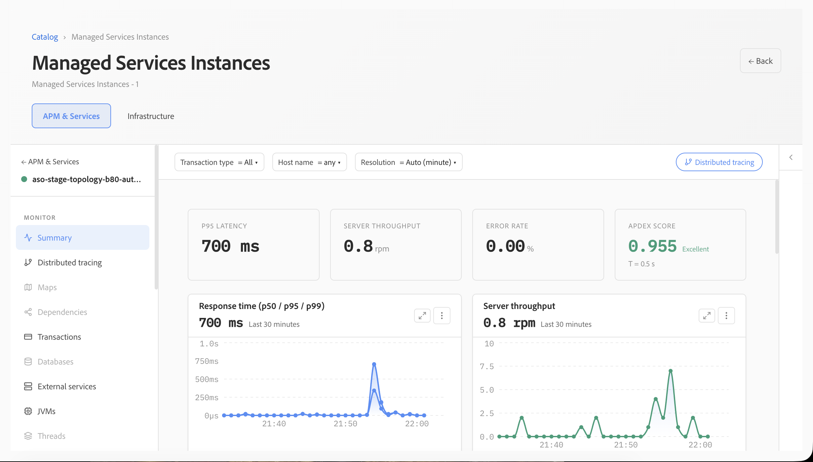
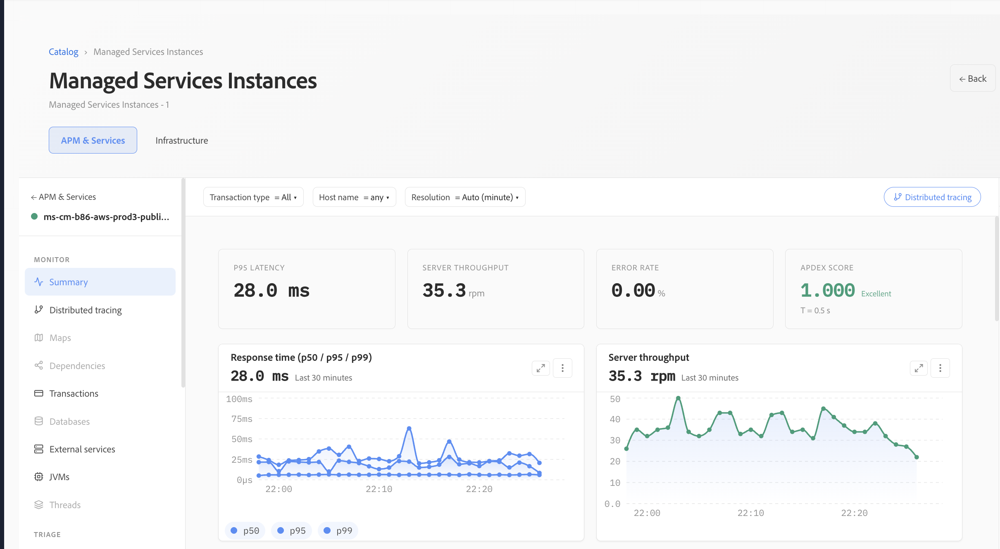
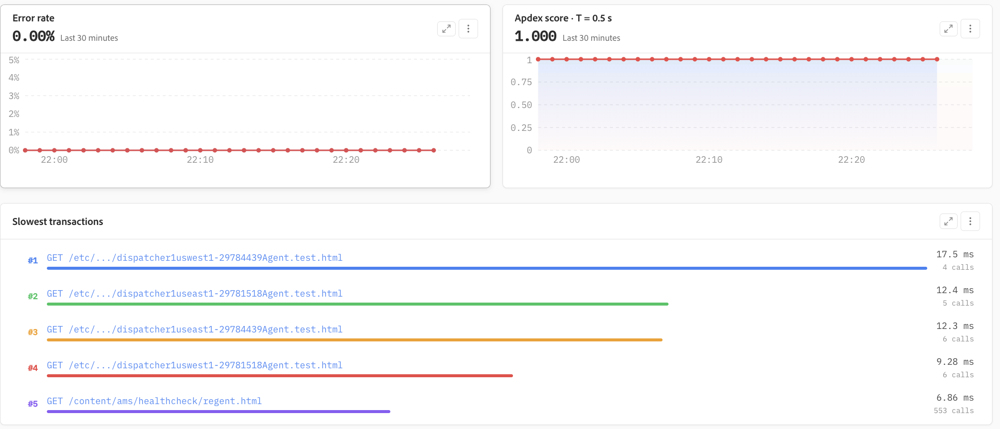
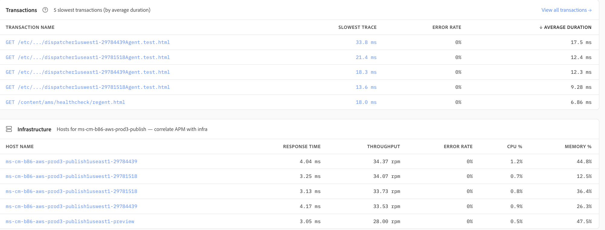
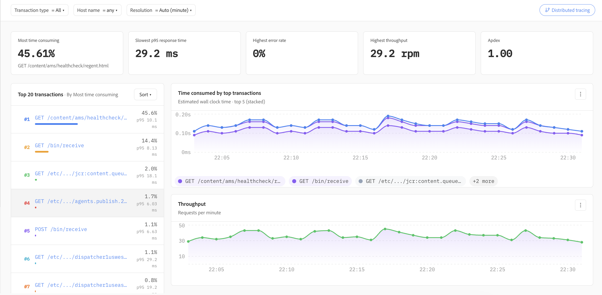

# Aplicaciones

Las aplicaciones proporcionan funciones de supervisión del rendimiento de las aplicaciones (APM), lo que ofrece una vista unificada del estado de la aplicación, el rendimiento, las transacciones y la infraestructura subyacente que admite cada servicio. Ayuda a los equipos de ingeniería y operaciones a comprender el comportamiento de las aplicaciones, identificar cuellos de botella en el rendimiento y pasar de los indicadores de estado de alto nivel a las transacciones individuales para una investigación más profunda.

## Resumen de aplicación

El resumen de **aplicaciones** proporciona una vista rápida de la aplicación seleccionada. Los indicadores clave como la latencia p95, el rendimiento del servidor, la tasa de error y Apdex facilitan la evaluación del estado de la aplicación en el intervalo de tiempo seleccionado.

Los filtros de tipo de transacción, host y resolución permiten refinar la vista para una investigación específica. Las tendencias del tiempo de respuesta y el rendimiento proporcionan un contexto adicional, lo que ayuda a los equipos a distinguir los picos aislados de los cambios de rendimiento sostenidos.

## Tiempo de respuesta, rendimiento y Apdex

El rendimiento de la aplicación se puede evaluar utilizando tiempos de respuesta de percentil junto con el rendimiento de las solicitudes. La visualización conjunta de la latencia p50, p95 y p99 ayuda a distinguir las experiencias del usuario típicas de los periféricos más lentos.

Apdex proporciona una medida complementaria de la capacidad de respuesta de la aplicación al convertir el rendimiento en el tiempo de respuesta en una puntuación de satisfacción fácil de entender. Junto con la tasa de error, estas métricas proporcionan una indicación concisa de si una aplicación está funcionando dentro de los niveles de rendimiento esperados.

## Errores y transacciones lentas

Las aplicaciones muestran continuamente tendencias de tasa de error y transacciones lentas para ayudar a identificar solicitudes que pueden estar afectando el rendimiento de la aplicación. La vista de tasa de error facilita el reconocimiento de los cambios a lo largo del tiempo, mientras que la tendencia de Apdex muestra el impacto correspondiente en la capacidad de respuesta de la aplicación.

La vista **Transacciones más lentas** resalta las transacciones con la duración promedio más alta e incluye el volumen de llamadas, lo que facilita la distinción de las cargas de trabajo ejecutadas con frecuencia de las solicitudes lentas aisladas.

## Correlación de transacciones e infraestructura

La lista de transacciones proporciona una vista específica de los tipos de transacciones más lentos, incluido el seguimiento más lento observado, la tasa de error y la duración promedio. Esto ayuda a los equipos a identificar rápidamente los patrones de transacción que merecen una investigación más a fondo.

Los datos de las aplicaciones se correlacionan con los hosts subyacentes para que el rendimiento de las transacciones pueda evaluarse junto con indicadores de infraestructura como el tiempo de respuesta, el rendimiento, la utilización de CPU y la utilización de la memoria. Esta correlación ayuda a determinar si un problema de rendimiento se origina en el procesamiento de la aplicación o si puede estar asociado con la infraestructura de soporte.

## Análisis del rendimiento de transacciones

La vista de análisis de transacciones clasifica las transacciones por características de rendimiento y resume indicadores clave como la transacción que más tiempo consume, el tiempo de respuesta p95 más lento, la tasa de error más alta, el rendimiento y Apdex.

Las visualizaciones de series temporales muestran cómo las transacciones más significativas contribuyen al tiempo de procesamiento general y cómo cambia el rendimiento de la solicitud durante el periodo seleccionado. Esto facilita la identificación de puntos finales de alto impacto, la comparación del comportamiento de transacciones y la determinación de qué solicitudes deben investigarse primero.

## Investigación de problemas de rendimiento

Las aplicaciones admiten un flujo de trabajo de investigación progresivo: comiencen con los indicadores de estado y rendimiento de nivel de aplicación, identifiquen tiempos de respuesta anómalos, errores o cambios de rendimiento y, a continuación, limiten la investigación a las transacciones que más contribuyen al problema. Los datos de transacción se pueden correlacionar con las métricas de infraestructura del nivel de host.

Este flujo de trabajo ayuda a los equipos a moverse de forma eficaz de **estado de la aplicación → tendencia de rendimiento → los hosts de → de transacciones**, lo que reduce el tiempo necesario para aislar el origen de un problema de rendimiento.
