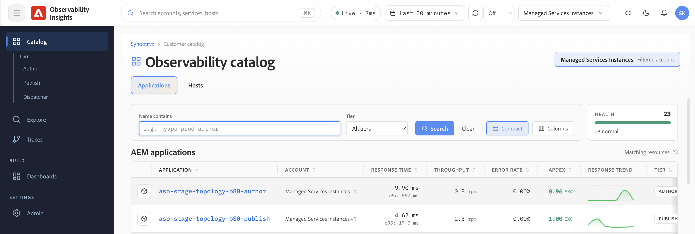

# Introducción a Observability Insights {#get-started}

Esta sección cubre los aspectos básicos para los nuevos usuarios: cómo acceder a su cuenta de Observability Insights, qué entornos y datos monitoriza Adobe en su nombre y cómo navegar por el resto de esta documentación.

## La interfaz de Observability Insights {#observability-insights-interface}

Al iniciar sesión en [insights.adobecqms.net](https://insights.adobecqms.net), la pantalla de apertura le proporciona un punto de entrada a todas las áreas de supervisión de los entornos de Managed Services de AEM.

La interfaz está organizada en torno a dos áreas de monitorización principales:

- **Aplicaciones**: muestra los datos de rendimiento de las aplicaciones para los niveles Author y Publish. Utilice esto para investigar el rendimiento de las solicitudes, las tasas de error, la latencia, el comportamiento de JVM y los detalles de ejecución en el nivel de seguimiento. Ver [Aplicaciones](../applications.md).
- **Hosts**: muestra datos de estado en el nivel de host en toda la topología administrada. Utilice esto para evaluar las señales de CPU, memoria, disco, red y almacenamiento en servidores individuales. Ver [Hosts](../hosts.md).

Ambas áreas son de solo lectura para los usuarios del cliente. Adobe Managed Services administra el aprovisionamiento de cuentas, la instrumentación y el control administrativo.

## Acceso y administración de cuentas {#access-overview}

El acceso a Observability Insights se administra mediante Adobe IMS. Adobe aprovisiona y administra la cuenta de su organización; los equipos de clientes reciben acceso de solo lectura a todos los datos supervisados.

Puntos clave:

- La cuenta de Observability Insights de su organización está vinculada a una sola cuenta maestra de Adobe.
- Todos los entornos del contrato de Managed Services (Autor y Publicación, producción y no producción) informan en esta cuenta.
- Su ingeniero de éxito del cliente (Customer Success Engineer, CSE) proporciona y administra el acceso de los usuarios.

Para ver los pasos de aprovisionamiento, las funciones de usuario y lo que los usuarios del cliente pueden y no pueden hacer, consulte [Administración de acceso y cuenta](access-and-accounts.md).

## Cobertura, entornos y retención de datos {#coverage-overview}

Adobe supervisa los niveles de AEM Author y Publish mediante el complemento Java de APM de Observability Insights y todos los servidores alojados mediante el agente de infraestructura de Observability Insights. La monitorización está habilitada tanto en entornos de producción como de no producción.

Puntos clave:

- Cada entorno de Managed Services de AEM incluye una aplicación APM para Autor y otra para Publicación.
- Las métricas de APM, las métricas de infraestructura y los eventos se conservan por un máximo de **30 días**.
- Observability Insights es adecuado para el análisis operativo y la comparación de tendencias recientes; no es una herramienta de archivo o de informes a largo plazo. Capture capturas de pantalla o evidencias exportadas antes de que los datos caduquen.

Para obtener información detallada sobre la cobertura completa, incluido cómo se representan las aplicaciones en su cuenta y las implicaciones operativas de la ventana de retención, consulte [Cobertura, entornos y retención de datos](coverage-and-data.md).

## Estructura de esta guía {#how-this-guide-is-structured}

La documentación está organizada en cuatro áreas. Utilice las descripciones siguientes para ir directamente a lo que necesita.

**Introducción** — Esta sección. Abarca el acceso, el aprovisionamiento de cuentas, el ámbito de monitorización y la retención de datos.

**[Usar perspectivas de observabilidad](../use-observability-insights.md)**: orientación orientada a tareas para la investigación diaria. Use [Aplicaciones](../applications.md) cuando el síntoma afecte a la aplicación: páginas lentas, picos de error o transacciones inestables. Use [Hosts](../hosts.md) cuando necesite determinar si la presión de recursos en el nivel de host (CPU, memoria, disco o red) explica lo que está viendo en las aplicaciones.

**[Preguntas más frecuentes](../troubleshooting/common-questions.md)**: preguntas comunes y puntos de entrada orientados a la asistencia para cuando no esté seguro de por dónde empezar o necesite respuestas rápidas durante un incidente activo.
