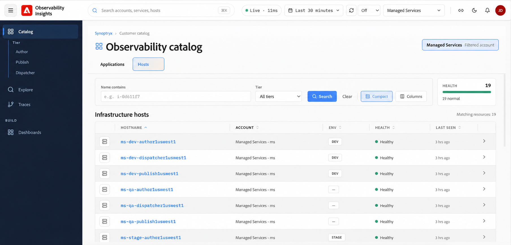
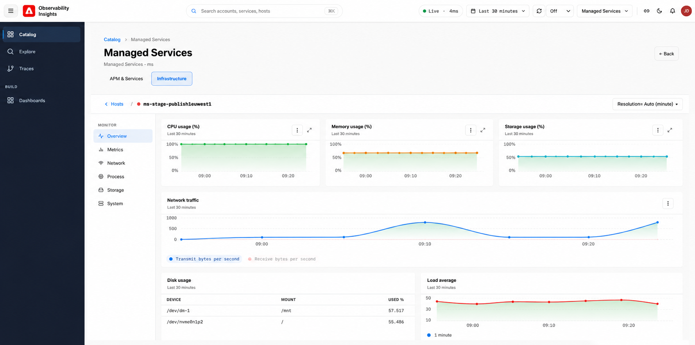

# Hosts {#hosts}

Utilice Hosts en Observability Insights para monitorizar el estado, el rendimiento y la utilización de recursos de la infraestructura que admite sus aplicaciones y servicios. Utilice los paneles de infraestructura para identificar los problemas relacionados con la capacidad del host, la presión de almacenamiento, el rendimiento de la red o la contención de recursos del sistema operativo.

## Qué ayuda a responder la monitorización de la infraestructura {#what-infrastructure-monitoring-helps-you-answer}

La monitorización de la infraestructura resulta muy útil cuando necesita responder preguntas como las siguientes:

- ¿La ralentización de la aplicación va acompañada de CPU, memoria o presión de E/S?
- ¿Un host se comporta de forma diferente a otros en el mismo entorno?
- ¿Cambian los patrones de red o de disco durante el mismo intervalo que un incidente del cliente?
- ¿Las tendencias de utilización del almacenamiento apuntan a un problema de capacidad inminente?

## Acceso a hosts de infraestructura {#infrastructure-host-overview}

La Monitorización de la infraestructura proporciona visibilidad a nivel de host sobre el estado y el rendimiento de la infraestructura que admite los entornos de AEM administrados. Desde **Observability Catalog**, puede examinar los hosts de la infraestructura y explorar en profundidad un host individual para investigar CPU, memoria, red, almacenamiento y otras señales del sistema.

## Acceso a hosts de infraestructura

En **Catálogo**, seleccione la ficha **Hosts** para ver la infraestructura asociada con la cuenta seleccionada.

La vista **hosts de infraestructura** proporciona un inventario de hosts supervisados e incluye:

- **Nombre de host**: nombre del host de infraestructura supervisada.
- **Cuenta** — Cuenta asociada con el host.
- **Entorno** — Clasificación del entorno, como `DEV` o `STAGE`.
- **Estado**: estado actual del host.
- **Última visualización**: La telemetría recibida recientemente desde el host.

## Flujo de investigación sugerido {#suggested-investigation-flow}

Para la mayoría de los incidentes, revise el panel del host en este orden:

1. Compruebe el uso de CPU, el promedio de carga y el uso de memoria para ver una saturación obvia.
2. Revise la espera de E/S de CPU y el rendimiento del disco si los tiempos de respuesta aumentan sin un pico de CPU coincidente.
3. Compare el rendimiento de la red con el tráfico de la aplicación para identificar los cambios relacionados con la carga.
4. Compruebe el uso del almacenamiento y el uso del disco en el nivel del sistema de archivos para detectar riesgos de capacidad persistentes.
5. Compare varios hosts para ver si el problema es localizado o sistémico.

## Qué se debe revisar primero {#what-to-review-first}

- **CPU y memoria** cuando una aplicación parece lenta o inestable en un intervalo de tiempo más amplio.
- **E/S de disco y E/S de CPU esperan** cuando las solicitudes se bloquean o se ponen en cola inesperadamente.
- **E/S de red** cuando cambian las características de tráfico o se sospechan dependencias descendentes.
- **Uso del almacenamiento** cuando los incidentes implican errores de implementación, presión de indización o problemas de capacidad a largo plazo.

Utilice el campo **Name contains** y el filtro **Tier** para reducir la lista de hosts. Seleccione un nombre de host para abrir los detalles de monitorización de su infraestructura.

## Monitorización del host

Después de seleccionar un host, la vista **Infraestructura** proporciona páginas de supervisión dedicadas para ese host.

La navegación del host incluye:

- **Información general** — Vista consolidada de las señales clave de uso y estado de la infraestructura.
- **Métricas**: métricas detalladas de rendimiento del host, como CPU, memoria, carga, E/S de disco y rendimiento de red.
- **Red**: tráfico de red, actividad de interfaz y errores de transmisión/recepción.
- **Proceso**: supervisión a nivel de proceso del host.
- **Almacenamiento**: uso del disco, E/S del disco y uso del sistema de archivos.
- **Sistema**: métricas de recursos del sistema principal como CPU, memoria y promedio de carga.

## Preguntas para responder durante la investigación {#questions-to-answer}

- ¿El problema está aislado en un host o es visible en todo el entorno?
- ¿Se elevan las señales de CPU, memoria o disco durante la misma ventana que el incidente?
- ¿Es el crecimiento del almacenamiento una tendencia hacia un umbral que podría afectar a las operaciones?
- ¿Los síntomas de infraestructura explican el comportamiento de la aplicación o solo aparecen como un efecto descendente?

## Evidencia que capturar al escalar {#evidence-to-capture}

- Entorno y hosts afectados
- Ventana de tiempo del problema
- Capturas de pantalla de CPU, memoria, disco y red
- Si la anomalía es aislada o sistémica
- Síntomas de la aplicación relacionados de APM
