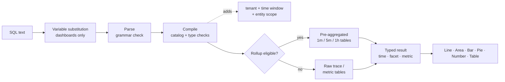

## Cómo consultar con SQL: la mecánica de la consulta {#how-to-query-with-sql-the-mechanics-of-querying}

Antes de usar cualquier herramienta, es útil saber cómo funciona. Este documento muestra cómo explorar los datos, explica qué sucede cuando se ejecuta una consulta y muestra consultas de ejemplo de simples a complejas.

### Exploración de datos

La mejor manera de usar SQL es abrir **Explorar** y probarlo con sus propios datos.

> **Sugerencia**
>
> SQL es de solo lectura. No puede cambiar ni eliminar datos, y cada consulta está vinculada a su inquilino.

1. **Elija un cliente** en el conmutador de inquilinos en la parte superior de la aplicación, SQL necesita un solo inquilino.
2. Abrir **Explorar**. La ficha **Generador de imágenes** le permite elegir **De** (una entidad), **Agregar**, **Filtros**, **Faceta** y **Series de tiempo**. El SQL generado aparece debajo de.
3. Cambie a la ficha **SQL** para editar la consulta directamente. El editor autocompleta entidades, atributos y funciones a medida que escribe.
4. Abra el panel **Guía de consulta** de la derecha para examinar entidades, tipos de atributos y consultas de ejemplo. Haga clic en un ejemplo para cargarlo.
5. Haga clic en **Validar** para comprobar una consulta sin ejecutarla o en **Ejecutar** (⌘/Ctrl + Entrar) para ver los resultados.

Comience escribiendo `FROM` y eligiendo una entidad, luego agregue `SELECT` y un atributo:

```sql
FROM Transaction SELECT name, duration LIMIT 20
```

Esta es una **consulta de evento** básica. Devuelve 20 solicitudes entrantes, que muestran el nombre de la operación y la duración de cada una.

Ahora reemplace los atributos con un **agregado** y agrupe el resultado:

```sql
FROM Transaction SELECT count(*) FACET service
```

Esto cuenta las solicitudes por servicio, lo que le muestra qué servicios están generando informes.

> **Importante**
>
> **Descubrir antes de compilar.** La disponibilidad de los atributos depende de cómo se instrumente cada servicio. Ejecute primero las [consultas de detección](../../examples/query-cookbook.md#data-discovery) en un nuevo inquilino para ver qué servicios, hosts, atributos y métricas contienen datos.

### Ejecución de una consulta

Al ejecutar una consulta, Observability Insights:

1. **Sustituye variables** y reemplaza `{{name}}` tokens por la selección actual de variables de panel. Esto sucede en el explorador, solo en los paneles.
2. **Analiza** el texto. Cualquier elemento fuera de la gramática SQL se rechaza, incluidos punto y coma, funciones SQL sin procesar y subconsultas.
3. **Compila** la consulta. Asigna cada atributo lógico (por ejemplo `urlPath`) a su expresión almacenada y valida tipos y funciones.
4. **Agrega guardias obligatorios**: su inquilino, la ventana de tiempo y el ámbito fijo de la entidad (por ejemplo, `Transaction` significa que solo se expande el servidor).
5. **Enruta** consultas de series temporales elegibles a **tablas resumidas** previamente agregadas. Esto es automático y los resultados coinciden con los datos sin procesar.
6. **Ejecuta** la consulta con un tiempo de espera de 15 segundos y un presupuesto de lectura de bytes y, a continuación, devuelve las columnas escritas (tiempo, faceta, métrica) que procesa la interfaz de usuario.



### Formas de resultado

Cada consulta devuelve una de las cuatro formas. La forma decide qué gráficos tienen sentido.

| Forma | Cómo lo consigues | Predeterminado `LIMIT` | Mejor visualización |
| --------------- | ---------------------------------------------------- | --------------- | ------------------ |
| **Valla publicitaria** | Solo agregados, sin `FACET` y sin `TIMESERIES` | 1 | Número |
| **Faceta** | Agregados + `FACET` | 10 | Barra, Circular, Tabla |
| **Serie temporal** | Agregados + `TIMESERIES` (con o sin `FACET`) | 5.000 filas | Línea, área, barra |
| **Eventos** | Solo atributos sin procesar | 100 | Tabla |

<a id="time-window-precedence"></a>

### Prioridad de ventana de tiempo

| Dónde se ejecuta la consulta | Qué ventana se aplica |
| --------------------------------- | ---------------------------------------------------------------------------------- |
| **Widget del panel** | El **selector de tiempo** del tablero. `SINCE`/`UNTIL` en la consulta se omiten. |
| **Agregar vista previa del widget** | El selector de tiempo dentro del cuadro de diálogo **Agregar widget**. |
| **Explorar** | El selector de tiempo global. Se omiten `SINCE`/`UNTIL` cuando hay un intervalo de selección activo. |
| **API sin intervalo explícito** | `SINCE`/`UNTIL` en la consulta, valor predeterminado de la última hora. |

> **Nota**
>
> Dado que el selector gana en los paneles y en Explorar, esta guía generalmente excluye a `SINCE` de las consultas de panel. Siempre se debe definir un selector de tiempo para las consultas.
