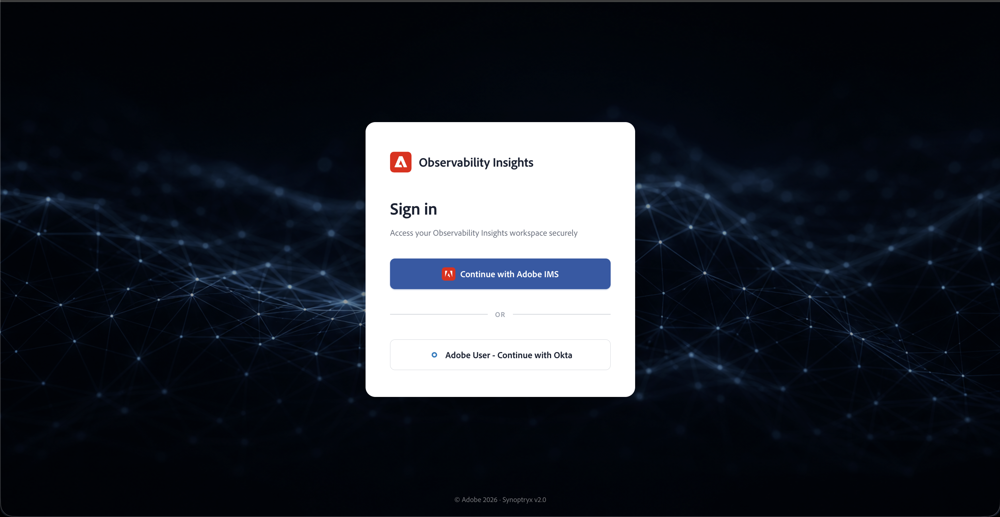

# Monitorice su entorno Managed Services de AEM con Observability Insights {#observability-insights-monitoring}

**Observability Insights** proporciona visibilidad sobre el rendimiento de la aplicación, el estado de la infraestructura y el comportamiento del servicio en AEM Managed Services, sin requerir una plataforma de supervisión independiente.

Si usted es responsable de la confiabilidad del servicio, la respuesta a incidentes o el análisis del rendimiento, **Observability Insights** le ayuda a pasar de los síntomas a la evidencia rápidamente. Combina la telemetría de aplicaciones y las señales de estado en el nivel de host para que los equipos de clientes y Adobe puedan investigar los problemas desde una vista operativa compartida.

## ¿Por qué los equipos utilizan Observability Insights? {#why-teams-use-observability-insights}

Utilice Observability Insights para responder preguntas operativas como:

- ¿El problema afecta a Autor, Publicación o ambos?
- ¿El problema se debe al comportamiento de la aplicación, a la presión del recurso host o a una combinación de ambos?
- ¿Qué transacciones, extremos o grupos de estado explican el pico de errores o latencia?
- ¿El problema está aislado en un entorno o es visible en toda la topología?

Observability Insights está diseñado para el análisis operativo del comportamiento reciente. Ayuda a identificar qué ha cambiado, dónde ha cambiado y qué señales son las más relevantes antes de la escalación o la acción correctiva.

## ¿Qué ayuda Observability Insights? {#what-observability-insights-helps-you-do}

Utilice Observability Insights para:

- Comprenda cómo se comportan los niveles de creación y publicación bajo el tráfico real.
- Correlacione la latencia de la aplicación, las tasas de error y el estado de JVM con señales en el nivel de host.
- Confirme si un problema está aislado en un entorno, un nivel o un host.
- Proporcione a Adobe Managed Services y a sus equipos internos una vista operativa compartida durante la investigación.

Observability Insights se incluye con AEM Managed Services. Adobe aprovisiona y administra la cuenta, instrumenta los entornos admitidos y expone los paneles resultantes a su equipo como herramientas operativas de solo lectura.

Dado que Adobe administra la configuración y la instrumentación de la plataforma, puede centrarse en la investigación y la interpretación en lugar de en la implementación del agente, la administración de cuentas o el ensamblado del tablero.

## De un vistazo {#at-a-glance}

Como parte de AEM Managed Services, recibirá lo siguiente:

- **Cuenta de perspectivas de observación dedicada**: aprovisionada y supervisada por Adobe Managed Services, con acceso de solo lectura para su equipo.
- **Supervisión profunda de transacciones de AEM**: el agente de APM de Observability Insights rastrea transacciones significativas hasta llamadas de método (incluidos números de línea), dependencias externas y operaciones de repositorio.
- **Vista de hosts y aplicaciones unificadas**: combine aplicaciones y métricas de nivel de host para optimizar el rendimiento de forma integral.

## Para quién es esta documentación {#who-this-documentation-is-for}

Esta documentación está diseñada principalmente para:

- Administradores de AEM Managed Services que necesitan visibilidad de los entornos supervisados
- Equipos de operaciones y de apoyo que gestionan incidentes, análisis de tendencias y revisión de servicios
- Equipos de ingeniería de clientes que se asocian con Adobe Managed Services durante las investigaciones
- Partes interesadas que necesiten comprender el alcance de la monitorización y las responsabilidades operativas

## Qué monitoriza Adobe con Observability Insights {#what-we-monitor}

Adobe supervisa los niveles de AEM **Author** y **Publish** con el complemento Java de APM de Observability Insights. Todos los servidores alojados en su topología se supervisan con el agente de infraestructura de Observability Insights. La monitorización personalizada de APM e infraestructura está habilitada tanto en entornos de Managed Services de producción como de no producción.

### Aplicaciones en su cuenta {#applications-in-your-account}

Su cuenta de Observability Insights está vinculada a una sola cuenta maestra de Adobe y puede recibir datos de varias aplicaciones, entre ellas:

- Una aplicación APM para el nivel **Author** por entorno de Managed Services de AEM
- Una aplicación APM para el nivel **Publish** por entorno de AEM Managed Services

Cada aplicación tiene su propia clave de licencia. Todas las topologías del contrato de Managed Services se incluyen en una cuenta de Observability Insights. Las métricas y los eventos de APM e infraestructura se conservarán por un período máximo de **30 días**.

## Acceso a su cuenta {#access}

Los datos de monitorización se consolidan en una cuenta de Observability Insights que Adobe aprovisiona y administra. Los usuarios clientes reciben **acceso de solo lectura** a los datos de APM e infraestructura recopilados por los agentes. Adobe Managed Services conserva la propiedad de la cuenta y el control administrativo.

### Requisitos previos {#access-prerequisites}

Antes de iniciar sesión, confirme lo siguiente:

- Su organización tiene una suscripción activa a **AEM Managed Services**. Observability Insights se incluye sin coste adicional.
- Su ingeniero de éxito del cliente (Customer Success Engineer, CSE) ha aprovisionado su cuenta de Adobe IMS y le ha concedido acceso a la cuenta de Observability Insights para su organización.

>[!NOTE]
>
> **Obtener acceso:** El acceso a Observability Insights requiere el aprovisionamiento de Adobe IMS. Póngase en contacto con su ingeniero de éxito del cliente (Customer Success Engineer, CSE) para proporcionar y administrar el acceso de los usuarios a su organización.

Una vez que el CSE haya aprovisionado la cuenta, inicie sesión en [insights.adobecqms.net](https://insights.adobecqms.net). Esta URL es la misma para todos los clientes de AEM Managed Services; los entornos y paneles de su organización se asignan a su cuenta aprovisionada.
