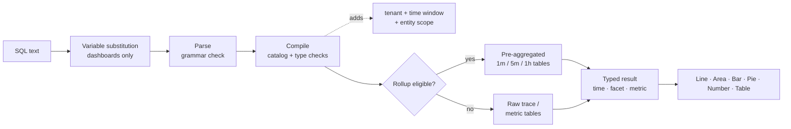

<a id="top"></a>

# Documentación de Adobe Observability Insights Dashboard/Query

**Adobe Observability Insights Query Language (SQL)**: consulte, grafique y tablero su telemetría en Adobe Observability Insights.

|                |                                                                  |
| -------------- | ---------------------------------------------------------------- |
| **Se aplica a** | Interfaz de usuario de Insights → **Explorar** y **Paneles** (paneles personalizados) |
| **Público** | Ingenieros, SRE y usuarios avanzados que conocen SQL |

>[!TIP]
> Cada bloque de código marcado `sql` es una consulta SQL que puede pegar directamente en **Explorar → SQL** o en **Paneles → Agregar widget → SQL**.

## Mapa de documentación

| Sección | Doc | Lo que aprenderá |
| --------------- | ----------------------------------------------------------------------------------- | ------------------------------------------------------------------------------------------- |
| **Introducción** | [1. Introducción a SQL](#1-get-started-with-SQL-the-language-of-your-telemetry) | Qué es SQL, qué puede consultar, dónde utilizarlo, las reglas básicas |
|                 | [2. Cómo consultar con SQL](#2-how-to-query-with-SQL-the-mechanics-of-querying) | Cómo explorar datos, cómo se ejecuta una consulta, ejemplos prácticos |
|                 | [3. Gráficos y tableros](#3-charts-and-dashboards-visualizing-your-data) | Cómo convertir consultas en gráficos y crear paneles paso a paso |
| **Referencia** | [4. Referencia SQL ](#4-SQL-reference) | Cada cláusula, función y operador, con ejemplos |
|                 | [5. Diccionario de datos ](#5-data-dictionary) | Cada entidad y atributo que puede consultar |
| **Tutoriales** | [6. Tutorial 1: Sus primeras consultas](#6-tutorial-1-your-first-queries) | `SELECT`, `FROM`, `LIMIT`, agregados, tiempo, `TIMESERIES`, `WHERE`, `FACET` |
|                 | [7. Tutorial 2: Controlar los datos](#7-tutorial-2-control-your-data) | Valores únicos, más reciente/más antiguo, porcentajes, percentiles, etiquetas, caracteres comodín, orden |
|                 | [8. Tutorial 3: Avance en el tablero](#8-tutorial-3-advance-your-dashboarding) | Agregados condicionales, Apdex, tasas, histogramas, fórmulas, variables, secciones |
|                 | [9. Tutorial 4: Funciones avanzadas ](#9-tutorial-4-advanced-functions) | `stddev`, `derivative`, clasificado `latest`, porcentaje del total, composición de intervalo, detección de métrica |
| **Ejemplos** | [10. Consultar libro de cocina](#10-query-cookbook) | Más de 100 consultas listas para usar por tema (incluido AEM) |
|                 | [11. Modelos de panel](#11-dashboard-blueprints) | Diez paneles completos y complejos con la consulta de cada widget |
| **Operar** | [12. Rendimiento](#12-performance) | Resúmenes, presupuestos de consultas y cómo mantener los paneles de forma rápida |
|                 | [13. Solucionando problemas](#13-troubleshooting) | Cada mensaje de error, qué significa y cómo corregirlo |
|                 | [14. Apéndice](#14-appendix) | Límites, exportar formato de archivo, hoja de trucos de una página |

# Introducción

## &#x200B;1. Introducción a SQL: el idioma de la telemetría

SQL es un lenguaje de consulta similar a SQL para los datos de Observability Insights. Es el mismo idioma detrás de cada widget de panel personalizado y de la página **Explorar**, para que puedas crear las vistas que tu equipo necesita.

SQL funciona con **entidades**, que son vistas lógicas descriptivas como `Transaction`, `Span` o `CpuUtilization`. Nunca consulta directamente las tablas de almacenamiento. Observability Insights compila cada consulta SQL en una consulta de almacén parametrizada y segura. Siempre abarca esa consulta al inquilino y la ventana de tiempo seleccionada.

```sql
SELECT count(*) AS requests FROM Transaction TIMESERIES AUTO
```

### Qué puede hacer con SQL

Utilice SQL para lo siguiente:

- **Cree gráficos** de rendimiento, tasa de error, latencia, Apdex, CPU, memoria, montón de JVM, disco y red a lo largo del tiempo.
- **Responda preguntas específicas**, como &quot;¿qué rutas de URL en el nivel de publicación tienen la peor p95?&quot; o &quot;¿qué dominio descendente falla?&quot;
- **Investigue incidentes** explorando desde un KPI hasta solicitudes individuales e ID de seguimiento.
- **Generar paneles** con KPI, tendencias, tablas, fórmulas, notas, encabezados de sección y variables.
- **Cargas de trabajo de perfil de AEM** (Adobe Experience Manager) con atributos de Sling, JSP, JCR, Dispatcher y GraphQL.

SQL admite **consultas de eventos**, que devuelven filas de solicitud individuales, y **consultas de agregados**, que devuelven totales, percentiles, tasas, desgloses y series temporales.

>[!TIP]
> Las plantillas de **Paneles → Crear panel** se han creado completamente a partir de SQL. Abra cualquier widget de plantilla con el icono de lápiz para ver su consulta y aprender de ella.

### Qué puede consultar

SQL puede consultar cuatro familias de datos. La lista completa está en el [diccionario de datos](#5-data-dictionary).

| Familia | Entidades | Preguntas habituales |
| ------------------------------------ | ------------------------------------------------------------------------------------------------------------------------------------------------------------------ | -------------------------------------------------------------------- |
| **Seguimientos (APM)** | `Transaction` (solicitudes entrantes), `AppRequest` (solicitudes + consumidores de mensajes), `Span` (cada intervalo) | Rendimiento, latencia, errores, Apdex, llamadas descendentes, rutas de código AEM |
| **Métricas de tiempo de ejecución y host revisadas** | `CpuUtilization`, `MemoryUtilization`, `LoadAverage5m`, `DiskUtilization`, `NetworkReceiveRate`, `JvmHeapUsed`, `JvmThreadCount`, `DispatcherRequestRate` y más | Saturación, capacidad, estado de JVM, carga de Dispatcher |
| **Métricas genéricas** | `MetricGauge`, `MetricSum` | Cualquier métrica de OpenTelemetry por nombre, detección de métricas |
| **Composición de span preagregada** | `SpanBreakdown` | Qué operaciones secundarias constituyen una transacción |

>[!NOTE]
> Los registros, las definiciones de alertas y las relaciones de inventario no están disponibles.

### Dónde usar SQL

| Donde | Cómo abrirlo. | ¿Para qué sirve? |
| ----------------------- | ------------------------------------------------------------------------------ | ------------------------------------------------------------------------------------------------------------------------------------------------------------------------------------ |
| **Explorar** | → de navegación izquierda **Explorar** | Análisis ad hoc. Use el **Generador de imágenes** o la ficha **SQL**, **Validar**, luego **Ejecutar** (⌘/Ctrl + Entrar). Incluye consultas **History** y **Saved** y un panel de **guía de consulta**. |
| **Paneles** | El → de navegación izquierdo **Paneles** → abrir o crear un panel → **Agregar widget** | Gráficos, KPI y tablas persistentes, combinados en paneles. |
| **Widgets de fórmula** | **Agregar widget → fórmula** | Combine de 2 a 6 consultas SQL con aritméticas (relaciones, margen de ampliación, tasas de grabación). |
| **Variables de panel** | **+ → de variable de una consulta** | Rellenar un selector desde los distintos valores de una consulta SQL `FACET`. |
| **Inspección de consultas** | Pase el ratón sobre un gráfico → inspeccionar consulta | Consulte el SQL detrás de un gráfico integrado o de panel. |

### Estructura de consulta SQL

SQL sigue una sintaxis basada en cláusulas. Esta consulta cuenta todas las solicitudes entrantes en la ventana seleccionada:

```sql
SELECT count(*) FROM Transaction
```

Estas son todas las cláusulas disponibles:

```text
SELECT  function(attribute) [FILTER (WHERE condition)] [AS alias] [, ...]
        | attribute [AS alias] [, ...]
FROM    Entity
  [WHERE      condition [AND | OR ...]]
  [FACET      attribute [, attribute ...]]        -- up to 5
  [SINCE      n unit [AGO]]
  [UNTIL      NOW | n unit [AGO]]
  [TIMESERIES AUTO | MAX | n unit]
  [ORDER BY   alias [ASC | DESC]]
  [LIMIT      number]                              -- 1 to 5000
```

Estas son las reglas que SQL sigue:

| Regla | Detalles |
| ---------------------------- | ------------------------------------------------------------------------------------------------------------------------------------------------------------------------------------ |
| **Cláusulas requeridas** | Se requieren `SELECT` y `FROM`. Todas las demás cláusulas son opcionales. Puede empezar con: `FROM Transaction SELECT count(*)` también es válido. |
| **Orden de la cláusula** | Las cláusulas posteriores a `FROM` pueden aparecer en cualquier orden. Cada cláusula puede aparecer una sola vez. |
| **Tamaño de consulta** | Una consulta debe tener 4 KB o menos. |
| **Distinción de mayúsculas y minúsculas** | Las palabras clave, los nombres de función, los nombres de entidad y los nombres de atributo **no** distinguen entre mayúsculas y minúsculas. Los valores de cadena **distinguen entre mayúsculas y minúsculas** (`'Error'` ≠ `'error'`). |
| **Cadenas** | Use comillas simples: `WHERE status = 'Error'`. Para incluir un presupuesto, debe duplicarlo: `'O''Brien'`. No se aceptan comillas dobles. |
| **Literales** | Cadenas, números (incluidos negativos y decimales), `TRUE`, `FALSE`, `NULL`. |
| **Nombres de atributos** | Los nombres pueden contener letras, dígitos, `_` y `.` (por ejemplo `http.statusCode`). No se necesitan palos traseros. |
| **Agregados vs. atributos** | Una consulta selecciona atributos sin procesar (una lista de eventos) o agregados, nunca ambos. Para agrupar, use `FACET`. |
| **Ventana de tiempo** | El valor predeterminado es la última hora. El máximo es de 31 días. En los paneles y en Explorar, el **selector de tiempo** establece la ventana (consulte [Ventana de tiempo](#time-window-precedence)). |
| **No compatible** | Punto y coma, comentarios, subconsultas, combinaciones, `SELECT *`, matemáticas entre atributos en `SELECT`, `HAVING`, `COMPARE WITH`. Vea [Lo que SQL no hace](#what-SQL-doesnt-do) para obtener alternativas. |

### Próximos pasos

- [Cómo consultar con SQL](#2-how-to-query-with-SQL-the-mechanics-of-querying): explore los datos y comprenda cómo se ejecutan las consultas.
- [Gráficos y paneles](#3-charts-and-dashboards-visualizing-your-data): visualice sus resultados.
- [Tutorial 1: sus primeras consultas](#6-tutorial-1-your-first-queries): un tutorial práctico.
- [Referencia SQL](#4-SQL-reference): sintaxis completa, cláusulas y funciones.

[↑ Volver al inicio](#top)

## &#x200B;2. Cómo consultar con SQL: la mecánica de la consulta

Antes de usar cualquier herramienta, es útil saber cómo funciona. Este documento muestra cómo explorar los datos, explica qué sucede cuando se ejecuta una consulta y muestra consultas de ejemplo de simples a complejas.

### Exploración de datos

La mejor manera de usar SQL es abrir **Explorar** y probarlo con sus propios datos.

>[!TIP]
> SQL es de solo lectura. No puede cambiar ni eliminar datos, y cada consulta está vinculada a su inquilino.

1. **Elija un cliente** en el conmutador de inquilinos en la parte superior de la aplicación, SQL necesita un solo inquilino.
2. Abrir **Explorar**. La ficha **Generador de imágenes** le permite elegir **De** (una entidad), **Agregar**, **Filtros**, **Faceta** y **Series de tiempo**. El SQL generado aparece debajo de.
3. Cambie a la ficha **SQL** para editar la consulta directamente. El editor autocompleta entidades, atributos y funciones a medida que escribe.
4. Abra el panel **Guía de consulta** de la derecha para examinar entidades, tipos de atributos y consultas de ejemplo. Haga clic en un ejemplo para cargarlo.
5. Haga clic en **Validar** para comprobar una consulta sin ejecutarla o en **Ejecutar** (⌘/Ctrl + Entrar) para ver los resultados.

Comience escribiendo `FROM` y eligiendo una entidad, luego agregue `SELECT` y un atributo:

```sql
FROM Transaction SELECT name, duration LIMIT 20
```

Esta es una **consulta de evento** básica. Devuelve 20 solicitudes entrantes, que muestran el nombre de la operación y la duración de cada una.

Ahora reemplace los atributos con un **agregado** y agrupe el resultado:

```sql
FROM Transaction SELECT count(*) FACET service
```

Esto cuenta las solicitudes por servicio, lo que le muestra qué servicios están generando informes.

>[!IMPORTANT]
> **Descubrir antes de compilar.** La disponibilidad de los atributos depende de cómo se instrumente cada servicio. Ejecute primero las [consultas de detección](#101-data-discovery) en un nuevo inquilino para ver qué servicios, hosts, atributos y métricas contienen datos.

### Ejecución de una consulta

Al ejecutar una consulta, Observability Insights:

1. **Sustituye variables** y reemplaza `{{name}}` tokens por la selección actual de variables de panel. Esto sucede en el explorador, solo en los paneles.
2. **Analiza** el texto. Cualquier elemento fuera de la gramática SQL se rechaza, incluidos punto y coma, funciones SQL sin procesar y subconsultas.
3. **Compila** la consulta. Asigna cada atributo lógico (por ejemplo `urlPath`) a su expresión almacenada y valida tipos y funciones.
4. **Agrega guardias obligatorios**: su inquilino, la ventana de tiempo y el ámbito fijo de la entidad (por ejemplo, `Transaction` significa que solo se expande el servidor).
5. **Enruta** consultas de series temporales elegibles a **tablas resumidas** previamente agregadas. Esto es automático y los resultados coinciden con los datos sin procesar.
6. **Ejecuta** la consulta con un tiempo de espera de 15 segundos y un presupuesto de lectura de bytes y, a continuación, devuelve las columnas escritas (tiempo, faceta, métrica) que procesa la interfaz de usuario.



### Formas de resultado

Cada consulta devuelve una de las cuatro formas. La forma decide qué gráficos tienen sentido.

| Forma | Cómo lo consigues | Predeterminado `LIMIT` | Mejor visualización |
| --------------- | ---------------------------------------------------- | --------------- | ------------------ |
| **Valla publicitaria** | Solo agregados, sin `FACET` y sin `TIMESERIES` | 1 | Número |
| **Faceta** | Agregados + `FACET` | 10 | Barra, Circular, Tabla |
| **Serie temporal** | Agregados + `TIMESERIES` (con o sin `FACET`) | 5.000 filas | Línea, área, barra |
| **Eventos** | Solo atributos sin procesar | 100 | Tabla |

<a id="time-window-precedence"></a>

### Prioridad de ventana de tiempo

| Dónde se ejecuta la consulta | Qué ventana se aplica |
| --------------------------------- | ---------------------------------------------------------------------------------- |
| **Widget del panel** | El **selector de tiempo** del tablero. `SINCE`/`UNTIL` en la consulta se omiten. |
| **Agregar vista previa del widget** | El selector de tiempo dentro del cuadro de diálogo **Agregar widget**. |
| **Explorar** | El selector de tiempo global. Se omiten `SINCE`/`UNTIL` cuando hay un intervalo de selección activo. |
| **API sin intervalo explícito** | `SINCE`/`UNTIL` en la consulta, valor predeterminado de la última hora. |

>[!NOTE]
> Dado que el selector gana en los paneles y en Explorar, esta guía generalmente excluye a `SINCE` de las consultas de panel. Siempre se debe definir un selector de tiempo para las consultas.

### Ejemplos de consultas SQL

Este es un ejemplo más completo. Para esta consulta:

- Usted elige `Transaction` como entidad.
- Utilice `SELECT` para calcular la duración del percentil 95.
- Agrupa los resultados por servicio con `FACET`.
- Se usa `TIMESERIES AUTO` para trazar los datos en un intervalo de tamaño automático.

```sql
FROM Transaction SELECT percentile(duration, 95) AS p95 FACET service TIMESERIES AUTO
```

Esto genera una línea por servicio en un gráfico de líneas, con los 10 servicios más ocupados mostrados de forma predeterminada.

Haga clic en cada ejemplo a continuación para ampliarlo.

<details>
<summary><strong>Consulta básica de solicitudes entrantes</strong></summary>

Tiempo medio de respuesta, en milisegundos, de todas las solicitudes entrantes:

```sql
SELECT average(duration) FROM Transaction
```

</details>

<details>
<summary><strong>Nombres de atributo que contienen puntos</strong></summary>

Los nombres de puntos no necesitan comillas:

```sql
SELECT count(*) FROM Transaction WHERE http.statusCode >= 500 FACET http.route
```

</details>

<details>
<summary><strong>La consulta devuelve varias columnas</strong></summary>

Varios agregados de una consulta se convierten en columnas en una tabla:

```sql
SELECT count(*) AS requests, average(duration) AS avgMs, percentile(duration, 95) AS p95, max(duration) AS maxMs FROM Transaction FACET service
```

</details>

<details>
<summary><strong>Agregados condicionales en un solo paso</strong></summary>

Total, errores y 5xx en paralelo:

```sql
SELECT count(*) AS total, count(*) FILTER (WHERE status = 'Error') AS errors, count(*) FILTER (WHERE http.statusCode >= 500) AS http5xx FROM Transaction FACET service
```

</details>

<details>
<summary><strong>Consultando una métrica seleccionada</strong></summary>

Promedio de CPU por host a lo largo del tiempo:

```sql
SELECT average(value) AS cpu FROM CpuUtilization FACET host TIMESERIES AUTO
```

</details>

<details>
<summary><strong>Consultando cualquier métrica de OpenTelemetry por nombre</strong></summary>

Use `MetricGauge` / `MetricSum` para métricas sin una entidad depurada:

```sql
SELECT latest(value) AS bytesUsed FROM MetricSum WHERE metric = 'jvm.memory.used' FACET host, pool
```

</details>

<a id="what-SQL-doesnt-do"></a>

### Qué no hace SQL

SQL es deliberadamente pequeño. Esto mantiene las consultas seguras, rápidas y aisladas del inquilino. Cuando necesite una de estas capacidades, utilice la alternativa.

| Capacidad | Estado | Alternativa |
| ------------------------------------------- | ------------- | ------------------------------------------------------------------------------------------------------------ |
| `SELECT *` | No compatible | Enumere los atributos que desee: `SELECT timestamp, name, duration, traceId …`. |
| Combinación de atributos sin procesar y agregados | No compatible | Use `FACET attr` o `latest(attr)` / `earliest(attr)`. |
| Matemáticas en `SELECT` (`a - b`, `count(*) / 60`) | No compatible | Widget de **Fórmula** (paneles). |
| Uniones y subconsultas | No compatible | **Widget de fórmula** o dos widgets uno al lado del otro. |
| `HAVING` | No compatible | `ORDER BY alias` + `LIMIT`. |
| `COMPARE WITH` | No compatible | Cambie el selector de tiempo o coloque dos widgets en pestañas diferentes. |
| `FACET CASES` | No compatible | Una columna `count(*) FILTER (WHERE …)` por caso (consulte [Tutorial 3](#83-group-values-into-cases-with-filter)). |
| `histogram()` | No compatible | Columnas `FILTER` agrupadas (consulte [Tutorial 3](#84-build-a-latency-histogram)). |
| `uniques()` / `keyset()` | No compatible | `FACET attr LIMIT n` enumera valores distintos. Las consultas de detección enumeran métricas y atributos rellenados. |
| `RLIKE` (regex) | No compatible | `LIKE` / `NOT LIKE` con `%` y `_` caracteres comodín, o `IN (…)`. |
| Comentarios (`--`, `//`, `/* */`) | No compatible | Coloque notas en el título del widget o en un widget de **texto**. |
| Fechas absolutas en `SINCE` | No compatible | Utilice el intervalo absoluto del selector de tiempo. |
| Conversión de tipos (`numeric()`, `string()`) | No se necesita | Los atributos se escriben en el catálogo. |

[↑ Volver al inicio](#top)

## &#x200B;3. Gráficos y paneles: visualización de los datos

Las consultas encuentran la información que necesita. Los gráficos y paneles hacen que esa información sea útil para su organización. Este documento muestra cómo los resultados de SQL se convierten en gráficos, y cómo crear, organizar y compartir paneles.

### Gráficos

Cada resultado SQL se puede representar como uno de los seis tipos de gráficos.

| Tipo de gráfico | Úselo para | Forma Consulta |
| --------------- | --------------------------------------------------- | ----------------------------------------------- |
| **Línea** | Tendencias con el tiempo; una línea por valor de faceta | Agregar + `TIMESERIES` |
| **Área** | Volumen con el tiempo, como rendimiento por servicio | Agregar + `TIMESERIES` |
| **Barra** | Comparar categorías; series temporales dispersas | Agregar + `FACET` (± `TIMESERIES`) |
| **Circular / Anillo** | Participación de un todo (combinación de código de estado, tráfico por nivel) | Un agregado + `FACET`, pocos valores |
| **Número** | Un solo KPI, con umbrales de color opcionales | Vallas (solo agregados) |
| **Tabla** | Varios agregados por grupo o listas de eventos | Varios agregados + `FACET` o atributos sin procesar |

Una vez que un widget se encuentra en un tablero, puede hacer lo siguiente:

- **Editar** su consulta, título, tipo de gráfico y unidad (icono de lápiz).
- **Duplicar** la prueba para crear una variante, como el mismo gráfico para otro nivel.
- **Descargar CSV** de las filas actuales o **PNG** con una resolución de 2×.
- **Arrástrelo** por el controlador de agarre y **cambie su tamaño** desde la esquina inferior derecha.

### Paneles de control

Los gráficos funcionan bien por sí solos, pero los paneles los unen. Un tablero es una colección con nombre y ámbito de inquilino de **tabulaciones**. Cada ficha es una cuadrícula de 12 columnas de **widgets**.

| Concepto | Significado |
| --------------- | ------------------------------------------------------------------------------------------------------------------------------- |
| **Panel de control** | Una colección con nombre de 1-40 pestañas, almacenadas del lado del servidor para el inquilino seleccionado. |
| **Pestaña** | Una cuadrícula de widgets (hasta 200). Cambiarle el nombre con el lápiz, eliminarlo con ×, agregar uno con **+**. Debe quedar al menos una pestaña. |
| **Widget** | Una **consulta única**, una **fórmula** o **texto** (una nota o un encabezado de sección contraíble). |
| **Variable** | Un selector sobre la cuadrícula. Su valor se inserta como `{{name}}`. |
| **Selector de tiempo** | Ventana de cada widget del tablero. |

### Creación de un tablero, paso a paso

#### Paso 1: Antes de comenzar

- **Seleccione un solo cliente** en el conmutador de inquilinos. **Crear tablero** está deshabilitado mientras que **Todas las cuentas** está seleccionado. SQL no se puede ejecutar con el inquilino de demostración.
- **Roles.** Cualquier persona con acceso al tablero puede añadir, editar y guardar widgets. Crear o editar **variables** e inspeccionar la consulta de un widget está limitado a **administradores de organización** y **superadministradores**.

#### Paso 2: Crear el tablero

1. Abra **Paneles** en el panel de navegación izquierdo.
2. Haga clic en **Crear tablero**.
3. Elija un punto de partida:

   | Opción | Lo que obtienes |
   | ---------------------------- | -------------------------------------------------------------------------------------------------------- |
   | **Crear un tablero personalizado** | Un tablero vacío con una pestaña. |
   | **Conceptos básicos de CPU** | Alojar y procesar CPU (usuario/sistema/iowait/robo), rendimiento, carga, Apdex. |
   | **Información general de todo en uno** | KPI (volumen, porcentaje de error, Apdex, p95), pasos de error/tráfico, tablas de CPU/memoria, subprocesos JVM, operaciones lentas. |
   | **Transacciones Principales** | Apdex, p95 por operación, carga por host/CPU, transacciones más lentas con ID de seguimiento, desglose de errores HTTP. |

4. Escriba un **nombre** y confirme. Se abre el lienzo del panel.

#### Paso 3: Conozca el lienzo

| Área | Controles |
| ---------------------------- | --------------------------------------------------------------------------------------------------------- |
| **Barra superior** | **Agregar widget**, **Guía** (hoja de trucos en la aplicación), **Importar**, **Exportar**, **Guardar**, selector de tiempo y actualización |
| **Barra variable** | Distintivo de inquilino, un selector por variable, **+ variable** (administradores) |
| **Barra de fichas** | Cambiar fichas; cambiar nombre (lápiz), eliminar (×), agregar (+) |
| **Cuadrícula** | 12 columnas. Arrastre los widgets por el control y cambie su tamaño desde la esquina (mínimo 2×2). |
| **Encabezado de widget** (al pasar el ratón por encima) | Descargar CSV, Descargar PNG, Editar, Duplicar, Eliminar, controlador de arrastre |

>[!IMPORTANT]
> **El guardado es explícito.** Los cambios de diseño, los nuevos widgets, las pestañas y las variables permanecerán en el explorador hasta que hagas clic en **Guardar**. El botón muestra _Guardando... → guardado_ o _Error al guardar_ (consulte [Solución de problemas](#13-troubleshooting)).

#### Paso 4: Añadir un widget

Haga clic en **Agregar widget**. El cuadro de diálogo tiene tres modos: **Consulta única**, **Fórmula** y **Texto**. También tiene su propio selector de tiempo, por lo que puede previsualizar el widget en cualquier ventana.

**Opción A: el generador (sin código)**

1. _(Opcional)_ **Comience con un asistente**: elija uno de los 57 ajustes preestablecidos, agrupados como Golden signals, APM, AEM, Transactions, Traces &amp; Spans, Infrastructure, Publishers, JVM &amp; runtime y Data discovery. Un ajuste preestablecido rellena el título, la consulta, el tipo de gráfico y la unidad.
2. **Mostrar**: elige `Count`, `Average`, `Percentile` (y su nivel), `Sum`, `Min`, `Max` o `Unique count`, y después un atributo.
3. **de**: elija la entidad.
4. **Filtro**: agregue filas de `attribute operator value` (`=`, `!=`, `>`, `<`, `>=`, `<=`, `LIKE`). Todas las filas se combinan con `AND`.
5. **Agrupar por**: elige un atributo de faceta y **N** superior para mantener solamente las series más concurridas.
6. **Con el tiempo**: activa `TIMESERIES`, con un tamaño de bloque de **cada N minutos**.
7. Compruebe el SQL generado en el formulario y haga clic en **Ejecutar consulta**.

**Opción B: el editor SQL**

1. Cambie el conmutador de **Builder** a **SQL**. La edición de un widget existente siempre se abre en SQL.
2. Escriba o pegue una consulta. El editor autocompleta desde el catálogo en directo.
3. Utilice el panel **Guía de consulta** para examinar entidades, atributos y ejemplos.
4. Haga clic en **Ejecutar consulta**. Verá que la consulta _`<Entity>`es válida_, una vista previa en vivo y un resumen (`N rows · N time points · N groups`). Aparece una advertencia _Serie dispersa_ cuando hay menos de tres puntos de tiempo.

>[!TIP]
> El Generador de consultas abarca las consultas más comunes. Cambiar a SQL para `apdex`, `percentage`, `rate`, `FILTER`, varios agregados, `OR`, `IN`, varias facetas o `ORDER BY`.

#### Paso 5: Configurar el aspecto

| Campo | Notas |
| --------------------- | ----------------------------------------------------------------------------------------------------------------------------------------------------------------------- |
| **Título** | Hasta 200 caracteres. Puede contener `{{variable}}` tokens. |
| **Tipo de gráfico** | `Line`, `Area`, `Bar`, `Pie / Donut`, `Number`, `Table`. Se recomienda un tipo de gráfico después de cada ejecución hasta que elija uno. |
| **Unidad** | Opcional; hasta 40 caracteres (`ms`, `%`, `req/s`, `MB`, `bytes`). Déjela vacía para utilizar la unidad deducida (por ejemplo `ms` para `duration`, `%` para `CpuUtilization`). |
| **Umbrales de color** | Solo widgets numéricos. Hasta 10 bandas con el formato _en o por encima de `value` → Verde / Ámbar / Rojo_. La banda más alta gana. |

#### Paso 6: Guardar el widget y luego el tablero

**Guardar widget** solo se habilita después de que una ejecución devuelva datos. Los nuevos widgets tienen 6 columnas × 3 filas y se empaquetan dos por fila. Organícelos y luego haga clic en **Guardar** en la barra superior.

### Elija el gráfico correcto

| Forma Consulta | Mejor gráfico | ¿Por qué? |
| ------------------------------------------------- | ------------------- | ---------------------------------------------- |
| Un agregado, no `FACET`, no `TIMESERIES` | **Número** | Un solo mosaico de KPI; agregue umbrales. |
| Agregar + `TIMESERIES` | **Línea** / **Área** | Una tendencia; una serie por valor de faceta. |
| Agregar + `FACET` (pocos valores) | **Barra** / **Circular** | Compara categorías; circular para compartir un todo. |
| Varios agregados + `FACET` | **Tabla** | Cada acumulado se convierte en una columna. |
| Atributos sin procesar | **Tabla** | Una lista de eventos. |
| Agregar + `FACET` + `TIMESERIES` en datos dispersos | **Barra** | Lee mejor que las líneas espaciadas. |

Cuando la fila única de un widget de número lleva un valor de texto (por ejemplo, `latest(host)`), el widget lo muestra como un subtítulo.

### Widgets de texto: notas y encabezados de sección

**Agregar widget → texto**:

- **Nota**: texto sin formato (se conservan hasta 4.000 caracteres y líneas en blanco). Utilícelo para vínculos de runbook, propietarios y definiciones de SLO. Se procesaron `{{variables}}`.
- **Encabezado de sección**: marca _Convertir esto en un encabezado de sección_. Abarca todo el ancho y sus comillas angulares contraen todos los widgets debajo de él, hasta el encabezado de la siguiente sección. Úselo para agrupaciones como **PUBLISH**, **AUTHOR** y **DISPATCHER**.

>[!TIP]
> Los títulos de widgets que terminan en `- PUBLISH` o `- AUTHOR` obtienen una sutil señal de color, lo que facilita la búsqueda por niveles de los paneles de AEM.

### El selector de tiempo

- Establece la ventana para **cada** widget y para las opciones de variables basadas en consultas.
- Anula `SINCE` / `UNTIL` en las consultas de widgets.
- La ventana máxima es de **31 días**.
- `TIMESERIES AUTO` adapta su tamaño de contenedor a la ventana.
- El subtítulo de cada widget muestra la ventana aplicada, por ejemplo _Desde hace una hora_.
- Los resultados se almacenan en caché durante 30 segundos. Utilice el botón de actualización para forzar una nueva ejecución.

### Variables

Las variables permiten que un tablero sirva a muchos contextos, como un servicio, entorno o umbral a la vez. Se tratan en profundidad en [Tutorial 3](#87-make-dashboards-reusable-with-variables).

>[!WARNING]
> **Limitación conocida en la versión actual:** `{{variables}}` funcionan en los widgets **títulos** y **widgets de texto** del widget. Dentro del widget **SQL**, se representan en el panel, pero la vista previa de **Agregar widget** y la comprobación de **Guardar** del lado del servidor rechazan el token `{{name}}` sin procesar con `Unexpected character '{'`. Hasta que esto se arregle, use valores literales en consultas de widget y use **Duplicate** para hacer variantes.

### Widgets de fórmula

Una fórmula combina aritméticamente de 2 a 6 consultas SQL con nombre, por ejemplo `(errors / total) * 100`. Utilice una cuando un KPI necesite más de una consulta, como una relación, un margen de ampliación, una suma de tasas o una tasa de grabación. Ver [Tutorial 3](#86-combine-queries-with-formula-widgets).

### Compartir, exportar e importar

| Acción | Qué hace |
| ------------- | ------------------------------------------------------------------------------------------------------------------------------------------------------------------------- |
| **Guardar** | Conserva el nombre, las pestañas, los widgets, el diseño y las variables. Cada consulta de widget se vuelve a validar en el lado del servidor; un widget no válido falla al guardar por completo. |
| **Exportar** | Descargas `<dashboard-name>.json` (pestañas, widgets, variables). |
| **Importar** | Carga una exportación de JSON **en el tablero que está abierto**, reemplazando sus fichas y variables. Luego haz clic en **Guardar**. Sugerencia: cree primero un tablero vacío y, a continuación, impórtelo. |
| **CSV / PNG** | Descargas por widget desde el encabezado del widget. |

>[!TIP]
> Exportar e importar permite controlar las versiones de los paneles en Git y promocionar un panel de un cliente a otro. El formato de archivo se describe en el [Apéndice](#142-export-file-format).

### Sugerencias para el rendimiento de tableros y gráficos

- **Use tablas para grandes conjuntos de resultados** en lugar de barras o líneas de varias series.
- **Dividir tableros ocupados en fichas.** Solo se ejecutan los widgets de la pestaña visible.
- **Siempre `LIMIT` consultas con facetas**, especialmente en atributos de alta cardinalidad como `urlPath`, `traceId` y `jcr.path`.
- **Filtrar antes** por atributos de baja cardinalidad (`service`, `kind`, `status`).
- **Prefiera`TIMESERIES AUTO`** a los contenedores pequeños fijos y evite `TIMESERIES MAX` excepto en unos minutos.
- **Diseñar tendencias de largo alcance para resúmenes.** Ver [Rendimiento](#12-performance).

[↑ Volver al inicio](#top)

# Referencia

## &#x200B;4. Referencia SQL

Esta referencia cubre sintaxis, cláusulas, funciones y operadores SQL. Expanda cada entrada para obtener detalles y ejemplos.

**En este documento:** [Componentes de consulta](#41-query-components) · [Cláusulas requeridas](#42-required-clauses) · [Cláusulas opcionales](#43-optional-clauses) · [Funciones agregadoras](#44-aggregator-functions) · [Operadores y condiciones](#45-operators-and-conditions) · [Control de tipos](#46-type-handling-blank-vs-null) · [SQL a SQL](#47-translate-sql-to-SQL) · [NRQL a SQL](#48-translate-nrql-to-SQL)

### 4.1 Componentes de consulta

```text
SELECT <select-item> [, <select-item> ...]
FROM   <Entity>
[WHERE      <condition>]
[FACET      <attribute> [, <attribute> ...]]          -- up to 5
[SINCE      <n> <unit> [AGO]]
[UNTIL      NOW | <n> <unit> [AGO]]
[TIMESERIES AUTO | MAX | <n> <unit>]
[ORDER BY   <alias-or-selected-name> [ASC | DESC]]
[LIMIT      <1..5000>]

<select-item> := <function>(<args>) [FILTER (WHERE <condition>)] [AS <alias>]
               | <attribute> [AS <alias>]
<unit>        := second | seconds | minute | minutes | hour | hours | day | days | week | weeks
```

>[!NOTE]
> Las `--` anotaciones anteriores son solo documentación. SQL en sí no acepta comentarios.

### 4.2 Cláusulas obligatorias

<details>
<summary><code>SELECT</code> — qué se debe devolver</summary>

`SELECT` enumera **atributos sin procesar** (una consulta de evento) o **funciones de agregador** (una consulta de agregado). No se pueden mezclar los dos.

| Formulario | Ejemplo | Resultado |
| ------------ | -------------------------------------------------- | ------------------------------------------------- |
| Atributos | `SELECT timestamp, name, duration` | Filas de eventos individuales (valor predeterminado 100) |
| Agregados | `SELECT count(*), average(duration)` | Un valor por acumulado (por faceta/bloque de tiempo) |
| Con alias | `SELECT count(*) AS requests` | Etiqueta de columna `requests` |
| Alias citado | `SELECT percentile(duration, 95) AS 'p95 latency'` | Etiqueta con espacios |

Lista de eventos:

```sql
SELECT timestamp, service, name, duration, status, traceId FROM Transaction WHERE status = 'Error' LIMIT 50
```

Varios agregados:

```sql
SELECT count(*) AS requests, average(duration) AS avgMs, max(duration) AS maxMs FROM Transaction
```

Reglas:

- `SELECT *` no es compatible. Enumere los atributos que desee.
- No se admiten las coincidencias entre atributos o agregados (`sum(a) / count(*)`). Usar un [widget de fórmula](#86-combine-queries-with-formula-widgets).
- La combinación de atributos y agregados produce un error con _No se pueden mezclar atributos sin procesar con agregados; use FACET para agrupar los resultados_.

</details>

<details>
<summary><code>FROM</code> — qué entidad consultar</summary>

`FROM` nombra exactamente **una** entidad del [diccionario de datos](#5-data-dictionary). El nombre de entidad no distingue entre mayúsculas y minúsculas.

```sql
SELECT count(*) FROM Transaction
```

```sql
FROM Span SELECT count(*) FACET kind
```

Cada entidad tiene un ámbito fijo. Por ejemplo, `Transaction` es siempre el servidor expandido y `CpuUtilization` es siempre la métrica de CPU ocupado con `value` convertido en porcentaje. No se puede consultar más de una entidad en una sola consulta. Para combinar entidades, usa un [widget de fórmula](#86-combine-queries-with-formula-widgets).

</details>

### 4.3 Cláusulas opcionales

<details>
<summary><code>AS</code> — etiquetar una columna</summary>

Use `AS` para dar un nombre legible a un agregado o atributo. El alias se convierte en el encabezado de columna, la etiqueta de leyenda y el nombre al que hace referencia en `ORDER BY`.

```sql
SELECT count(*) AS requests, percentile(duration, 95) AS p95 FROM Transaction FACET service ORDER BY p95 DESC LIMIT 10
```

Utilice una cadena entre comillas simples para las etiquetas con espacios:

```sql
SELECT percentile(duration, 95) AS 'p95 latency (ms)' FROM Transaction TIMESERIES AUTO
```

</details>

<details>
<summary><code>FACET</code> — resultados del grupo</summary>

`FACET` agrupa los resultados por hasta **5** atributos, como SQL `GROUP BY`.

```sql
SELECT count(*) FROM Transaction FACET service, http.method, http.statusCode LIMIT 30
```

| Consulta | Qué significa `LIMIT n` | Predeterminado |
| ---------------------------- | ----------------------------------------------------------------------------------------------------------------------------- | --------------------------------- |
| `FACET` sin `TIMESERIES` | Número de filas | 10 |
| `FACET` con `TIMESERIES` | **Serie n superior**, clasificada por la suma del primer agregado en toda la ventana. Cada periodo de tiempo se conserva para esas series. | Todas las series (con un límite de 5000 filas) |

Serie temporal con facetas, top 5:

```sql
SELECT count(*) AS requests FROM Transaction FACET service TIMESERIES AUTO LIMIT 5
```

Los valores de faceta pueden ser cadenas o números. Las cadenas en blanco forman su propio grupo. Excluirlos con `WHERE attr != ''`.

</details>

<details>
<summary><code>FILTER</code> - agregados condicionales</summary>

Anexe `FILTER (WHERE condition)` a cualquier agregado para calcularlo en un subconjunto de filas. Esto permite comparar varias condiciones en un solo paso.

```sql
SELECT count(*) AS total, count(*) FILTER (WHERE status = 'Error') AS errors, percentile(duration, 95) FILTER (WHERE http.method = 'GET') AS getP95 FROM Transaction FACET service LIMIT 20
```

`FILTER` no se permite con `apdex`, `rate` o `derivative`. `percentage` ya cumple su propia condición.

</details>

<details>
<summary><code>LIMIT</code>: cuántas filas o series</summary>

`LIMIT` toma un entero positivo. Los valores superiores a 5.000 se fijan a 5.000.

| Forma Resultado | Predeterminado |
| ------------ | ---------- |
| Valla | 1 |
| Faceta | 10 |
| Serie temporal | 5.000 filas |
| Eventos | 100 |

```sql
SELECT count(*) FROM Transaction FACET urlPath LIMIT 50
```

>[!TIP]
> Establezca siempre `LIMIT` en variables controladas por consultas y en facetas de alta cardinalidad (`urlPath`, `traceId`, `jcr.path`, `url`).

</details>

<details>
<summary><code>ORDER BY</code> — ordenar resultados</summary>

`ORDER BY` ordena por un **alias o atributo seleccionado**. La dirección predeterminada es `DESC`.

```sql
SELECT count(*) AS requests, percentile(duration, 95) AS p95 FROM Transaction FACET name ORDER BY p95 DESC LIMIT 20
```

| Forma Resultado | Orden predeterminado |
| ----------------- | --------------------------------------------------------------------------- |
| Valla publicitaria/faceta | Primer agregado, `DESC` |
| Serie temporal | Hora, `ASC` |
| Eventos | Primera columna seleccionada, `DESC` (así que ponga `timestamp` primero para &quot;más reciente primero&quot;) |

Reglas:

- La referencia a algo que no está seleccionado falla con _ORDER BY &#39;x&#39; debe hacer referencia a un valor o alias seleccionado_.
- No agregue `ORDER BY` a una consulta `TIMESERIES`. Anula el orden de tiempo que necesitan los gráficos.

</details>

<details>
<summary><code>SINCE</code> — inicio de la ventana</summary>

`SINCE n unit [AGO]` establece hasta dónde empieza la ventana. Unidades: `second`, `minute`, `hour`, `day`, `week` (singular o plural). `AGO` es opcional.

```sql
SELECT count(*) FROM Transaction SINCE 6 hours ago
```

- El valor predeterminado es `SINCE 1 hour ago`.
- La ventana no puede exceder de **31 días** (_El intervalo de tiempo no puede exceder de 31 días_).
- Las fechas absolutas (`SINCE '2026-01-01'`) y `TODAY` / `YESTERDAY` no son compatibles.

>[!IMPORTANT]
> En los paneles y en Explorar, el selector de tiempo **anula** `SINCE` y `UNTIL`. Consulte [Prioridad de la ventana de tiempo](#time-window-precedence).

</details>

<details>
<summary><code>TIMESERIES</code> — trazar con el tiempo</summary>

`TIMESERIES` devuelve una fila por bloque de tiempo (por valor de faceta), que está lista para gráficos de líneas, áreas o barras.

| Formulario | Tamaño del cubo |
| ---------------------- | --------------------------------------------------------------------------------------------------------------------------------------------- |
| `TIMESERIES 5 minutes` | Exactamente lo que usted pide (cualquier unidad) |
| `TIMESERIES AUTO` | Sobre la ventana ÷ 120, redondeado a 1s / 5s / 10s / 15s / 30s / 1m / 5m / 10m / 15m / 30m / 1h / 3h / 6h / 12h / 1d. **Nunca menos de 2 minutos.** |
| `TIMESERIES MAX` | Contenedores de 1 segundo. Usar solo durante unos minutos. |

`AUTO` contenedores habituales:

| Ventana | 1 h | 6 h | 24 h | 7 d | 30 d |
| ------ | ----- | ----- | ------ | --- | ---- |
| Cubo | 2 min | 5 min | 15 min | 3 h | 6 h |

```sql
SELECT percentile(duration, 95) AS p95 FROM Transaction TIMESERIES AUTO
```

```sql
SELECT count(*) FROM Transaction TIMESERIES 1 hour SINCE 1 day ago
```

>[!TIP]
> Preferir `AUTO` en los paneles. Mantiene alrededor de 120 puntos sea lo que sea que diga el selector de tiempo. También evita líneas por host &quot;destrozadas&quot;, ya que las métricas de host se eliminan aproximadamente cada 90 segundos.

</details>

<details>
<summary><code>UNTIL</code> — final de la ventana</summary>

`UNTIL NOW` (predeterminado) o `UNTIL n unit [AGO]`. Combínelo con `SINCE` para ver una ventana anterior:

```sql
SELECT count(*) AS yesterday FROM Transaction SINCE 2 days ago UNTIL 1 day ago
```

`SINCE` debe ser anterior a `UNTIL`. De lo contrario, la consulta falla con _SINCE debe ser anterior a UNTIL_.

</details>

<details>
<summary><code>WHERE</code> — filas de filtro</summary>

`WHERE` mantiene solamente las filas que cumplen una condición. Combinar condiciones con `AND`, `OR`, `NOT` y paréntesis. Consulte [Operadores y condiciones](#45-operators-and-conditions).

```sql
SELECT count(*) FROM Transaction WHERE service = 'checkout' AND (status = 'Error' OR http.statusCode >= 500)
```

`WHERE` solo puede aparecer una vez. Ponga todas las condiciones en él.

</details>

### 4.4 Funciones de agregador

| Función | Argumentos | Devuelve | Funciona en |
| -------------------------------------- | ----------------------------------- | ---------------------- | ------------------------------------- |
| [`apdex`](#fn-apdex) | duración numérica, umbral `T` | 0-1 | Seguimiento de entidades |
| [`average` / `avg`](#fn-average) | numérico | Misma unidad que la entrada | Cualquiera |
| [`count`](#fn-count) | `*` o atributo | Número de filas | Cualquiera |
| [`derivative`](#fn-derivative) | numérico | Cambio por segundo | Cualquiera (necesita `TIMESERIES`) |
| [`earliest`](#fn-latest) | cualquier [, rango] | Valor de atributo | Cualquiera |
| [`latest`](#fn-latest) | cualquier [, rango] | Valor de atributo | Cualquiera |
| [`max` / `min`](#fn-minmax) | cualquiera | Misma unidad que la entrada | Cualquiera |
| [`percentage`](#fn-percentage) | `*` o atributo, `WHERE` condición | % | Cualquiera |
| [`percentile`](#fn-percentile) | numérico, nivel `p` | Misma unidad que la entrada | Cualquiera |
| [`percentOfTotal`](#fn-percentoftotal) | numérico | % | Cualquiera (no `TIMESERIES`) |
| [`rate`](#fn-rate) | contador numérico | Por segundo | Entidades de contador (necesita `TIMESERIES`) |
| [`stddev`](#fn-stddev) | numérico | Misma unidad que la entrada | Cualquiera |
| [`sum`](#fn-sum) | numérico | Misma unidad que la entrada | Cualquiera |
| [`uniqueCount`](#fn-uniquecount) | cualquiera | Valores distintos | Cualquiera |

<a id="fn-apdex"></a>

<details>
<summary><code>apdex(attribute, T)</code></summary>

Calcula una puntuación de [Apdex](https://www.apdex.org/) de 0 (frustrado) a 1 (satisfecho), usando el umbral `T` en la unidad del atributo (milisegundos para `duration`).

| Cubo | Condición | Grosor |
| ---------- | ------------------------------------ | ------ |
| Satisfecho | `duration ≤ T` y no es un error | 1 |
| Tolerante | `T < duration ≤ 4T` y no es un error | 0.5 |
| Frustrado | `duration > 4T`, **o cualquier error** | 0 |

```sql
SELECT apdex(duration, 500) AS apdex FROM Transaction FACET service
```

- Solo funciona en entidades de seguimiento (`Transaction`, `AppRequest`, `Span`).
- `T` debe ser mayor que 0. `FILTER` no está permitido.
- `apdex(duration, 500)` en `Transaction` está acelerado con el resumen en ventanas largas.

</details>

<a id="fn-average"></a>

<details>
<summary><code>average(attribute)</code> / <code>avg(attribute)</code></summary>

La media aritmética de un atributo numérico.

```sql
SELECT average(duration) AS avgMs FROM Transaction FACET service TIMESERIES AUTO
```

</details>

<a id="fn-count"></a>

<details>
<summary><code>count(*)</code> / <code>count(attribute)</code></summary>

- `count(*)` cuenta filas.
- `count(attribute)` cuenta filas donde el atributo es **no NULL**. Para los atributos de cadena, los valores que faltan están en blanco (`''`) en lugar de ser NULL, por lo que se siguen contando (consulte [Tratamiento de tipos](#46-type-handling-blank-vs-null)).

```sql
SELECT count(*) AS requests, count(http.statusCode) AS withStatusCode FROM Transaction
```

</details>

<a id="fn-derivative"></a>

<details>
<summary><code>derivative(attribute)</code></summary>

El cambio por segundo de `average(attribute)` entre bloques consecutivos: (este bloque − el anterior) ÷ segundos de bloque. El resultado puede ser negativo. Utilícelo en indicadores para ver si un valor está creciendo o reduciéndose.

```sql
SELECT derivative(value) AS heapGrowthPerSec FROM JvmHeapUsed WHERE host = 'publish-1' TIMESERIES 5 minutes
```

- Requiere `TIMESERIES` y debe ser el agregado **only**. `FILTER` no está permitido.
- El primer bloque no tiene predecesor.

</details>

<a id="fn-latest"></a>

<details>
<summary><code>latest(attribute [, rankAttribute])</code> / <code>earliest(…)</code></summary>

- `latest(attr)` devuelve el valor de la fila más reciente. `earliest(attr)` devuelve el valor de la fila más antigua.
- Con un segundo argumento, ese atributo elige la fila en lugar de tiempo. `latest(traceId, duration)` devuelve el identificador de seguimiento de la solicitud **más lenta**. `earliest(traceId, duration)` devuelve el valor más rápido.

```sql
SELECT latest(value) AS current FROM MemoryUtilization FACET host
```

```sql
SELECT max(duration) AS slowestMs, latest(traceId, duration) AS slowestTrace FROM Transaction FACET name ORDER BY slowestMs DESC LIMIT 10
```

</details>

<a id="fn-minmax"></a>

<details>
<summary><code>max(attribute)</code> / <code>min(attribute)</code></summary>

El valor más grande o más pequeño. Funciona en números, cadenas y marcas de tiempo.

```sql
SELECT min(duration) AS fastestMs, max(duration) AS slowestMs, max(timestamp) AS lastSeen FROM Transaction FACET service
```

</details>

<a id="fn-percentage"></a>

<details>
<summary><code>percentage(*, WHERE condition)</code></summary>

El recurso compartido de filas que coinciden con `condition`, de 0 a 100.

```sql
SELECT percentage(*, WHERE status = 'Error') AS errorPct FROM Transaction FACET service TIMESERIES AUTO
```

```sql
SELECT percentage(*, WHERE duration > 2000) AS slowPct FROM Transaction
```

`percentage` tiene su propia condición, por lo que no requiere `FILTER`.

</details>

<a id="fn-percentile"></a>

<details>
<summary><code>percentile(attribute, p)</code></summary>

El percentil p-th aproximado, donde `0 < p ≤ 100`. Use un(a) `percentile` por nivel.

```sql
SELECT percentile(duration, 50) AS p50, percentile(duration, 95) AS p95, percentile(duration, 99) AS p99 FROM Transaction TIMESERIES AUTO
```

p50, p95 y p99 en `Transaction` se aceleran mediante acumulación en ventanas largas.

</details>

<a id="fn-percentoftotal"></a>

<details>
<summary><code>percentOfTotal(attribute)</code></summary>

Cuota de cada fila de faceta de **suma total** de un atributo numérico. Las filas suman 100%.

```sql
SELECT sum(duration) AS totalMs, percentOfTotal(duration) AS shareOfTime FROM Transaction FACET name LIMIT 15
```

No se permite con `TIMESERIES`.

</details>

<a id="fn-rate"></a>

<details>
<summary><code>rate(attribute)</code></summary>

Frecuencia por segundo de **contador acumulado**. En cada contenedor, `rate` obtiene la lectura de contador más alta por serie y la diferencia con el contenedor anterior. Los restablecimientos de contador tienen un piso de 0 y el primer bloque es 0.

```sql
SELECT rate(value) AS bytesPerSec FROM NetworkReceiveRate FACET host TIMESERIES AUTO
```

- Solo funciona en entidades de contador (marcadas ✔ en el [diccionario de datos](#53-curated-metric-entities)).
- Requiere `TIMESERIES` y debe ser el agregado **only**. `FILTER` no está permitido.

>[!WARNING]
> Siempre `FACET host` o filtre a un solo host. Un elemento `rate()` sin facetas en muchos hosts compara los contadores de hosts diferentes y produce números sin sentido. Los contadores de discos son por dispositivo, por lo que `FACET host, device` es el más preciso.

</details>

<a id="fn-stddev"></a>

<details>
<summary><code>stddev(attribute)</code></summary>

La desviación estándar de muestra. Utilícelo con `average` para juzgar la latencia coherente.

```sql
SELECT average(duration) AS avgMs, stddev(duration) AS stddevMs FROM Transaction FACET name LIMIT 20
```

</details>

<a id="fn-sum"></a>

<details>
<summary><code>sum(attribute)</code></summary>

El total de un atributo numérico.

```sql
SELECT sum(callCount) AS calls FROM SpanBreakdown FACET segment LIMIT 20
```

</details>

<a id="fn-uniquecount"></a>

<details>
<summary><code>uniqueCount(attribute)</code></summary>

El número **exacto** de valores distintos.

```sql
SELECT uniqueCount(host) AS hosts, uniqueCount(traceId) AS traces FROM Transaction FACET service
```

</details>

Restricciones de función de un vistazo:

| Restricción | Funciones |
| ------------------------------------- | ----------------------------------------------------------------------------------------- |
| Atributo numérico obligatorio | `average`, `sum`, `percentile`, `stddev`, `percentOfTotal`, `rate`, `derivative`, `apdex` |
| No `FILTER (WHERE …)` | `apdex`, `rate`, `derivative`, `percentage` |
| Requiere `TIMESERIES`, solo agregado | `rate`, `derivative` |
| No con `TIMESERIES` | `percentOfTotal` |
| Rastrear entidades solamente | `apdex` |
| Solo entidades de contador | `rate` |

### 4.5 Operadores y condiciones

| Operador | Significado | Ejemplo |
| ------------------------- | -------------------------------------------------------------------------- | ---------------------------------------- |
| `=` | Signo igual | `status = 'Error'` |
| `!=`, `<>` | Distinto a | `kind != 'Internal'` |
| `<`, `<=`, `>`, `>=` | Comparación | `http.statusCode >= 500` |
| `LIKE` | Coincidencia de comodín: `%` = cualquier carácter, `_` = un carácter. Distinción entre mayúsculas y minúsculas. | `urlPath LIKE '/content/%'` |
| `NOT LIKE` | Carácter comodín anulado | `urlPath NOT LIKE '%.css'` |
| `IN (…)` | Coincide con cualquiera de los valores 1 a 100 | `service IN ('checkout', 'cart')` |
| `NOT IN (…)` | No coincide con ningún valor | `http.method NOT IN ('OPTIONS', 'HEAD')` |
| `IS NULL` / `IS NOT NULL` | Comprobación nula | `http.statusCode IS NOT NULL` |
| `AND`, `OR`, `NOT` | Lógica | `NOT (status = 'Ok')` |
| `( … )` | Agrupación | `(a = 1 OR b = 2) AND c = 3` |

```sql
SELECT count(*) FROM Transaction WHERE (status = 'Error' OR duration > 2000) AND NOT host LIKE '%dispatcher%' AND http.method IN ('GET', 'POST')
```

>[!WARNING]
> `attr = NULL` es un error. Usar `attr IS NULL`.

### 4.6 Administración de tipos: en blanco o nulo

Cada atributo tiene un tipo en el catálogo: `string`, `number`, `boolean` o `timestamp`. El tipo SQL comprueba las funciones en él (por ejemplo, `average(service)` se rechaza). No se necesitan ni están disponibles funciones de conversión de tipos.

>[!IMPORTANT]
> **En blanco frente a NULL.** La mayoría de los atributos de cadena provienen de asignaciones de atributos OpenTelemetry, donde una clave _missing_ se lee como una cadena vacía `''`, no como `NULL`. Para mantener solamente los espacios que llevan un atributo, use **`attr != ''`** en lugar de `IS NOT NULL`. Los atributos numéricos como `http.statusCode` son `NULL` de verdad cuando están ausentes, por lo que `IS NOT NULL` funciona para ellos.

```sql
SELECT count(*) AS jcrCalls FROM Span WHERE jcr.operation != '' FACET jcr.operation
```

### 4.7 Traducir SQL a SQL

| SQL | SQL |
| ------------------------------------------------------------ | ------------------------------------------------------------------- |
| `WHERE ts > now() - INTERVAL 1 HOUR` | Nada; el selector de tiempo (o `SINCE 1 hour ago`) establece la ventana |
| `GROUP BY service` | `FACET service` |
| `GROUP BY toStartOfInterval(ts, INTERVAL 5 MINUTE), service` | `FACET service TIMESERIES 5 minutes` |
| `quantile(0.95)(duration)` | `percentile(duration, 95)` |
| `countIf(status = 'Error')` | `count(*) FILTER (WHERE status = 'Error')` |
| `100 * countIf(x) / count()` | `percentage(*, WHERE x)` |
| `count(DISTINCT host)` | `uniqueCount(host)` |
| `argMax(traceId, duration)` | `latest(traceId, duration)` |
| `x / sum(x) OVER ()` | `percentOfTotal(x)` |
| `ORDER BY p95 DESC LIMIT 20` | `ORDER BY p95 DESC LIMIT 20` |
| `HAVING count() > 100` | _No compatible_. Ordene y `LIMIT` en su lugar. |
| `JOIN` / subconsulta | _No compatible_. Usar un widget **Formula**. |
| `CASE WHEN` | _No compatible_. Use `FILTER` columnas o `WHERE … LIKE` + `FACET`. |

### 4.8 Importación del panel existente a Insights

Si conoce la consulta existente, a continuación verá los detalles de la migración

| Consulta existente | SQL | Notas |
| ------------------------------------------- | ------------------------------------------------------------------ | ------------------------------------------------------------ |
| `FROM Transaction SELECT count(*)` | Igual | Se admite el primer pedido de `FROM` |
| `SINCE 1 day ago` | Igual | Se ignora en los paneles; el selector gana |
| `TIMESERIES AUTO` / `MAX` / `5 minutes` | Igual | `AUTO` piso es de 2 minutos |
| `FACET appName` | `FACET appName` / `FACET service` |                                                              |
| `percentage(count(*), WHERE error IS true)` | `percentage(*, WHERE status = 'Error')` |                                                              |
| `filter(count(*), WHERE …)` | `count(*) FILTER (WHERE …)` | Formulario estándar de SQL |
| `apdex(duration, t: 0.5)` | `apdex(duration, 500)` | `duration` está en **ms** |
| `latest(x)` / `earliest(x)` | Igual | Además de un formulario clasificado: `latest(x, rankAttr)` |
| `uniqueCount(x)` | Igual | Exacto |
| `rate(count(*), 1 minute)` | `count(*)` con `TIMESERIES 1 minute` | SQL `rate()` es solo para contadores |
| `derivative(x, 1 minute)` | `derivative(x)` + `TIMESERIES` | Por segundo |
| `uniques(x)` | `count(*) … FACET x LIMIT n` |                                                              |
| `keyset()` / `SHOW EVENT TYPES` | [Consultas de detección](#101-data-discovery) o el panel Guía de consulta |                                                              |
| `histogram(duration, …)` | `FILTER` contenedores | Ver [Tutorial 3](#84-build-a-latency-histogram) |
| `FACET CASES (…)` | `FILTER` columnas | Ver [Tutorial 3](#83-group-values-into-cases-with-filter) |
| `COMPARE WITH 1 week ago` | No compatible | Cambie el selector de tiempo o use `SINCE … UNTIL …` mediante la API |
| `RLIKE` | `LIKE` / `IN` |                                                              |
| Matemáticas en `SELECT` / agregación anidada | Widget **Fórmula** |                                                              |
| `WITH TIMEZONE`, `EXTRAPOLATE`, `SLIDE BY` | No compatible |                                                              |

[↑ Volver al inicio](#top)

## &#x200B;5. Diccionario de datos

Esta es cada entidad y atributo que puede consultar. El catálogo en vivo, con descripciones, también está en el panel **Guía de consulta** en Explorar y en el cuadro de diálogo Agregar widget.

### 5.1 Entidades de seguimiento

| Entidad | Contiene | Ámbito fijo | Resúmenes |
| ------------- | --------------------------------------------------------- | ---------------------------- | --------------------------------------------- |
| `Transaction` | Solicitudes de servidor entrantes | `kind = Server` | 1m / 5m / 1h ([Rendimiento](#12-performance)) |
| `AppRequest` | Solicitudes de consumidor de mensajes del servidor entrante **y** | `kind IN (Server, Consumer)` | — |
| `Span` | Cada intervalo (servidor, cliente, productor, consumidor, interno) | — | — |

<details open>
<summary><strong>Atributos de seguimiento</strong> (idénticos en las tres entidades)</summary>

| Atributo | Tipo | Descripción |
| --------------------------------------------------- | ----------- | ----------------------------------------------------------------------------------------------- |
| `timestamp` | timestamp | Hora de inicio del intervalo |
| `traceId`, `spanId`, `parentSpanId` | cadena | Identificadores (los espacios raíz tienen `parentSpanId = ''`) |
| `name` | cadena | Nombre de operación o transacción |
| `kind` | cadena | `Server`, `Client`, `Producer`, `Consumer`, `Internal` |
| `service` | cadena | Emitiendo nombre de servicio |
| `serviceKey` | cadena | Identidad de servicio efectiva (vuelve a `appName` cuando `service` está en blanco o es un elemento principal no válido) |
| `appName` | cadena | Nombre de aplicación de Observability Insights |
| `appInstance` | cadena | Identidad por instancia: prefijo de host de autor/publicación, nombre de aplicación y, por último, servicio |
| `hostTierPrefix` | cadena | Nombre de host truncado en su sufijo de rol `author` / `publish` / `dispatcher` |
| `duration` | número (ms) | Duración del intervalo en milisegundos |
| `status` | cadena | `Ok`, `Error`, `Unset` |
| `statusMessage` | cadena | Descripción del estado |
| `host` | cadena | Nombre de host |
| `environment` | cadena | Entorno de implementación |
| `region` | cadena | Región de nube |
| `cloud.provider` | cadena | AWS/Azure/GCP |
| `http.method` | cadena | `GET`, `POST`, ... |
| `http.statusCode` | número | Estado de respuesta HTTP |
| `http.route` | cadena | Plantilla de ruta normalizada |
| `url` | cadena | URL completa |
| `urlPath` | cadena | Parte de ruta de acceso de la dirección URL (`/content/site/en.html`) |
| `externalDomain` | cadena | Dominio de una dirección URL saliente (se utiliza en los intervalos del cliente) |
| `peer.service` | cadena | Servicio descendente llamado |
| `db.system`, `db.operation`, `db.namespace` | cadena | Tecnología, operación y esquema de bases de datos |
| `messaging.system`, `messaging.destination` | cadena | Kafka, RabbitMQ, ... y tema o cola |
| `rpc.system`, `rpc.method` | cadena | gRPC y similar |
| `error.type` | cadena | Excepción o tipo de error |
| `sling.script`, `sling.servlet`, `sling.requestUri` | cadena | Detalles de AEM Sling |
| `jsp.path` | cadena | AEM JSP ejecutado |
| `jcr.operation`, `jcr.path` | cadena | Ruta y operación del repositorio JCR de AEM |
| `graphql.operation` | cadena | Nombre de operación de GraphQL |

</details>

### 5.2 Entidades métricas genéricas

| Entidad | Contiene |
| ------------- | -------------------------------------------------- |
| `MetricGauge` | Cada muestra de medición de OpenTelemetry en un momento dado |
| `MetricSum` | Cada muestra de suma de OpenTelemetry acumulativa o delta |

Úselos para **discovery** o para métricas que no tengan una entidad depurada: `WHERE metric = 'jvm.gc.duration'`.

<details open>
<summary><strong>Atributos de métrica</strong> (compartidos por todas las entidades de métrica)</summary>

| Atributo | Tipo | Descripción |
| ----------------------------------------------------------------------- | --------- | ------------------------------------------------------- |
| `timestamp` | timestamp | Tiempo de muestra |
| `metric` | cadena | Nombre de métrica de OpenTelemetry |
| `value` | número | Valor de muestra (convertido en entidades depuradas; consulte a continuación) |
| `unit` | cadena | Unidad métrica |
| `service`, `appName`, `host`, `environment`, `region`, `cloud.provider` | cadena | Identidad del recurso |
| `state` | cadena | Modo CPU o estado de memoria |
| `cpu`, `device`, `direction`, `mountpoint` | cadena | Por CPU, por dispositivo, dirección de E/S, sistema de archivos |
| `pool` | cadena | Grupo de memoria JVM o grupo de conexión |
| `topic` | cadena | Tema de Kafka |
| `process.pid`, `process.name`, `process.owner` | cadena | Identidad del proceso |

</details>

### 5.3 Entidades de métricas depuradas

Cada entidad depurada ajusta una métrica de OpenTelemetry con el filtro correcto y la conversión de unidad, por lo que `value` ya tiene sentido. **Contador** entidades (✔) contienen totales acumulativos. Consúltelos con `rate(value)` y `TIMESERIES`.

| Entidad | `value` significa | Unidad | Contador | Notas |
| ------------------------------------------------------------------------------ | ----------------------------------- | --------- | ------- | -------------------------------------------- |
| `CpuUtilization` | CPU ocupado | % |         | Resumen de 1 minuto de `average(value)` por host |
| `CpuUserPercent` / `CpuSystemPercent` / `CpuIowaitPercent` / `CpuStealPercent` | Tiempo de CPU por modo | % |         |                                              |
| `MemoryUtilization` | Memoria utilizada | % |         | Resumen de 1 minuto para `average(value)` |
| `LoadAverage1m` / `LoadAverage5m` / `LoadAverage15m` | Cargar promedio | — |         |                                              |
| `LoadAverageWithFallback` | Carga de 5m, volviendo a caer a 1m | — |         |                                              |
| `DiskUtilization` | Disco utilizado por montaje | % |         | Faceta por `mountpoint` |
| `DiskFreeBytes` | Sistema de archivos raíz libre | bytes |         |                                              |
| `DiskReadRate` / `DiskWriteRate` | Rendimiento de disco | bytes/s | ✔ |                                              |
| `DiskReadOpsRate` / `DiskWriteOpsRate` | IOPS de disco | ops/s | ✔ |                                              |
| `NetworkReceiveRate` / `NetworkTransmitRate` | rendimiento eth0 | bytes/s | ✔ |                                              |
| `NetworkReceiveRateAllDevices` / `NetworkTransmitRateAllDevices` | Todos los dispositivos | bytes/s | ✔ |                                              |
| `NetworkIoRate` | Todas las direcciones y dispositivos combinados | bytes/s | ✔ |                                              |
| `NetworkReceiveErrorRate` / `NetworkTransmitErrorRate` | Errores de red | errores/s | ✔ |                                              |
| `NetworkReceivePacketRate` / `NetworkTransmitPacketRate` | Paquetes | paquetes/s | ✔ |                                              |
| `ProcessCpuUtilization` | CPU por proceso | % |         | Faceta por `process.name` |
| `ProcessMemoryUsage` | Memoria por proceso | MB |         |                                              |
| `JvmHeapUsed` / `JvmHeapLimit` | Montón de JVM | MB |         | Notificado por grupo de memoria |
| `JvmThreadCount` | Hilos de JVM | — |         |                                              |
| `JvmCpuRecentUtilization` | CPU de proceso JVM | % |         | Resumen de 1 minuto |
| `DispatcherRequestRate` | Solicitudes HTTP del distribuidor de AEM | req/s | ✔ |                                              |

>[!NOTE]
> Las métricas de memoria de JVM se registran **por grupo de memoria**, por lo que `average(value)` en `JvmHeapUsed` / `JvmHeapLimit` promedios entre grupos. Use `FACET host, pool` para obtener una vista exacta por grupo.

### 5.4 `SpanBreakdown`: composición de transacciones preagregadas

`SpanBreakdown` contiene la composición por minuto de intervalo secundario de cada transacción. Se calcula durante la ingesta, por lo que es barato consultarlo.

| Atributo | Tipo | Descripción |
| --------------- | --------- | ---------------------------------------------------------------------- |
| `timestamp` | timestamp | Depósito de un minuto |
| `service` | cadena | Servicio |
| `rootOperation` | cadena | Nombre de transacción principal |
| `segment` | cadena | Nombre de span secundario |
| `callCount` | número | Llamadas de este segmento en el bloque |
| `avgDurationMs` | número | Duración media del segmento en el bloque (establezca la unidad en `ms` manualmente) |

[↑ Volver al inicio](#top)

# Tutoriales

## &#x200B;6. Tutorial 1: Sus primeras consultas

Bienvenido a SQL. En este tutorial escribirá sus primeras consultas, controlará la ventana de tiempo, trazará tendencias, filtrará y agrupará resultados y colocará su primer gráfico en un panel. Cada paso se basa en el anterior.

**En este tutorial:** [Antes de comenzar](#before-you-begin) · [6.1 Eventos de consulta](#61-query-events-with-select-from-and-limit) · [6.2 Agregado](#62-aggregate-your-data) · [6.3 Varios agregados](#63-return-several-aggregates-at-once) · [6.4 Ventana de tiempo](#64-set-the-time-window) · [6.5 SERIES DE TIEMPO](#65-plot-trends-with-timeseries) · [6.6 DÓNDE](#66-filter-with-where) · [6.7 FACETA](#67-group-with-facet) · [6.8 Guardar en un tablero](#68-save-your-query-to-a-dashboard)

### Antes de empezar

- Necesita acceso a Observability Insights y, al menos, un inquilino de cliente que envíe seguimientos o métricas.
- Seleccione ese **cliente** en el conmutador de inquilinos. SQL no se ejecuta mientras se seleccionan **Todas las cuentas**.
- Abra **Explorar** y cambie a la ficha **SQL**. Use **Ejecutar** (⌘/Ctrl + Entrar) después de cada consulta.

### 6.1 Eventos de consulta con `SELECT`, `FROM` y `LIMIT`

Cada consulta necesita dos cláusulas: `SELECT` dice lo que debe devolverse y `FROM` dice qué entidad debe leerse. Comenzar con solicitudes entrantes:

```sql
SELECT timestamp, service, name, duration FROM Transaction
```

Esta es una **consulta de evento**. Cada fila es una solicitud. Sin `LIMIT` se obtienen hasta 100 filas. Pida menos:

```sql
SELECT timestamp, service, name, duration FROM Transaction LIMIT 10
```

Las filas se ordenan por la primera columna, en sentido de bajada, de modo que al colocar `timestamp` en primer lugar, se muestran las solicitudes más recientes en la parte superior.

>[!NOTE]
> SQL no tiene `SELECT *`. La lista de atributos mantiene los resultados pequeños y legibles. El [diccionario de datos](#5-data-dictionary) y el completado automático en el editor muestran lo que está disponible.

### 6.2 Añadir sus datos

La mayoría de los paneles no muestran eventos individuales. Ellos los resumen. Reemplazar los atributos con una **función de agregador**:

```sql
SELECT count(*) FROM Transaction
```

Ese es el número de solicitudes entrantes en la ventana. Pruebe con algunas más:

```sql
SELECT average(duration) FROM Transaction
```

```sql
SELECT max(duration) FROM Transaction
```

```sql
SELECT uniqueCount(host) FROM Transaction
```

### 6.3 Devolver varios acumulados a la vez

Separe los agregados con comas y asigne a cada uno `AS` nombres:

```sql
SELECT count(*) AS requests, average(duration) AS avgMs, max(duration) AS maxMs FROM Transaction
```

>[!TIP]
> Los alias se convierten en encabezados de columna y etiquetas de leyenda y son a los que se hace referencia en `ORDER BY`. Toma el hábito de nombrar cada agregado.

### 6.4 Establecer la ventana de tiempo

De manera predeterminada, una consulta cubre la **última hora**. Use `SINCE` para ver más atrás:

```sql
SELECT count(*) AS requests FROM Transaction SINCE 1 day ago
```

Use `UNTIL` para finalizar la ventana en el pasado. Esto cuenta el tráfico de ayer, de hace 48 a 24 horas:

```sql
SELECT count(*) AS requests FROM Transaction SINCE 2 days ago UNTIL 1 day ago
```

Las unidades pueden ser `second`, `minute`, `hour`, `day` o `week`. La ventana puede ser de 31 días como máximo.

>[!IMPORTANT]
> En **Explorar** y en **paneles**, el **selector de tiempo** en la parte superior de la página controla la ventana y anula `SINCE`/`UNTIL`. Para ver otro período, cambie el selector. El resto de esta guía excluye a `SINCE` de las consultas de panel por ese motivo.

### 6.5 Trazar tendencias con `TIMESERIES`

Agregue `TIMESERIES` para convertir un solo número en una línea a lo largo del tiempo:

```sql
SELECT count(*) AS requests FROM Transaction TIMESERIES AUTO
```

`AUTO` elige un tamaño de contenedor de modo que el gráfico tenga aproximadamente 120 puntos (2 minutos para una ventana de 1 hora, 15 minutos para 24 horas). También puede establecer el contenedor explícitamente:

```sql
SELECT average(duration) AS avgMs FROM Transaction TIMESERIES 5 minutes
```

### 6.6 Filtro con `WHERE`

`WHERE` mantiene solamente las filas que le interesan. Contar solo las solicitudes con errores:

```sql
SELECT count(*) AS errors FROM Transaction WHERE status = 'Error'
```

Combinar condiciones con `AND`, `OR` y paréntesis:

```sql
SELECT count(*) AS slowOrFailed FROM Transaction WHERE service = 'checkout' AND (status = 'Error' OR duration > 2000)
```

Use `LIKE` con `%` para las coincidencias parciales:

```sql
SELECT count(*) AS contentRequests FROM Transaction WHERE urlPath LIKE '/content/%'
```

>[!NOTE]
> Los valores de cadena distinguen entre mayúsculas y minúsculas y utilizan comillas simples: `'Error'`, no `"Error"` ni `'error'`. Reemplazar `checkout` por un servicio de su inquilino. El siguiente paso muestra cómo enumerarlos.

### 6.7 Grupo con `FACET`

`FACET` agrupa resultados, como el de SQL `GROUP BY`. Enumere los servicios y la disponibilidad de cada uno:

```sql
SELECT count(*) AS requests FROM Transaction FACET service
```

Una consulta con facetas devuelve los 10 grupos principales de forma predeterminada. Use `LIMIT` para ver más:

```sql
SELECT count(*) AS requests, average(duration) AS avgMs FROM Transaction FACET service LIMIT 50
```

Combine `FACET` y `TIMESERIES` para obtener una línea por grupo:

```sql
SELECT count(*) AS requests FROM Transaction FACET service TIMESERIES AUTO LIMIT 5
```

Aquí, `LIMIT 5` mantiene las cinco series más concurridas.

### 6.8 Guarde la consulta en un tablero

1. Abra **Paneles → Crear panel → Crear un panel personalizado** y asígnele el nombre _Mi primer panel_.
2. Haga clic en **Agregar widget**, elija **Consulta única** y cambie el conmutador a **SQL**.
3. Pegue la consulta desde el paso 6.7 y haga clic en **Ejecutar consulta**.
4. Establece **Title** en _Solicitudes del servicio_ y elige el tipo de gráfico de **Línea**.
5. Haga clic en **Guardar widget** y luego en **Guardar** en la barra superior.

Ha creado su primer tablero.

### Siguientes pasos

- [Tutorial 2: controla tus datos](#7-tutorial-2-control-your-data) y cubre valores, porcentajes, percentiles, comodines y clasificación únicos.
- La [referencia SQL](#4-SQL-reference) tiene cada cláusula y función.

[↑ Volver al inicio](#top)

## &#x200B;7. Tutorial 2: Control de datos

En este tutorial, aprenderá las funciones y cláusulas que convierten los recuentos sin procesar en respuestas: recuentos distintos, valores más recientes, porcentajes, percentiles, caracteres comodín, ordenación y agrupación multidimensional.

**En este tutorial:** [7.1 uniqueCount](#71-count-distinct-values-with-uniquecount) · [7.2 más reciente/más reciente](#72-find-the-latest-and-earliest-values) · [7.3 porcentaje](#73-calculate-percentages) · [7.4 percentil](#74-understand-latency-with-percentile) · [7.5 Etiquetas](#75-make-results-readable-with-labels) · [7.6 Comodines y listas](#76-match-patterns-and-lists) · [7.7 Clasificación](#77-sort-and-rank-with-order-by) · [7.8 Múltiples facetas](#78-group-by-several-attributes) · [7.9 windows](#79-look-at-a-past-window)

### 7.1 Contar valores distintos con `uniqueCount`

¿Cuántos hosts y seguimientos distintos tiene cada servicio?

```sql
SELECT uniqueCount(host) AS hosts, uniqueCount(traceId) AS traces FROM Transaction FACET service
```

`uniqueCount` es exacto, no una estimación.

Para **enumerar** los valores distintos (lo que NRQL llama `uniques()`), haga lo siguiente en el atributo:

```sql
SELECT count(*) AS requests FROM Transaction FACET host LIMIT 100
```

### 7.2 Buscar los valores más recientes y más antiguos

`latest(attr)` devuelve el valor más reciente y `earliest(attr)` el más antiguo. Son útiles para tablas de &quot;estado actual&quot;:

```sql
SELECT latest(value) AS currentCpu FROM CpuUtilization FACET host
```

```sql
SELECT earliest(timestamp) AS firstSeen, latest(timestamp) AS lastSeen FROM Transaction FACET service
```

### 7.3 Cálculo de porcentajes

`percentage(*, WHERE condition)` devuelve el recurso compartido de filas que cumplen una condición. Esta es la tasa de error:

```sql
SELECT percentage(*, WHERE status = 'Error') AS errorPct FROM Transaction
```

Tendencias por servicio:

```sql
SELECT percentage(*, WHERE status = 'Error') AS errorPct FROM Transaction FACET service TIMESERIES AUTO LIMIT 10
```

Y realice un seguimiento de la proporción de solicitudes lentas:

```sql
SELECT percentage(*, WHERE duration > 2000) AS slowPct FROM Transaction FACET service
```

### 7.4 Comprender la latencia con `percentile`

Los promedios ocultan periféricos. Los percentiles muestran lo que experimentan la mayoría de los usuarios (p50) y lo que experimentan los desafortunados (p95, p99):

```sql
SELECT percentile(duration, 50) AS p50, percentile(duration, 95) AS p95, percentile(duration, 99) AS p99 FROM Transaction TIMESERIES AUTO
```

>[!TIP]
> p50, p95 y p99 de `Transaction.duration` se sirven desde resúmenes en ventanas largas, por lo que permanecen rápidas para las vistas semanales.

### 7.5 Hacer que los resultados sean legibles con etiquetas

Use `AS` con comillas simples en las etiquetas que contengan espacios:

```sql
SELECT count(*) AS 'Requests', percentile(duration, 95) AS 'p95 (ms)' FROM Transaction FACET service
```

>[!NOTE]
> Los alias se aplican solamente a `SELECT` elementos. Las columnas de faceta siempre se etiquetan con el nombre del atributo.

### 7.6 Patrones de coincidencia y listas

`LIKE` usa `%` para cualquier número de caracteres y `_` para exactamente uno:

```sql
SELECT count(*) AS requests FROM Transaction WHERE urlPath LIKE '/content/%.html' FACET urlPath LIMIT 20
```

Excluir recursos estáticos con `NOT LIKE`:

```sql
SELECT count(*) AS requests FROM Transaction WHERE urlPath NOT LIKE '%.js' AND urlPath NOT LIKE '%.css' AND urlPath NOT LIKE '%.png' FACET urlPath LIMIT 20
```

Coincidencia con una lista con `IN` y `NOT IN` (hasta 100 valores):

```sql
SELECT count(*) AS requests FROM Transaction WHERE http.method IN ('POST', 'PUT', 'DELETE') FACET service
```

>[!NOTE]
> SQL no tiene expresiones regulares (`RLIKE`). Combine `LIKE` patrones con `OR` o use `IN`.

### 7.7 Ordenar y clasificar con `ORDER BY`

De forma predeterminada, los resultados con facetas se ordenan por el primer acumulado. Use `ORDER BY` para clasificarse por otra cosa, como las operaciones más lentas por p95:

```sql
SELECT count(*) AS requests, percentile(duration, 95) AS p95 FROM Transaction FACET name ORDER BY p95 DESC LIMIT 20
```

O los servicios menos utilizados primero:

```sql
SELECT count(*) AS requests FROM Transaction FACET service ORDER BY requests ASC LIMIT 10
```

>[!TIP]
> No hay `HAVING`. Para buscar solo operaciones &quot;ocupadas&quot;, clasifíquelas por `requests` y mantén el N superior, o agrega un `WHERE` que elimine el ruido (por ejemplo, `WHERE http.method != 'OPTIONS'`).

### 7.8 Agrupar por varios atributos

`FACET` acepta hasta cinco atributos. Cada combinación se convierte en una fila o serie:

```sql
SELECT count(*) AS requests FROM Transaction WHERE http.statusCode >= 400 FACET service, http.method, http.statusCode LIMIT 30
```

### 7.9 Observar una ventana anterior

No hay `COMPARE WITH`. En los paneles y en Explorar, cambie el **selector de tiempo**. Cuando llama a la API sin un intervalo explícito, `SINCE … UNTIL …` le muestra cualquier ventana anterior:

```sql
SELECT count(*) AS lastWeekSameHour FROM Transaction SINCE 169 hours ago UNTIL 168 hours ago
```

### Siguientes pasos

- [Tutorial 3: Avanza en el tablero](#8-tutorial-3-advance-your-dashboarding) que cubre agregados condicionales, Apdex, tasas, histogramas, fórmulas y variables.

[↑ Volver al inicio](#top)

## &#x200B;8. Tutorial 3: Avance en el tablero

En este tutorial, creará los componentes de un panel de control de nivel de producción: puntuaciones de experiencia del usuario, tasas de contador, agrupación de casos, histogramas, mosaicos de KPI con umbrales, secciones, widgets de fórmula y variables.

**En este tutorial:** [8.1 apdex](#81-score-user-experience-with-apdex) · [8.2 rate](#82-turn-counters-into-rates-with-rate) · [8.3 casos](#83-group-values-into-cases-with-filter) · [8.4 histogramas](#84-build-a-latency-histogram) · [8.5 mosaicos y secciones de KPI](#85-build-kpi-tiles-and-sections) · [8.6 fórmulas](#86-combine-queries-with-formula-widgets) · [8.7 variables](#87-make-dashboards-reusable-with-variables) · [8.8 Ponlo en conjunto](#88-put-it-together)

### 8.1 Puntuación de la experiencia del usuario con `apdex`

Apdex convierte latencia y errores en una puntuación de 0 a 1. Con un umbral de 500 ms, una solicitud está _satisfecha_ a 500 ms o menos, _tolera_ hasta 2.000 ms y _se siente frustrada_ por encima de ese **o si da error**:

```sql
SELECT apdex(duration, 500) AS apdex FROM Transaction
```

Tendencias por servicio:

```sql
SELECT apdex(duration, 500) AS apdex FROM Transaction FACET service TIMESERIES AUTO LIMIT 8
```

Colóquelo en un widget **Number** con umbrales `0 → Red`, `0.7 → Amber`, `0.85 → Green`. La banda más alta gana, así que los puntajes bajos se mantienen rojos.

### 8.2 Convertir los contadores en tasas con `rate`

Las entidades de contador (✔ en el [diccionario de datos](#53-curated-metric-entities)) almacenan totales en constante aumento. `rate(value)` los convierte a valores por segundo. Necesita `TIMESERIES` y debe ser el único agregado:

```sql
SELECT rate(value) AS rxBytesPerSec FROM NetworkReceiveRate FACET host TIMESERIES AUTO
```

```sql
SELECT rate(value) AS writeBytesPerSec FROM DiskWriteRate FACET host, device TIMESERIES AUTO LIMIT 10
```

>[!WARNING]
> Use siempre la faceta `rate()` por `host` (y por `device` para los discos) o filtre a un host. Sin eso, las lecturas de diferentes hosts se mezclan y el resultado no tiene sentido.

Para obtener una tasa de **request** de los seguimientos, cuente las solicitudes en bloques fijos en su lugar. Esto proporciona solicitudes por minuto:

```sql
SELECT count(*) AS requestsPerMinute FROM Transaction TIMESERIES 1 minute
```

### 8.3 Agrupar valores en casos con `FILTER`

`FACET CASES` de NRQL agrupa filas en bloques con nombre. En SQL, escriba una columna `FILTER` por cada caso. Estas son las clases de estado por servicio:

```sql
SELECT count(*) FILTER (WHERE http.statusCode < 400) AS ok, count(*) FILTER (WHERE http.statusCode >= 400 AND http.statusCode < 500) AS clientErrors, count(*) FILTER (WHERE http.statusCode >= 500) AS serverErrors FROM Transaction FACET service LIMIT 20
```

La misma idea funciona con el tiempo, dando una línea por caso:

```sql
SELECT count(*) FILTER (WHERE urlPath LIKE '/content/%') AS pages, count(*) FILTER (WHERE urlPath LIKE '/bin/%') AS servlets, count(*) FILTER (WHERE urlPath LIKE '/graphql/%') AS graphql FROM Transaction TIMESERIES AUTO
```

### 8.4 Creación de un histograma de latencia

SQL no tiene la función `histogram()`. Compile los contenedores usted mismo con `FILTER` y procese el resultado como un widget de **Barra** o **Tabla**:

```sql
SELECT count(*) FILTER (WHERE duration <= 100) AS 'le 100ms', count(*) FILTER (WHERE duration > 100 AND duration <= 250) AS '100-250ms', count(*) FILTER (WHERE duration > 250 AND duration <= 500) AS '250-500ms', count(*) FILTER (WHERE duration > 500 AND duration <= 1000) AS '0.5-1s', count(*) FILTER (WHERE duration > 1000 AND duration <= 2000) AS '1-2s', count(*) FILTER (WHERE duration > 2000) AS 'over 2s' FROM Transaction
```

Agregue `FACET service` para comparar las distribuciones de varios servicios uno al lado del otro.

### 8.5 Generación de mosaicos y secciones de KPI

Un buen panel comienza con una fila de mosaicos de KPI y, a continuación, agrupa gráficos de detalles en secciones.

1. Agregue cuatro widgets de **Number**, cada uno con 3 columnas de ancho:

   | Título | Consulta | Unidad | Umbrales |
   | -------- | --------------------------------------------------------------------------- | ---- | ---------------------------------------- |
   | Solicitudes | `SELECT count(*) AS requests FROM Transaction` |      |                                          |
   | Error % | `SELECT percentage(*, WHERE status = 'Error') AS errorPct FROM Transaction` | `%` | `0 → Green`, `1 → Amber`, `5 → Red` |
   | p95 | `SELECT percentile(duration, 95) AS p95 FROM Transaction` | `ms` | `0 → Green`, `800 → Amber`, `2000 → Red` |
   | Apdex | `SELECT apdex(duration, 500) AS apdex FROM Transaction` |      | `0 → Red`, `0.7 → Amber`, `0.85 → Green` |

2. Agregue un widget de **Texto**, marque _Convertir esto en encabezado de sección_ y denomínelo **LATENCIA**. Agregue gráficos de latencia debajo.
3. Agregue otro encabezado de sección, **ERRORES**, seguido de gráficos de errores. Contraer una sección con sus comillas angulares para centrarse en la otra.
4. Use **tabs** para distintas audiencias, por ejemplo _Información general_, _AEM_, _Infraestructura_. Solo la pestaña visible ejecuta sus consultas.

### 8.6 Combinar consultas con widgets de fórmula

SQL no puede realizar operaciones matemáticas en `SELECT` y no tiene subconsultas. **Los widgets de fórmula** llenan ese vacío: ejecutan de 2 a 6 consultas con nombre y combinan sus resultados con `+ - * / ( )`.

**Ejemplo: solicitudes por host a lo largo del tiempo** (Fórmula, Línea)

1. **Agregar widget → fórmula**.
2. Asigne un nombre a la primera consulta `requests` y a la segunda `hosts`.
3. Escriba las consultas y la fórmula y, a continuación, haga clic en **Ejecutar fórmula**.

Consulta `requests`:

```sql
SELECT count(*) AS v FROM Transaction TIMESERIES AUTO
```

Consulta `hosts`:

```sql
SELECT uniqueCount(host) AS v FROM Transaction TIMESERIES AUTO
```

Fórmula:

```text
requests / hosts
```

**Ejemplo: porcentaje de tiempo empleado en la base de datos** (Fórmula, Número, unidad `%`)

Consulta `db`:

```sql
SELECT sum(duration) AS v FROM Span WHERE db.system != ''
```

Consulta `server`:

```sql
SELECT sum(duration) AS v FROM Transaction
```

Fórmula:

```text
(db / server) * 100
```

Reglas para consultas de fórmula:

| Regla | Detalles |
| --------------- | -------------------------------------------------------------------------------------------------------------------- |
| Nombres | Letras, dígitos y `_`, que comienzan con una letra o `_`; hasta 40 caracteres; únicos |
| Expresión | `+ - * / ( )`, números y nombres de consulta; hasta 500 caracteres |
| Misma forma | Todas las consultas son totales sin formato (número), **o** y todas son `TIMESERIES` con **el mismo tamaño de contenedor** (línea/área/barra) |
| Una métrica cada uno | Cada consulta devuelve exactamente un agregado y no `FACET` |
| Faltan datos | Un valor que falta o una división por cero produce un punto vacío, nunca `Infinity` ni `NaN` |

>[!TIP]
> Use `TIMESERIES AUTO` en cada consulta de una fórmula de serie temporal. Dado que las consultas comparten una ventana, siempre se resuelven en el mismo tamaño de bloque.

### 8.7 Hacer que los paneles se puedan reutilizar con variables

Las variables permiten que un tablero sirva para muchos servicios, niveles o umbrales. Cada variable es un selector en la barra de variables. Puede hacer referencia a él como `{{name}}` en los títulos de los widgets y widgets de texto (y, una vez corregida la limitación siguiente, en el SQL de los widgets).

**Crear una variable** (_org y superadministradores_): haga clic en **+ variable**.

| Campo | Notas |
| ----------------------------------- | ------------------------------------------------------------------------------------------------------------------------------------------------------- |
| **Nombre** | Letras, dígitos y `_`, comenzando por una letra o `_`. Debe ser único. Se usó como `{{name}}`. |
| **Etiqueta** | Lo que muestra el selector (opcional). |
| **Tipo** | **Lista personalizada** (un valor por línea), **De una consulta** (una consulta SQL con un `FACET`; sus distintos valores se convierten en opciones) o **Cuadro de texto** (texto libre). |
| **Permitir la selección de varios valores** | Se expande a una lista separada por comas. Úselo con `IN (…)`. |
| **Los valores son números** | Inserta valores sin comillas (`500` en lugar de `'500'`). |

**Funcionamiento de la sustitución**

| Selección | `{{svc}}` se convierte en |
| ---------------------------------- | ------------------------------------------------------- |
| Cadena única `checkout` | `'checkout'` |
| Varios valores `checkout`, `cart` | `'checkout', 'cart'` |
| Número `500` | `500` |
| Valor que contiene `'` | Se escapó como `''` |
| Nada seleccionado | El widget espera y muestra _Seleccione un valor para{{svc}}_ |

```text
WHERE service = {{svc}}            single select
WHERE service IN ({{svc}})         multiple select
WHERE duration > {{slowMs}}        numeric text box
```

Para una variable controlada por consulta, **agregue siempre un`LIMIT`**. Una consulta con facetas devuelve solo los 10 valores principales de forma predeterminada. Esta lista incluye hasta 200 servicios:

```sql
SELECT count(*) FROM Transaction FACET service LIMIT 200
```

Las opciones se actualizan cuando cambia el inquilino o el selector de hora y se ordenan alfabéticamente. Cuando la selección actual ya no es válida, se selecciona automáticamente el primer valor (selección única) o todos los valores (selección múltiple). La consulta de una variable no puede hacer referencia a otras variables.

>[!WARNING]
> **Límite de compilación actual.** La sustitución se produce en la cuadrícula del panel, pero la vista previa de **Agregar widget** y la **comprobación de guardado del lado del servidor** reciben el token `{{name}}` sin procesar y lo rechazan con `Unexpected character '{'`. En la práctica:
>
> - `{{variables}}` en **títulos de widgets** y **widgets de texto** funcionan de extremo a extremo.
> - `{{variables}}` dentro de **widget SQL** se representa correctamente después de **Importar**, pero el tablero no se puede **guardar** mientras existan estos widgets.
>
> Hasta que esto se arregle, genere widgets por contexto con filtros literales (por ejemplo `WHERE service = 'checkout'`) y use **Duplicate** para clonarlos.

### 8,8 Póngalo todo junto

Ahora tiene todos los bloques de creación utilizados en [Planes del panel](#11-dashboard-blueprints): mosaicos de KPI con umbrales, secciones, percentiles, Apdex, tasas, columnas de mayúsculas y minúsculas, histogramas, fórmulas y variables. Los modelos muestran cómo combinarlos en paneles completos de señales doradas, clasificación de errores, AEM, infraestructura y JVM.

### Siguientes pasos

- [Tutorial 4: funciones avanzadas](#9-tutorial-4-advanced-functions) abarca `stddev`, `derivative`, clasificación `latest`, `percentOfTotal`, composición de span y descubrimiento de métricas.

[↑ Volver al inicio](#top)

## &#x200B;9. Tutorial 4: Funciones avanzadas

Este tutorial cubre las funciones y entidades que impulsan investigaciones más profundas: variabilidad, crecimiento, búsquedas del &quot;peor ejemplo&quot;, proporción del total, composición de transacciones y métricas arbitrarias de OpenTelemetry.

**En este tutorial:** [9.1 stddev](#91-measure-consistency-with-stddev) · [9.2 derivado](#92-spot-growth-with-derivative) · [9.3 Último clasificado](#93-find-the-worst-example-with-ranked-latest) · [9.4 por ciento del total](#94-find-where-time-goes-with-percentoftotal) · [9.5 SpanBreakdown](#95-break-down-transactions-with-spanbreakdown) · [9.6 Cualquier métrica](#96-discover-and-query-any-metric) · [9.7 Elige la entidad](#97-choose-the-right-trace-entity) · [9.8 Agregación anidada](#98-work-around-nested-aggregation)

### 9.1 Medir la coherencia con `stddev`

Dos operaciones pueden compartir un promedio y seguir comportándose de forma muy diferente. La desviación estándar muestra la cantidad de latencia que varía:

```sql
SELECT count(*) AS requests, average(duration) AS avgMs, stddev(duration) AS stddevMs FROM Transaction FACET name ORDER BY stddevMs DESC LIMIT 20
```

Una desviación estándar mayor que la media apunta a una operación con solicitudes ocasionales muy lentas. Mira su p99 a continuación.

### 9.2 Crecimiento puntual con `derivative`

`derivative(attr)` devuelve el cambio por segundo del promedio del atributo entre bloques. Es útil para detectar un medidor que está subiendo, como el uso de la pila antes de una fuga:

```sql
SELECT derivative(value) AS heapMBPerSec FROM JvmHeapUsed FACET host TIMESERIES 5 minutes
```

Una línea positiva sostenida significa crecimiento. Los valores negativos significan que el indicador está cayendo (por ejemplo, después de la recolección de basura). Al igual que `rate`, `derivative` necesita `TIMESERIES` y debe ser el único agregado.

### 9.3 Busque el peor ejemplo con el `latest` clasificado

El segundo argumento de `latest` y `earliest` cambia &quot;más reciente&quot; a &quot;más alto por este atributo&quot;. `latest(traceId, duration)` devuelve el identificador de seguimiento de la solicitud más lenta, para que pueda pegarlo en la búsqueda de seguimiento:

```sql
SELECT count(*) AS requests, max(duration) AS slowestMs, latest(traceId, duration) AS slowestTrace, latest(urlPath, duration) AS slowestPath FROM Transaction FACET name ORDER BY slowestMs DESC LIMIT 15
```

Use `earliest(traceId, duration)` para obtener el ejemplo más rápido para la comparación.

### 9.4 Buscar adónde va el tiempo con `percentOfTotal`

`percentOfTotal(attr)` muestra la participación de cada grupo en el total. Aplicado a `duration`, muestra qué operaciones consumen la mayor parte del tiempo del servidor. Esto suele ser más útil que las operaciones más lentas:

```sql
SELECT count(*) AS requests, sum(duration) AS totalMs, percentOfTotal(duration) AS shareOfServerTime FROM Transaction FACET name LIMIT 15
```

`percentOfTotal` no se puede combinar con `TIMESERIES`.

### 9.5 Desglose de transacciones con `SpanBreakdown`

`SpanBreakdown` se acumula previamente en la ingesta. Registra en qué operaciones secundarias (`segment`) pasa tiempo cada transacción (`rootOperation`), minuto a minuto. Responde a &quot;¿qué hace este extremo?&quot; barato:

```sql
SELECT sum(callCount) AS calls, average(avgDurationMs) AS avgMs FROM SpanBreakdown WHERE rootOperation LIKE '%GET%' FACET rootOperation, segment LIMIT 25
```

Tendencia de un segmento con el tiempo:

```sql
SELECT average(avgDurationMs) AS avgMs FROM SpanBreakdown FACET segment TIMESERIES AUTO LIMIT 8
```

>[!NOTE]
> `avgDurationMs` no se ha etiquetado automáticamente con una unidad. Establezca el widget **Unit** en `ms`.

### 9.6 Descubra y consulte cualquier métrica

SQL no tiene `keyset()` ni `SHOW EVENT TYPES`. En su lugar, enumere todas las métricas que estén generando informes, junto con su unidad y el valor más reciente:

```sql
SELECT count(*) AS samples, latest(value) AS latestValue FROM MetricGauge FACET metric, unit LIMIT 200
```

```sql
SELECT count(*) AS samples, latest(value) AS latestValue FROM MetricSum FACET metric, unit LIMIT 200
```

A continuación, consulte cualquier métrica por su nombre. Por ejemplo, memoria JVM utilizada, por grupo:

```sql
SELECT latest(value) AS bytesUsed FROM MetricSum WHERE metric = 'jvm.memory.used' FACET host, pool LIMIT 50
```

Para ver qué **atributos span** se rellenan para cada servicio, cuente los valores que no estén en blanco:

```sql
SELECT count(*) FILTER (WHERE http.route != '') AS withRoute, count(*) FILTER (WHERE db.system != '') AS dbCalls, count(*) FILTER (WHERE peer.service != '') AS withPeer, count(*) FILTER (WHERE error.type != '') AS withErrorType FROM Span FACET service LIMIT 50
```

>[!TIP]
> Cuando existe una entidad depurada (por ejemplo, `CpuUtilization`), preferirla sobre `MetricGauge`. Aplica el filtro y la conversión de unidad adecuados, y puede acelerarse con el resumen.

### 9.7 Elegir la entidad de seguimiento correcta

| Uso | Cuando quieras | Ejemplo |
| ------------- | ------------------------------------------------------------------------------------------- | --------------------------------- |
| `Transaction` | KPI de solicitudes HTTP/RPC entrantes (rendimiento, latencia, errores, Apdex). Acumulación acelerada. | Señales de oro |
| `AppRequest` | Los mismos KPI, **incluidos los consumidores de mensajes** (Kafka y similares) | Servicios impulsados por eventos |
| `Span` | Cualquier cosa por debajo de la solicitud: HTTP de salida, base de datos, mensajería, AEM Sling/JCR/JSP, intervalos internos | Análisis de dependencias y rutas de código |

Cuente cada tipo de intervalo para ver qué se ha instrumentado:

```sql
SELECT count(*) AS spans, percentile(duration, 95) AS p95 FROM Span FACET kind
```

Llamadas salientes por dominio externo:

```sql
SELECT count(*) AS calls, percentage(*, WHERE status = 'Error') AS errorPct, percentile(duration, 95) AS p95 FROM Span WHERE kind = 'Client' AND externalDomain != '' FACET externalDomain LIMIT 20
```

### 9.8 Solución a la agregación anidada

NRQL permite agregar un agregado con una subconsulta, por ejemplo, &quot;el promedio de los máximos por host&quot;. SQL no lo hace. Estas son las alternativas:

| Meta | Enfoque SQL |
| --------------------------------------- | ---------------------------------------------------------- |
| Un valor por grupo y, a continuación, clasifique los grupos | `FACET group` + `ORDER BY alias` + `LIMIT` |
| Una proporción de dos agregados | [Widget de fórmulas](#86-combine-queries-with-formula-widgets) |
| Un valor por host y, a continuación, el &quot;peor host&quot; | `FACET host ORDER BY alias DESC LIMIT 1` |
| Un promedio por host a lo largo del tiempo | `FACET host TIMESERIES AUTO` y lea la serie |

Ejemplo: el peor host por p95:

```sql
SELECT percentile(duration, 95) AS p95 FROM Transaction FACET host ORDER BY p95 DESC LIMIT 1
```

### Siguientes pasos

- Examine la [guía de consultas](#10-query-cookbook) para ver si hay consultas listas para usarse.
- Crear un tablero completo a partir de [modelos de tablero](#11-dashboard-blueprints).

[↑ Volver al inicio](#top)

# Ejemplos

## &#x200B;10. Consultar libro de cocina

La guía es una biblioteca de consultas listas para usar, agrupadas por temas. Cada consulta está precedida por el tipo de gráfico que mejor se adapte a ella, en **negrita**. Las cláusulas de tiempo se omiten porque el selector de tiempo controla la ventana.

**En este documento:** [10.1 Detección de datos](#101-data-discovery) · [Rendimiento de 10.2](#102-throughput) · [10.3 Latencia](#103-latency) · [10.4 Errores](#104-errors) · [10.5 Apdex](#105-apdex--user-experience) · [10.6 Servicios y hosts](#106-services-hosts--instances) · [10.7 Dependencias](#107-downstream-dependencies) · [10.8 AEM](#108-aem-adobe-experience-manager) · [10.9 Infraestructura](#109-infrastructure) · [10.10 JVM](#1010-jvm--runtime)

>[!TIP]
> Reemplace valores de ejemplo como `'checkout'` o `'web-publish-01'` por valores reales de su inquilino. Las consultas de detección de datos siguientes las enumeran.

### 10.1 Detección de datos

**Tabla** — que sirve el tráfico de informe:

```sql
SELECT count(*) AS requests, uniqueCount(host) AS hosts FROM Transaction FACET service LIMIT 200
```

**Tabla** — qué hosts/niveles existen:

```sql
SELECT count(*) AS requests FROM Transaction FACET hostTierPrefix, host LIMIT 200
```

**Tabla** — qué entornos y regiones existen:

```sql
SELECT count(*) AS spans FROM Span FACET environment, region LIMIT 50
```

**Tabla**: todos los informes de métricas de medición, con su valor más reciente:

```sql
SELECT count(*) AS samples, latest(value) AS latestValue FROM MetricGauge FACET metric, unit LIMIT 200
```

**Tabla** — cada métrica de suma/contador:

```sql
SELECT count(*) AS samples, latest(value) AS latestValue FROM MetricSum FACET metric, unit LIMIT 200
```

**Tabla** — los atributos span que se rellenan (ejemplo de AEM):

```sql
SELECT count(*) FILTER (WHERE sling.script != '') AS slingScripts, count(*) FILTER (WHERE jcr.operation != '') AS jcrOps, count(*) FILTER (WHERE db.system != '') AS dbCalls, count(*) FILTER (WHERE graphql.operation != '') AS graphql FROM Span FACET service LIMIT 50
```

### 10.2 Rendimiento

**Número** — total de solicitudes:

```sql
SELECT count(*) AS requests FROM Transaction
```

**Línea** — tendencia de rendimiento:

```sql
SELECT count(*) AS requests FROM Transaction TIMESERIES AUTO
```

**Área** — rendimiento por servicio, 8 principales:

```sql
SELECT count(*) AS requests FROM Transaction FACET service TIMESERIES AUTO LIMIT 8
```

**Barra** — rendimiento por método HTTP:

```sql
SELECT count(*) AS requests FROM Transaction FACET http.method LIMIT 10
```

**Tabla** — Rutas de URL más ocupadas:

```sql
SELECT count(*) AS requests, percentile(duration, 95) AS p95 FROM Transaction FACET urlPath ORDER BY requests DESC LIMIT 50
```

**Número** — trazos distintos:

```sql
SELECT uniqueCount(traceId) AS traces FROM Span
```

### 10.3 Latencia

**Número** — tiempo de respuesta p95 (unidad auto = ms):

```sql
SELECT percentile(duration, 95) AS p95 FROM Transaction
```

**Línea** — p50 / p95 / p99 en un gráfico:

```sql
SELECT percentile(duration, 50) AS p50, percentile(duration, 95) AS p95, percentile(duration, 99) AS p99 FROM Transaction TIMESERIES AUTO
```

**Línea** — p95 por servicio, los 10 más ocupados:

```sql
SELECT percentile(duration, 95) AS p95 FROM Transaction FACET service TIMESERIES AUTO LIMIT 10
```

**Barra** — operaciones más lentas por p95:

```sql
SELECT percentile(duration, 95) AS p95 FROM Transaction FACET name ORDER BY p95 DESC LIMIT 20
```

**Tabla** — perfil de latencia por operación:

```sql
SELECT count(*) AS calls, average(duration) AS avgMs, percentile(duration, 50) AS p50, percentile(duration, 95) AS p95, percentile(duration, 99) AS p99, max(duration) AS maxMs, stddev(duration) AS stddevMs FROM Transaction FACET name ORDER BY p95 DESC LIMIT 50
```

**Barra** — parte del tiempo total empleado por operación (a donde va el presupuesto de tiempo):

```sql
SELECT percentOfTotal(duration) AS timeShare FROM Transaction FACET name LIMIT 20
```

**Tabla**: id. de seguimiento de la solicitud más lenta por operación:

```sql
SELECT count(*) AS calls, max(duration) AS slowestMs, latest(traceId, duration) AS slowestTraceId FROM Transaction FACET name ORDER BY slowestMs DESC LIMIT 50
```

**Número** — porcentaje de solicitudes más lento que 2 s:

```sql
SELECT percentage(*, WHERE duration > 2000) AS slowShare FROM Transaction
```

**Tabla** — bloques de latencia a través de recuentos filtrados (un sustituto de histograma):

```sql
SELECT count(*) FILTER (WHERE duration <= 100) AS under100ms, count(*) FILTER (WHERE duration > 100 AND duration <= 500) AS to500ms, count(*) FILTER (WHERE duration > 500 AND duration <= 2000) AS to2s, count(*) FILTER (WHERE duration > 2000) AS over2s FROM Transaction FACET service LIMIT 20
```

### 10.4 Errores

**Número** — porcentaje de error:

```sql
SELECT percentage(*, WHERE status = 'Error') AS errorRate FROM Transaction
```

**Línea** — porcentaje de error por servicio:

```sql
SELECT percentage(*, WHERE status = 'Error') AS errorRate FROM Transaction FACET service TIMESERIES AUTO LIMIT 10
```

**Línea** — tendencia de recuento de errores:

```sql
SELECT count(*) AS errors FROM Transaction WHERE status = 'Error' TIMESERIES AUTO
```

**Circular** — Mezcla de clases de estado HTTP:

```sql
SELECT count(*) AS requests FROM Transaction WHERE http.statusCode IS NOT NULL FACET http.statusCode LIMIT 15
```

**Tabla** — 5xx puntos de conexión:

```sql
SELECT count(*) AS errors5xx FROM Transaction WHERE http.statusCode >= 500 FACET service, urlPath, http.statusCode LIMIT 50
```

**Tabla** — errores por tipo de excepción:

```sql
SELECT count(*) AS errors, uniqueCount(traceId) AS traces, latest(statusMessage) AS lastMessage FROM Span WHERE status = 'Error' FACET service, error.type LIMIT 50
```

**Tabla**: errores frente al total en paralelo:

```sql
SELECT count(*) AS total, count(*) FILTER (WHERE status = 'Error') AS errors, percentage(*, WHERE status = 'Error') AS errorPct FROM Transaction FACET service ORDER BY errors DESC LIMIT 20
```

**Tabla** — últimas solicitudes con error (lista de eventos):

```sql
SELECT timestamp, service, name, urlPath, http.statusCode, duration, traceId FROM Transaction WHERE status = 'Error' LIMIT 100
```

### 10.5 Apdex y experiencia del usuario

**Número** — Apdex (T = 500 ms):

```sql
SELECT apdex(duration, 500) AS apdex FROM Transaction
```

**Línea** — Apdex por servicio:

```sql
SELECT apdex(duration, 500) AS apdex FROM Transaction FACET service TIMESERIES AUTO LIMIT 10
```

**Bar** — peor Apdex por ruta de URL (destino de 300 ms más estricto):

```sql
SELECT apdex(duration, 300) AS apdex, count(*) AS requests FROM Transaction WHERE urlPath LIKE '/content/%' FACET urlPath ORDER BY apdex ASC LIMIT 20
```

### 10.6 Servicios, hosts e instancias

**Tabla** — cuadro de mandos de servicio:

```sql
SELECT count(*) AS requests, percentage(*, WHERE status = 'Error') AS errorPct, percentile(duration, 95) AS p95, apdex(duration, 500) AS apdex, uniqueCount(host) AS hosts FROM Transaction FACET serviceKey ORDER BY requests DESC LIMIT 50
```

**Tabla** — por instancia (AppRequest incluye consumidores):

```sql
SELECT count(*) AS requests, percentage(*, WHERE status = 'Error') AS errorPct, percentile(duration, 95) AS p95 FROM AppRequest FACET appInstance ORDER BY requests DESC LIMIT 50
```

**Línea** — rendimiento por host:

```sql
SELECT count(*) AS requests FROM Transaction FACET host TIMESERIES AUTO LIMIT 10
```

**Barra** — comprobación de equilibrio de carga (recurso compartido de solicitudes por host):

```sql
SELECT count(*) AS requests FROM Transaction FACET host LIMIT 30
```

### 10.7 Dependencias descendentes

**Tabla** — servicios descendentes llamados:

```sql
SELECT count(*) AS calls, percentile(duration, 95) AS p95, percentage(*, WHERE status = 'Error') AS errorPct FROM Span WHERE kind = 'Client' AND peer.service != '' FACET service, peer.service LIMIT 50
```

**Tabla** — dominios externos llamados:

```sql
SELECT count(*) AS calls, percentile(duration, 95) AS p95, count(*) FILTER (WHERE status = 'Error') AS errors FROM Span WHERE kind = 'Client' AND externalDomain != '' FACET externalDomain ORDER BY calls DESC LIMIT 50
```

**Barra**: latencia de la base de datos por sistema y operación:

```sql
SELECT count(*) AS calls, percentile(duration, 95) AS p95 FROM Span WHERE db.system != '' FACET db.system, db.operation LIMIT 30
```

**Tabla** — áreas de nombres de base de datos lentas:

```sql
SELECT count(*) AS calls, average(duration) AS avgMs, percentile(duration, 99) AS p99 FROM Span WHERE db.system != '' FACET db.system, db.namespace ORDER BY p99 DESC LIMIT 30
```

**Línea** — rendimiento de mensajes por destino:

```sql
SELECT count(*) AS messages FROM Span WHERE messaging.system != '' FACET messaging.destination TIMESERIES AUTO LIMIT 10
```

**Tabla** — productor vs. consumidor por tema:

```sql
SELECT count(*) FILTER (WHERE kind = 'Producer') AS produced, count(*) FILTER (WHERE kind = 'Consumer') AS consumed, percentile(duration, 95) AS p95 FROM Span WHERE messaging.system != '' FACET messaging.system, messaging.destination LIMIT 30
```

**Tabla** — Métodos RPC:

```sql
SELECT count(*) AS calls, percentile(duration, 95) AS p95, count(*) FILTER (WHERE status = 'Error') AS errors FROM Span WHERE rpc.system != '' FACET rpc.system, rpc.method LIMIT 30
```

### 10.8 AEM (Adobe Experience Manager)

**Área** — tráfico por nivel de AEM (prefijo de autor/publicación/Dispatcher):

```sql
SELECT count(*) AS requests FROM Transaction WHERE hostTierPrefix != '' FACET hostTierPrefix TIMESERIES AUTO LIMIT 10
```

**Línea** — nivel de publicación p95:

```sql
SELECT percentile(duration, 95) AS p95 FROM Transaction WHERE host LIKE '%publish%' FACET host TIMESERIES AUTO LIMIT 10
```

**Línea** — nivel de autor p95:

```sql
SELECT percentile(duration, 95) AS p95 FROM Transaction WHERE host LIKE '%author%' FACET host TIMESERIES AUTO LIMIT 10
```

**Tabla** — solicitudes de página (`/content`) vs. llamadas de servlet (`/bin`):

```sql
SELECT count(*) FILTER (WHERE urlPath LIKE '/content/%') AS pages, count(*) FILTER (WHERE urlPath LIKE '/bin/%') AS servlets, count(*) FILTER (WHERE urlPath LIKE '/etc.clientlibs/%') AS clientlibs, count(*) FILTER (WHERE urlPath LIKE '/content/dam/%') AS assets FROM Transaction FACET hostTierPrefix LIMIT 20
```

**Tabla** — servlets `/bin` más lentos:

```sql
SELECT count(*) AS calls, percentile(duration, 95) AS p95, percentage(*, WHERE status = 'Error') AS errorPct FROM Transaction WHERE urlPath LIKE '/bin/%' FACET urlPath ORDER BY p95 DESC LIMIT 30
```

**Tabla** — URI de solicitud de Sling:

```sql
SELECT count(*) AS requests, percentile(duration, 95) AS p95 FROM Transaction WHERE sling.requestUri != '' FACET sling.requestUri ORDER BY requests DESC LIMIT 100
```

**Tabla** — scripts de Sling lentos:

```sql
SELECT count(*) AS executions, percentile(duration, 95) AS p95, sum(duration) AS totalMs FROM Span WHERE sling.script != '' FACET sling.script ORDER BY totalMs DESC LIMIT 50
```

**Barra** — Sling servlets por tiempo compartido:

```sql
SELECT percentOfTotal(duration) AS timeShare FROM Span WHERE sling.servlet != '' FACET sling.servlet LIMIT 20
```

**Tabla** — JSP lentos:

```sql
SELECT count(*) AS executions, percentile(duration, 95) AS p95 FROM Span WHERE jsp.path != '' FACET jsp.path ORDER BY p95 DESC LIMIT 50
```

**Barra** — Combinación de operaciones JCR:

```sql
SELECT count(*) AS operations FROM Span WHERE jcr.operation != '' FACET jcr.operation LIMIT 20
```

**Tabla** — Rutas JCR más populares:

```sql
SELECT count(*) AS operations, percentile(duration, 95) AS p95, sum(duration) AS totalMs FROM Span WHERE jcr.path != '' FACET jcr.operation, jcr.path ORDER BY totalMs DESC LIMIT 50
```

**Tabla** — Operaciones de GraphQL (sin encabezado):

```sql
SELECT count(*) AS calls, percentile(duration, 95) AS p95, count(*) FILTER (WHERE status = 'Error') AS errors FROM Span WHERE graphql.operation != '' FACET graphql.operation ORDER BY calls DESC LIMIT 50
```

**Línea** — tasa de solicitudes de Dispatcher por host:

```sql
SELECT rate(value) AS requestsPerSecond FROM DispatcherRequestRate FACET host TIMESERIES AUTO
```

**Tabla**: de qué se compone una transacción (desglose de segmentos; unidad de conjunto `ms`):

```sql
SELECT sum(callCount) AS calls, average(avgDurationMs) AS avgMs FROM SpanBreakdown WHERE rootOperation LIKE 'GET /content%' FACET rootOperation, segment ORDER BY calls DESC LIMIT 50
```

### 10.9 Infraestructura

**Línea** — CPU por host:

```sql
SELECT average(value) AS cpu FROM CpuUtilization FACET host TIMESERIES AUTO
```

**Línea** — Hora del usuario de CPU:

```sql
SELECT average(value) AS userPct FROM CpuUserPercent TIMESERIES AUTO
```

>[!NOTE]
> SQL lee una entidad por consulta, de modo que user/system/iowait/robo necesita cuatro widgets en paralelo (consulte [modelo 11.6](#116-infrastructure-capacity-board) W7-W10). Una fórmula los contraería en un número, no en cuatro series.

**Barra** — CPU p95 por host:

```sql
SELECT percentile(value, 95) AS cpuP95 FROM CpuUtilization FACET host LIMIT 30
```

**Tabla** — instantánea de estado del host:

```sql
SELECT average(value) AS avgCpu, max(value) AS peakCpu, latest(value) AS nowCpu FROM CpuUtilization FACET host ORDER BY peakCpu DESC LIMIT 50
```

**Línea** — memoria utilizada %:

```sql
SELECT average(value) AS memory FROM MemoryUtilization FACET host TIMESERIES AUTO
```

**Línea** — tasa de crecimiento de memoria (búsqueda de fugas):

```sql
SELECT derivative(value) AS memoryTrend FROM MemoryUtilization FACET host TIMESERIES AUTO
```

**Tabla** — disco usado por montaje:

```sql
SELECT latest(value) AS usedPct FROM DiskUtilization FACET host, mountpoint ORDER BY usedPct DESC LIMIT 50
```

**Número** — disco raíz libre más bajo entre hosts (valor en bytes; unidad de conjunto `bytes`):

```sql
SELECT min(value) AS freeBytes FROM DiskFreeBytes
```

**Línea** — rendimiento de lectura y escritura de disco (uno por cada):

```sql
SELECT rate(value) AS readBytesPerSec FROM DiskReadRate FACET host TIMESERIES AUTO
```

```sql
SELECT rate(value) AS writeBytesPerSec FROM DiskWriteRate FACET host TIMESERIES AUTO
```

**Línea** — recepción/transmisión de red:

```sql
SELECT rate(value) AS rxBytesPerSec FROM NetworkReceiveRate FACET host TIMESERIES AUTO
```

```sql
SELECT rate(value) AS txBytesPerSec FROM NetworkTransmitRate FACET host TIMESERIES AUTO
```

**Línea** — errores de red:

```sql
SELECT rate(value) AS rxErrors FROM NetworkReceiveErrorRate FACET host TIMESERIES AUTO
```

**Línea** — promedio de carga:

```sql
SELECT average(value) AS load5m FROM LoadAverage5m FACET host TIMESERIES AUTO
```

**Tabla**: procesos principales por CPU y memoria:

```sql
SELECT average(value) AS cpuPct, max(value) AS peakCpuPct FROM ProcessCpuUtilization FACET host, process.name ORDER BY cpuPct DESC LIMIT 30
```

```sql
SELECT average(value) AS memMb FROM ProcessMemoryUsage FACET host, process.name ORDER BY memMb DESC LIMIT 30
```

**Tabla** — cualquier medidor sin procesar por nombre (no se necesita entidad depurada):

```sql
SELECT average(value) AS avgValue, max(value) AS maxValue FROM MetricGauge WHERE metric = 'system.cpu.utilization' FACET host, state LIMIT 50
```

### 10.10 JVM y tiempo de ejecución

**Línea** — montón utilizado por host (MB):

```sql
SELECT average(value) AS heapMb FROM JvmHeapUsed FACET host TIMESERIES AUTO
```

**Tabla** — montón utilizado vs límite (dos widgets o una fórmula — ver [modelo 11.7](#117-jvm-health-board)):

```sql
SELECT latest(value) AS heapLimitMb FROM JvmHeapLimit FACET host LIMIT 50
```

**Línea** — Hilos de JVM:

```sql
SELECT latest(value) AS threads FROM JvmThreadCount FACET host TIMESERIES AUTO
```

**Línea** — CPU de proceso JVM:

```sql
SELECT average(value) AS jvmCpu FROM JvmCpuRecentUtilization FACET host TIMESERIES AUTO
```

**Tabla** — Grupos de memoria JVM (métrica de suma genérica):

```sql
SELECT latest(value) AS bytesUsed FROM MetricSum WHERE metric = 'jvm.memory.used' FACET host, pool LIMIT 100
```

[↑ Volver al inicio](#top)

## &#x200B;11. Modelos de panel

Cada modelo es un tablero completo y complejo. Enumera el objetivo, el diseño de pestaña y sección, y cada widget con su tipo de gráfico, unidad, umbrales, tamaño y consulta. Los tamaños son `width×height` en la cuadrícula de 12 columnas. Genere cada uno de arriba a abajo y arrástrelos para ajustarlos.

| Modelo | Público | Lo más destacado |
| ------------------------------------------------------------------------------------ | --------------------- | ---------------------------------------------------------------------------------- |
| [11.1 Golden Signals / SLO](#111-golden-signals--slo-board) | SRE, de guardia | Mosaicos KPI con umbrales, Apdex, porcentaje de error, saturación |
| [11.2 Clasificación de errores](#112-error-triage-board) | De guardia | Clases de error, puntos interactivos 5xx, solicitudes fallidas con ID de seguimiento |
| [Profundización de latencia de 11.3](#113-latency-deep-dive-board) | Ingenieros de rendimiento | Percentiles, bloques de latencia, variabilidad, composición de transacciones, seguimientos más lentos |
| [11.4 Dependencias descendentes](#114-downstream-dependencies-board) | Propietarios de servicio | HTTP saliente, DB, mensajería, RPC |
| [11.5 AEM Author / Publish / Dispatcher](#115-aem-author--publish--dispatcher-board) | equipos de AEM | Secciones por nivel, Sling/JSP/JCR, carga de Dispatcher |
| [11.6 Capacidad de infraestructura](#116-infrastructure-capacity-board) | Plataforma/capacidad | modos CPU, memoria, disco, velocidades de red, fórmulas |
| [11.7 Estado de JVM](#117-jvm-health-board) | Equipos de Java | % de montón de fórmulas, montón por host y grupo, subprocesos, JVM CPU |
| [11.8 Executive / NOC wall](#118-executive--noc-wall-board) | NOC, liderazgo | Mosaicos KPI, fórmula de disponibilidad, tráfico por nivel, nota SLO |
| [11,9 Proporciones y espacio para el encabezado](#119-ratios--headroom-board-formula-showcase) | Todos | Muestra de widget de fórmula |
| [11.10 Explorador de servicios](#1110-service-explorer-variable-driven) | Cada equipo | Impulsado por variables, reutilizable |

**Leyenda de gráfico:** **N** = Número, **L** = Línea, **A** = Área, **B** = Barra, **P** = Circular, **T** = Tabla.

### 11.1 Tablero Golden Signals / SLO

**Objetivo:** una pantalla que responde &quot;¿está la plataforma en buen estado ahora?&quot; — tráfico, errores, latencia, saturación.
**Selector de tiempo:** últimas 1 h (incidente) o 24 h (revisión diaria).

```text
┌──────────── Section: SLO KPIs ────────────────────────────────┐
│ N Requests │ N Error % │ N p95 │ N Apdex │ N Slow % │ N Hosts  │  (6 × 2w×2h)
├──────────── Section: Traffic & Errors ────────────────────────┤
│ A Throughput by service (6w) │ L Error % by service (6w)       │
├──────────── Section: Latency ─────────────────────────────────┤
│ L p50/p95/p99 (6w)           │ L Apdex by service (6w)         │
├──────────── Section: Saturation ──────────────────────────────┤
│ L CPU by host (4w) │ L Memory by host (4w) │ L Load 5m (4w)    │
└───────────────────────────────────────────────────────────────┘
```

**W1 · Solicitudes** — N, 2×2

```sql
SELECT count(*) AS requests FROM Transaction
```

**W2 · Error %** — N, unidad `%`, 2×2. Umbrales: `0 → Green`, `1 → Amber`, `5 → Red`.

```sql
SELECT percentage(*, WHERE status = 'Error') AS errorRate FROM Transaction
```

**W3 · latencia p95** — N, unidad `ms`, 2×2. Umbrales: `0 → Green`, `800 → Amber`, `2000 → Red`.

```sql
SELECT percentile(duration, 95) AS p95 FROM Transaction
```

**W4 · Apdex** — N, 2×2. Umbrales: `0 → Red`, `0.7 → Amber`, `0.85 → Green` (la banda coincidente más alta gana, por lo que las puntuaciones más bajas permanecen en rojo).

```sql
SELECT apdex(duration, 500) AS apdex FROM Transaction
```

**W5 · Solicitudes > 2 s** — N, unidad `%`, 2×2. Umbrales: `0 → Green`, `2 → Amber`, `10 → Red`.

```sql
SELECT percentage(*, WHERE duration > 2000) AS slowPct FROM Transaction
```

**W6 · Hosts activos** — N, 2×2

```sql
SELECT uniqueCount(host) AS hosts FROM Transaction
```

**W7 · Rendimiento por servicio** — A, 6×4

```sql
SELECT count(*) AS requests FROM Transaction FACET service TIMESERIES AUTO LIMIT 8
```

**W8 · Porcentaje de error por servicio** — L, unidad `%`, 6×4

```sql
SELECT percentage(*, WHERE status = 'Error') AS errorRate FROM Transaction FACET service TIMESERIES AUTO LIMIT 8
```

**W9 · Percentiles de latencia** — L, unidad `ms`, 6×4

```sql
SELECT percentile(duration, 50) AS p50, percentile(duration, 95) AS p95, percentile(duration, 99) AS p99 FROM Transaction TIMESERIES AUTO
```

**W10 · Apdex por servicio** — L, 6×4

```sql
SELECT apdex(duration, 500) AS apdex FROM Transaction FACET service TIMESERIES AUTO LIMIT 8
```

**W11 · CPU por host** — L, 4×4

```sql
SELECT average(value) AS cpu FROM CpuUtilization FACET host TIMESERIES AUTO LIMIT 10
```

**W12 · Memoria por host** — L, 4×4

```sql
SELECT average(value) AS memory FROM MemoryUtilization FACET host TIMESERIES AUTO LIMIT 10
```

**W13 · Carga 5m** — L, 4×4

```sql
SELECT average(value) AS load5m FROM LoadAverage5m FACET host TIMESERIES AUTO LIMIT 10
```

### 11.2 Tablero de clasificación de errores

**Objetivo:** desde &quot;la tasa de error está arriba&quot; hasta &quot;este punto final, esta excepción, este seguimiento&quot; en tres clics.

```text
Tab "Overview"
│ N Errors │ N Error % │ N Affected traces │ N 5xx count │                 (4 × 3w×2h)
│ L Errors by service (8w) │ P Status code mix (4w)                       │
│ T Errors vs total by service (12w)                                       │
Tab "Drill-down"
│ T 5xx hot spots: service × path × code (12w)                             │
│ T Exception types (6w) │ T Downstream failures (6w)                      │
│ T Latest failing requests – event list (12w×6h)                          │
```

**Ficha Información general**

**W1 · Errores** — N, umbrales `0 → Green`, `1 → Amber`, `100 → Red`

```sql
SELECT count(*) AS errors FROM Transaction WHERE status = 'Error'
```

**W2 · Error %** — N, unidad `%`

```sql
SELECT percentage(*, WHERE status = 'Error') AS errorRate FROM Transaction
```

**W3 · Trazas afectadas** — N

```sql
SELECT uniqueCount(traceId) AS traces FROM Span WHERE status = 'Error'
```

**W4 · HTTP 5xx** — N, umbrales `0 → Green`, `1 → Red`

```sql
SELECT count(*) AS http5xx FROM Transaction WHERE http.statusCode >= 500
```

**W5 · Errores del servicio** — L, 8×4

```sql
SELECT count(*) AS errors FROM Transaction WHERE status = 'Error' FACET service TIMESERIES AUTO LIMIT 10
```

**W6 · Mezcla de código de estado** — P, 4×4

```sql
SELECT count(*) AS requests FROM Transaction WHERE http.statusCode >= 400 FACET http.statusCode LIMIT 10
```

**W7 · Errores frente al total por servicio** — T, 12×4

```sql
SELECT count(*) AS total, count(*) FILTER (WHERE status = 'Error') AS errors, percentage(*, WHERE status = 'Error') AS errorPct, count(*) FILTER (WHERE http.statusCode >= 500) AS http5xx, count(*) FILTER (WHERE http.statusCode >= 400 AND http.statusCode < 500) AS http4xx FROM Transaction FACET service ORDER BY errors DESC LIMIT 30
```

**Ficha de desglose**

**W8 · 5xx puntos de conexión** — T, 12×5

```sql
SELECT count(*) AS errors, percentile(duration, 95) AS p95, latest(traceId) AS lastTraceId FROM Transaction WHERE http.statusCode >= 500 FACET service, urlPath, http.statusCode ORDER BY errors DESC LIMIT 100
```

**W9 · Tipos de excepción** — T, 6×5

```sql
SELECT count(*) AS errors, latest(statusMessage) AS lastMessage FROM Span WHERE status = 'Error' AND error.type != '' FACET service, error.type ORDER BY errors DESC LIMIT 50
```

**W10 · Errores descendentes** — T, 6×5

```sql
SELECT count(*) AS failures, percentile(duration, 95) AS p95 FROM Span WHERE kind = 'Client' AND status = 'Error' FACET service, peer.service, externalDomain ORDER BY failures DESC LIMIT 50
```

**W11 · Últimas solicitudes con errores** — T, 12×6

```sql
SELECT timestamp, service, host, name, urlPath, http.statusCode, duration, statusMessage, traceId FROM Transaction WHERE status = 'Error' LIMIT 200
```

### 11.3 Tablero de inmersión profunda de latencia

**Objetivo:** encontrar _adónde va_ el tiempo — qué operaciones, qué segmentos, qué consistencia.

```text
│ L p50/p95/p99 (8w)               │ N p99 (4w)                │
│ B Time share by operation (6w)   │ B Slowest ops by p95 (6w) │
│ T Latency profile per operation (12w)                         │
│ T Latency buckets per service (6w) │ B Variability (6w)       │
│ T Transaction composition – SpanBreakdown (12w)               │
│ T Slowest trace per operation (12w)                           │
```

**W1 · Percentiles** — L, `ms`, 8×4

```sql
SELECT percentile(duration, 50) AS p50, percentile(duration, 95) AS p95, percentile(duration, 99) AS p99 FROM Transaction TIMESERIES AUTO
```

**W2 · p99** — N, `ms`, umbrales `0 → Green`, `1500 → Amber`, `4000 → Red`, 4×4

```sql
SELECT percentile(duration, 99) AS p99 FROM Transaction
```

**W3 · Tiempo compartido por la operación** — B, `%`, 6×4

```sql
SELECT percentOfTotal(duration) AS timeShare FROM Transaction FACET name LIMIT 15
```

**W4 · Operaciones más lentas (p95)** — B, `ms`, 6×4

```sql
SELECT percentile(duration, 95) AS p95 FROM Transaction FACET name ORDER BY p95 DESC LIMIT 15
```

**W5 · Perfil de latencia** — T, 12×5

```sql
SELECT count(*) AS calls, average(duration) AS avgMs, percentile(duration, 50) AS p50, percentile(duration, 95) AS p95, percentile(duration, 99) AS p99, max(duration) AS maxMs FROM Transaction FACET service, name ORDER BY p95 DESC LIMIT 100
```

**W6 · Bloques de latencia** — T, 6×4

```sql
SELECT count(*) FILTER (WHERE duration <= 100) AS fast, count(*) FILTER (WHERE duration > 100 AND duration <= 500) AS ok, count(*) FILTER (WHERE duration > 500 AND duration <= 2000) AS slow, count(*) FILTER (WHERE duration > 2000) AS verySlow FROM Transaction FACET service LIMIT 20
```

**W7 · Variabilidad de latencia** — B, `ms`, 6×4

```sql
SELECT stddev(duration) AS stddevMs FROM Transaction FACET service ORDER BY stddevMs DESC LIMIT 15
```

**W8 · Composición de transacciones** — T, unidad `ms`, 12×5

```sql
SELECT sum(callCount) AS calls, average(avgDurationMs) AS avgMs FROM SpanBreakdown FACET service, rootOperation, segment ORDER BY calls DESC LIMIT 100
```

**W9 · Seguimiento más lento por operación** — T, 12×5

```sql
SELECT count(*) AS calls, max(duration) AS slowestMs, latest(traceId, duration) AS slowestTraceId, latest(host, duration) AS slowestHost FROM Transaction FACET name ORDER BY slowestMs DESC LIMIT 50
```

### 11.4 Tablero de dependencias descendentes

**Meta:** ¿somos nosotros o ellos? Estado de cada base de datos, API, cola y RPC a las que llamamos.

```text
│ N Outbound calls │ N Outbound error % │ N Outbound p95 │            (3 × 4w×2h)
│ T Downstream services (12w)                                       │
│ L External domain p95 (6w) │ T External domains (6w)              │
│ B DB p95 by system/op (6w) │ T Slow DB namespaces (6w)            │
│ L Messages per destination (6w) │ T Producer vs consumer (6w)     │
│ T RPC methods (12w)                                               │
```

**W1 · Llamadas salientes** — N

```sql
SELECT count(*) AS calls FROM Span WHERE kind = 'Client'
```

**W2 · Error saliente %** — N, `%`, umbrales `0 → Green`, `2 → Amber`, `10 → Red`

```sql
SELECT percentage(*, WHERE status = 'Error') AS errorPct FROM Span WHERE kind = 'Client'
```

**W3 · Salida p95** — N, `ms`

```sql
SELECT percentile(duration, 95) AS p95 FROM Span WHERE kind = 'Client'
```

**W4 · Servicios descendentes** — T, 12×5

```sql
SELECT count(*) AS calls, percentile(duration, 95) AS p95, percentage(*, WHERE status = 'Error') AS errorPct FROM Span WHERE kind = 'Client' FACET service, peer.service ORDER BY calls DESC LIMIT 100
```

**W5 · Dominio externo p95** — L, `ms`, 6×4

```sql
SELECT percentile(duration, 95) AS p95 FROM Span WHERE kind = 'Client' AND externalDomain != '' FACET externalDomain TIMESERIES AUTO LIMIT 8
```

**W6 · Dominios externos** — T, 6×4

```sql
SELECT count(*) AS calls, percentile(duration, 95) AS p95, count(*) FILTER (WHERE status = 'Error') AS errors FROM Span WHERE kind = 'Client' AND externalDomain != '' FACET externalDomain ORDER BY calls DESC LIMIT 50
```

**W7 · DB p95** — B, `ms`, 6×4

```sql
SELECT percentile(duration, 95) AS p95 FROM Span WHERE db.system != '' FACET db.system, db.operation ORDER BY p95 DESC LIMIT 20
```

**W8 · Áreas de nombres de BD lentas** — T, 6×4

```sql
SELECT count(*) AS calls, average(duration) AS avgMs, percentile(duration, 99) AS p99, count(*) FILTER (WHERE status = 'Error') AS errors FROM Span WHERE db.system != '' FACET service, db.system, db.namespace ORDER BY p99 DESC LIMIT 50
```

**W9 · Mensajes por destino** — L, 6×4

```sql
SELECT count(*) AS messages FROM Span WHERE messaging.system != '' FACET messaging.destination TIMESERIES AUTO LIMIT 10
```

**W10 · Productor frente a consumidor** — T, 6×4

```sql
SELECT count(*) FILTER (WHERE kind = 'Producer') AS produced, count(*) FILTER (WHERE kind = 'Consumer') AS consumed, percentile(duration, 95) AS p95 FROM Span WHERE messaging.system != '' FACET messaging.system, messaging.destination LIMIT 50
```

**W11 · Métodos RPC** — T, 12×4

```sql
SELECT count(*) AS calls, percentile(duration, 95) AS p95, percentage(*, WHERE status = 'Error') AS errorPct FROM Span WHERE rpc.system != '' FACET service, rpc.system, rpc.method ORDER BY calls DESC LIMIT 50
```

### 11.5 AEM Author / Publish / Tablero de Dispatcher

**Objetivo:** un tablero de operaciones de AEM agrupado por nivel, reflejando el diseño clásico de New Relic AEM.
Use **encabezados de sección** llamados `PUBLISH`, `AUTHOR`, `DISPATCHER` y títulos de widgets finales con `- PUBLISH` / `- AUTHOR` para obtener la señal de color.

```text
Tab "Tiers"
├─ Section: OVERVIEW
│ A Traffic by tier (8w) │ T Content mix by tier (4w)
├─ Section: PUBLISH
│ N Requests - PUBLISH │ N Error % - PUBLISH │ N p95 - PUBLISH │ N Apdex - PUBLISH
│ L p95 by host - PUBLISH (6w) │ L CPU - PUBLISH (6w)
│ L Heap - PUBLISH (6w) │ T Slowest /bin servlets - PUBLISH (6w)
├─ Section: AUTHOR
│ N Requests - AUTHOR │ N Error % - AUTHOR │ N p95 - AUTHOR │ N Active authors' hosts - AUTHOR
│ L p95 by host - AUTHOR (6w) │ L Heap - AUTHOR (6w)
├─ Section: DISPATCHER
│ L Dispatcher req/s (8w) │ L CPU - DISPATCHER (4w)
Tab "Code hot spots"
│ T Slow Sling scripts (6w) │ T Slow JSPs (6w)
│ T Hottest JCR paths (6w)  │ B JCR operation mix (6w)
│ T Sling request URIs (6w) │ T GraphQL operations (6w)
│ B Sling servlet time share (12w)
```

**Información general**

**W1 · Tráfico por nivel** — A, 8×4

```sql
SELECT count(*) AS requests FROM Transaction WHERE hostTierPrefix != '' FACET hostTierPrefix TIMESERIES AUTO LIMIT 10
```

**W2 · Combinación de contenido por nivel** — T, 4×4

```sql
SELECT count(*) FILTER (WHERE urlPath LIKE '/content/%') AS pages, count(*) FILTER (WHERE urlPath LIKE '/bin/%') AS servlets, count(*) FILTER (WHERE urlPath LIKE '/content/dam/%') AS assets FROM Transaction FACET hostTierPrefix LIMIT 20
```

**Publicar sección**

**W3 · Solicitudes - PUBLICAR** — N

```sql
SELECT count(*) AS requests FROM Transaction WHERE host LIKE '%publish%'
```

**W4 · Error % - PUBLISH** — N, `%`, umbrales `0 → Green`, `1 → Amber`, `5 → Red`

```sql
SELECT percentage(*, WHERE status = 'Error') AS errorRate FROM Transaction WHERE host LIKE '%publish%'
```

**W5 · p95 - PUBLICAR** — N, `ms`, umbrales `0 → Green`, `1000 → Amber`, `3000 → Red`

```sql
SELECT percentile(duration, 95) AS p95 FROM Transaction WHERE host LIKE '%publish%'
```

**W6 · Apdex - PUBLICACIÓN** — N, umbrales `0 → Red`, `0.7 → Amber`, `0.85 → Green`

```sql
SELECT apdex(duration, 500) AS apdex FROM Transaction WHERE host LIKE '%publish%'
```

**W7 · p95 por host - PUBLISH** — L, `ms`, 6×4

```sql
SELECT percentile(duration, 95) AS p95 FROM Transaction WHERE host LIKE '%publish%' FACET host TIMESERIES AUTO LIMIT 10
```

**W8 · CPU - PUBLICAR** — L, `%`, 6×4

```sql
SELECT average(value) AS cpu FROM CpuUtilization WHERE host LIKE '%publish%' FACET host TIMESERIES AUTO
```

**W9 · Montón - PUBLICAR** — L, `MB`, 6×4

```sql
SELECT average(value) AS heapMb FROM JvmHeapUsed WHERE host LIKE '%publish%' FACET host TIMESERIES AUTO
```

**W10 · Servlets /bin más lentos - PUBLISH** — T, 6×4

```sql
SELECT count(*) AS calls, percentile(duration, 95) AS p95, percentage(*, WHERE status = 'Error') AS errorPct FROM Transaction WHERE host LIKE '%publish%' AND urlPath LIKE '/bin/%' FACET urlPath ORDER BY p95 DESC LIMIT 30
```

**Sección de autores**: duplique W3-W9 y cambie `'%publish%'` a `'%author%'` y el sufijo de título a `- AUTHOR`. Widget adicional:

**W11 · Hosts de autor activos - AUTOR** — N

```sql
SELECT uniqueCount(host) AS hosts FROM Transaction WHERE host LIKE '%author%'
```

**Sección de Dispatcher**

**W12 · Dispatcher req/s** — L, `req/s`, 8×4

```sql
SELECT rate(value) AS requestsPerSecond FROM DispatcherRequestRate FACET host TIMESERIES AUTO
```

**W13 · CPU - DISPATCHER** — L, `%`, 4×4

```sql
SELECT average(value) AS cpu FROM CpuUtilization WHERE host LIKE '%dispatcher%' FACET host TIMESERIES AUTO
```

**Ficha de zonas activas de código**

**W14 · Scripts Sling lentos** — T

```sql
SELECT count(*) AS executions, percentile(duration, 95) AS p95, sum(duration) AS totalMs FROM Span WHERE sling.script != '' FACET sling.script ORDER BY totalMs DESC LIMIT 50
```

**W15 · JSP lentos** — T

```sql
SELECT count(*) AS executions, percentile(duration, 95) AS p95 FROM Span WHERE jsp.path != '' FACET jsp.path ORDER BY p95 DESC LIMIT 50
```

**W16 · Rutas JCR más populares** — T

```sql
SELECT count(*) AS operations, percentile(duration, 95) AS p95, sum(duration) AS totalMs FROM Span WHERE jcr.path != '' FACET jcr.operation, jcr.path ORDER BY totalMs DESC LIMIT 50
```

**W17 · Combinación de operaciones JCR** — B

```sql
SELECT count(*) AS operations FROM Span WHERE jcr.operation != '' FACET jcr.operation LIMIT 20
```

**W18 · URI de solicitud de Sling** — T

```sql
SELECT count(*) AS requests, percentile(duration, 95) AS p95 FROM Transaction WHERE sling.requestUri != '' FACET sling.requestUri ORDER BY requests DESC LIMIT 100
```

**W19 · Operaciones de GraphQL** — T

```sql
SELECT count(*) AS calls, percentile(duration, 95) AS p95, count(*) FILTER (WHERE status = 'Error') AS errors FROM Span WHERE graphql.operation != '' FACET graphql.operation ORDER BY calls DESC LIMIT 50
```

**W20 · Tiempo compartido del servlet Sling** — B, `%`, 12×4

```sql
SELECT percentOfTotal(duration) AS timeShare FROM Span WHERE sling.servlet != '' FACET sling.servlet LIMIT 20
```

### 11.6 Tablero de capacidad de infraestructura

**Objetivo:** planificación de la capacidad y búsqueda de saturación en los hosts.
**Selector de tiempo:** 7 d para tendencias (los resúmenes lo hacen rápido), 1 h para incidentes.

```text
Tab "Compute"
│ N Hosts reporting │ N Peak CPU % │ N Peak memory % │ N Max load 5m │
│ L CPU by host (6w) │ L Memory by host (6w)                         │
│ L CPU user / system / iowait / steal (4 × 3w)                     │
│ T Host snapshot (12w)                                              │
│ T Top processes by CPU (6w) │ T Top processes by memory (6w)       │
Tab "Storage & Network"
│ T Disk used per mount (6w) │ N Lowest free root disk (6w)          │
│ L Disk read (6w) │ L Disk write (6w)                               │
│ L Network rx (6w) │ L Network tx (6w)                              │
│ L Total network I/O for one host – formula (12w)                   │
```

**W1 · Hosts que informan** — N

```sql
SELECT uniqueCount(host) AS hosts FROM CpuUtilization
```

**W2 · Pico de CPU** — N, `%`, umbrales `0 → Green`, `75 → Amber`, `90 → Red`

```sql
SELECT max(value) AS peakCpu FROM CpuUtilization
```

**W3 · Memoria máxima** — N, `%`, umbrales `0 → Green`, `80 → Amber`, `92 → Red`

```sql
SELECT max(value) AS peakMemory FROM MemoryUtilization
```

**W4 · Carga máxima 5m** — N

```sql
SELECT max(value) AS maxLoad FROM LoadAverage5m
```

**W5 · CPU del host** — L, `%`, 6×4

```sql
SELECT average(value) AS cpu FROM CpuUtilization FACET host TIMESERIES AUTO
```

**W6 · Memoria del host** — L, `%`, 6×4

```sql
SELECT average(value) AS memory FROM MemoryUtilization FACET host TIMESERIES AUTO
```

**W7-W10 · CPU por modo** — L, `%`, 3×4 cada uno

```sql
SELECT average(value) AS userPct FROM CpuUserPercent FACET host TIMESERIES AUTO LIMIT 10
```

```sql
SELECT average(value) AS systemPct FROM CpuSystemPercent FACET host TIMESERIES AUTO LIMIT 10
```

```sql
SELECT average(value) AS iowaitPct FROM CpuIowaitPercent FACET host TIMESERIES AUTO LIMIT 10
```

```sql
SELECT average(value) AS stealPct FROM CpuStealPercent FACET host TIMESERIES AUTO LIMIT 10
```

**W11 · Instantánea de host** — T, 12×5

```sql
SELECT average(value) AS avgCpu, percentile(value, 95) AS p95Cpu, max(value) AS peakCpu, latest(value) AS nowCpu FROM CpuUtilization FACET host ORDER BY p95Cpu DESC LIMIT 100
```

**W12 · Procesos principales por CPU** — T, 6×5

```sql
SELECT average(value) AS cpuPct, max(value) AS peakPct FROM ProcessCpuUtilization FACET host, process.name ORDER BY cpuPct DESC LIMIT 30
```

**W13 · Procesos principales por memoria** — T, `MB`, 6×5

```sql
SELECT average(value) AS memMb, max(value) AS peakMb FROM ProcessMemoryUsage FACET host, process.name ORDER BY memMb DESC LIMIT 30
```

**Ficha Almacenamiento y red**

**W14 · Disco utilizado por montaje** — T, `%`

```sql
SELECT latest(value) AS usedPct, max(value) AS peakPct FROM DiskUtilization FACET host, mountpoint ORDER BY usedPct DESC LIMIT 50
```

**W15 · El disco raíz libre más bajo** — N, unidad `bytes`, umbrales `0 → Red`, `5000000000 → Amber`, `20000000000 → Green`

```sql
SELECT min(value) AS freeBytes FROM DiskFreeBytes
```

**W16 / W17 · Rendimiento de disco** — L, `bytes/s`

```sql
SELECT rate(value) AS readBytesPerSec FROM DiskReadRate FACET host TIMESERIES AUTO
```

```sql
SELECT rate(value) AS writeBytesPerSec FROM DiskWriteRate FACET host TIMESERIES AUTO
```

**W18 / W19 · Rendimiento de red** — L, `bytes/s`

```sql
SELECT rate(value) AS rxBytesPerSec FROM NetworkReceiveRate FACET host TIMESERIES AUTO
```

```sql
SELECT rate(value) AS txBytesPerSec FROM NetworkTransmitRate FACET host TIMESERIES AUTO
```

**W20 · Total de E/S de red para un host (fórmula)** — Widget de fórmulas, L, `bytes/s`, 12×4. Las fórmulas no pueden `FACET` y `rate()` debe tener un ámbito de un host (consulte [Entidades de métricas revisadas](data-dictionary.md#curated-metric-entities)), por lo que anclar el host: reemplace `web-publish-01` por un nombre de host real de W5.

Consulta `netRx`:

```sql
SELECT rate(value) AS v FROM NetworkReceiveRate WHERE host = 'web-publish-01' TIMESERIES AUTO
```

Consulta `netTx`:

```sql
SELECT rate(value) AS v FROM NetworkTransmitRate WHERE host = 'web-publish-01' TIMESERIES AUTO
```

Fórmula:

```text
netRx + netTx
```

### 11.7 Placa JVM Health

**Objetivo:** captura la presión de la pila, las fugas de subprocesos y los picos de JVM CPU antes de que se produzcan interrupciones.

```text
│ N Heap used % (formula) │ N Peak threads │ N JVM CPU % │ N Max heap MB │
│ L Heap used % over time – formula (12w)                                │
│ L Heap used by host (6w) │ T Heap limit by host (6w)                    │
│ L Threads by host (6w)   │ L JVM CPU by host (6w)                       │
│ T Memory pools (12w)                                                   │
```

**W1 · Montón utilizado % (fórmula)** — Fórmula, N, `%`, umbrales `0 → Green`, `75 → Amber`, `90 → Red`

Consulta `used`:

```sql
SELECT average(value) AS v FROM JvmHeapUsed
```

Consulta `limit`:

```sql
SELECT average(value) AS v FROM JvmHeapLimit
```

Fórmula:

```text
(used / limit) * 100
```

**W2 · Hilos máximos** — N

```sql
SELECT max(value) AS peakThreads FROM JvmThreadCount
```

**W3 · JVM CPU** — N, `%`

```sql
SELECT average(value) AS jvmCpu FROM JvmCpuRecentUtilization
```

**W4 · Montón máximo utilizado** — N, `MB`

```sql
SELECT max(value) AS maxHeapMb FROM JvmHeapUsed
```

**W5 · Montón utilizado % con el tiempo (fórmula)** — Fórmula, L, `%`, 12×4

Consulta `used`:

```sql
SELECT average(value) AS v FROM JvmHeapUsed TIMESERIES AUTO
```

Consulta `limit`:

```sql
SELECT average(value) AS v FROM JvmHeapLimit TIMESERIES AUTO
```

Fórmula:

```text
(used / limit) * 100
```

>[!NOTE]
> Para definir el ámbito de una fórmula para un host, agregue `WHERE host = 'my-publish-01'` a **ambas** consultas.

**W6 · Montón utilizado por el host** — L, `MB`, 6×4

```sql
SELECT average(value) AS heapMb FROM JvmHeapUsed FACET host TIMESERIES AUTO
```

**W7 · Límite de montón por host** — T, `MB`, 6×4

```sql
SELECT latest(value) AS heapLimitMb FROM JvmHeapLimit FACET host LIMIT 50
```

**W8 · Threads del host** — L, 6×4

```sql
SELECT latest(value) AS threads FROM JvmThreadCount FACET host TIMESERIES AUTO
```

**W9 · JVM CPU por el host** — L, `%`, 6×4

```sql
SELECT average(value) AS jvmCpu FROM JvmCpuRecentUtilization FACET host TIMESERIES AUTO
```

**W10 · Grupos de memoria** — T, 12×5

```sql
SELECT latest(value) AS bytesUsed, max(value) AS peakBytes FROM MetricSum WHERE metric = 'jvm.memory.used' FACET host, pool ORDER BY peakBytes DESC LIMIT 100
```

### 11.8 Tablero de pared ejecutivo / NOC

**Objetivo:** una pantalla de pared brillante codificada por colores. Principalmente widgets numéricos con umbrales, una tendencia por fila.

```text
│ N Requests │ N Availability % (formula) │ N Apdex │ N p95 │ N 5xx │ N Hosts │
│ L Throughput (12w)                                                          │
│ B Requests by service (6w) │ P Traffic by tier (6w)                         │
│ Text: "SLO: 99.9 % availability, p95 < 800 ms. Owner: platform-sre" (12w×1h) │
```

**W1 · Solicitudes** — N

```sql
SELECT count(*) AS requests FROM Transaction
```

**W2 · % de disponibilidad (fórmula)** — fórmula, N, `%`, umbrales `0 → Red`, `99 → Amber`, `99.9 → Green`

Consulta `ok`:

```sql
SELECT count(*) AS v FROM Transaction WHERE status != 'Error'
```

Consulta `total`:

```sql
SELECT count(*) AS v FROM Transaction
```

Fórmula:

```text
(ok / total) * 100
```

**W3 · Apdex** — N, umbrales `0 → Red`, `0.7 → Amber`, `0.85 → Green`

```sql
SELECT apdex(duration, 500) AS apdex FROM Transaction
```

**W4 · p95** — N, `ms`, umbrales `0 → Green`, `800 → Amber`, `2000 → Red`

```sql
SELECT percentile(duration, 95) AS p95 FROM Transaction
```

**W5 · 5xx** — N, umbrales `0 → Green`, `1 → Amber`, `50 → Red`

```sql
SELECT count(*) AS http5xx FROM Transaction WHERE http.statusCode >= 500
```

**W6 · Hosts** — N

```sql
SELECT uniqueCount(host) AS hosts FROM Transaction
```

**W7 · Rendimiento** — L, 12×4

```sql
SELECT count(*) AS requests FROM Transaction TIMESERIES AUTO
```

**W8 · Solicitudes del servicio** — B, 6×4

```sql
SELECT count(*) AS requests FROM Transaction FACET service LIMIT 10
```

**W9 · Tráfico por nivel** — P, 6×4

```sql
SELECT count(*) AS requests FROM Transaction WHERE hostTierPrefix != '' FACET hostTierPrefix LIMIT 10
```

**W10 · Nota de SLO** — Widget de texto, 12×1.

### 11.9 Ratios y Headroom board (escaparate de fórmula)

**Objetivo:** KPI derivados que necesitan más de una consulta.

**W1 · Solicitudes por host** — Fórmula, L, `req/host`

Consulta `requests`:

```sql
SELECT count(*) AS v FROM Transaction TIMESERIES AUTO
```

Consulta `hosts`:

```sql
SELECT uniqueCount(host) AS v FROM Transaction TIMESERIES AUTO
```

Fórmula:

```text
requests / hosts
```

**W2 · 5xx parte de todos los errores** — Fórmula, N, `%`

Consulta `e5xx`:

```sql
SELECT count(*) AS v FROM Transaction WHERE http.statusCode >= 500
```

Consulta `errors`:

```sql
SELECT count(*) AS v FROM Transaction WHERE http.statusCode >= 400
```

Fórmula:

```text
(e5xx / errors) * 100
```

**W3 · Tiempo en la base de datos frente al tiempo total del servidor** — Fórmula, L, `%`

Consulta `db`:

```sql
SELECT sum(duration) AS v FROM Span WHERE db.system != '' TIMESERIES AUTO
```

Consulta `server`:

```sql
SELECT sum(duration) AS v FROM Transaction TIMESERIES AUTO
```

Fórmula:

```text
(db / server) * 100
```

**W4 · Espacio libre de la pila (MB)** — Fórmula, L, `MB`

Consulta `limit`:

```sql
SELECT average(value) AS v FROM JvmHeapLimit TIMESERIES AUTO
```

Consulta `used`:

```sql
SELECT average(value) AS v FROM JvmHeapUsed TIMESERIES AUTO
```

Fórmula:

```text
limit - used
```

**W5 · Relación de salida/entrada de red para un host** — Fórmula, L (anclar el host; consulte [Entidades de métricas revisadas](data-dictionary.md#curated-metric-entities))

Consulta `rx`:

```sql
SELECT rate(value) AS v FROM NetworkReceiveRate WHERE host = 'web-publish-01' TIMESERIES AUTO
```

Consulta `tx`:

```sql
SELECT rate(value) AS v FROM NetworkTransmitRate WHERE host = 'web-publish-01' TIMESERIES AUTO
```

Fórmula:

```text
tx / rx
```

**W6 · Relación de tráfico de publicación frente a autor** — Fórmula, N

Consulta `publish`:

```sql
SELECT count(*) AS v FROM Transaction WHERE host LIKE '%publish%'
```

Consulta `author`:

```sql
SELECT count(*) AS v FROM Transaction WHERE host LIKE '%author%'
```

Fórmula:

```text
publish / author
```

**W7 · Grabación de presupuesto de error ponderada (SLO 99,9 %)** — Fórmula, L

Consulta `errors`:

```sql
SELECT count(*) AS v FROM Transaction WHERE status = 'Error' TIMESERIES AUTO
```

Consulta `total`:

```sql
SELECT count(*) AS v FROM Transaction TIMESERIES AUTO
```

Fórmula (tasa de grabación: 1,0 = consumo del presupuesto exactamente según lo programado):

```text
(errors / total) / 0.001
```

### 11.10 Service Explorer (controlado por variables)

**Objetivo:** un tablero que cualquier equipo pueda señalar a _su servicio y entorno_.

>[!WARNING]
> Vea la **limitación de la versión actual** en [Tutorial 3, paso 8.7](#87-make-dashboards-reusable-with-variables): `{{variables}}` dentro del widget SQL aún no se puede previsualizar ni guardar. Hasta que se arregle, reemplace cada `{{…}}` por un literal (p. ej. `'checkout'`) y use _Duplicate_ para clonar el tablero por servicio. El diseño siguiente está listo para cuando se admita la sustitución de principio a fin.

**Variables**

| Nombre | Etiqueta | Tipo | Multi | Numérica | Definición |
| -------- | ------------------- | ------------ | ----- | ------- | ---------------------------------------------------------- |
| `svc` | Servicio | Desde una consulta | ✔ |         | `SELECT count(*) FROM Transaction FACET service LIMIT 200` |
| `env` | Entorno | Desde una consulta | ✔ |         | `SELECT count(*) FROM Span FACET environment LIMIT 50` |
| `slowMs` | Umbral lento (ms) | Cuadro de texto |       | ✔ | predeterminado `2000` |

```text
Section: "{{svc}} in {{env}}"
│ N Requests │ N Error % │ N p95 │ N Slow requests │
│ L Throughput by service (6w) │ L p95 by service (6w)   │
│ T Operations (12w)                                     │
│ T Slow requests over {{slowMs}} ms – events (12w)       │
│ T Downstream calls (12w)                               │
```

**W1 · Solicitudes —{{svc}}** — N

```sql
SELECT count(*) AS requests FROM Transaction WHERE service IN ({{svc}}) AND environment IN ({{env}})
```

**W2 · Error %** — N, `%`

```sql
SELECT percentage(*, WHERE status = 'Error') AS errorRate FROM Transaction WHERE service IN ({{svc}}) AND environment IN ({{env}})
```

**W3 · p95** — N, `ms`

```sql
SELECT percentile(duration, 95) AS p95 FROM Transaction WHERE service IN ({{svc}}) AND environment IN ({{env}})
```

**W4 · Solicitudes lentas** — N

```sql
SELECT count(*) AS slow FROM Transaction WHERE service IN ({{svc}}) AND environment IN ({{env}}) AND duration > {{slowMs}}
```

**W5 · Rendimiento por servicio** — L

```sql
SELECT count(*) AS requests FROM Transaction WHERE service IN ({{svc}}) AND environment IN ({{env}}) FACET service TIMESERIES AUTO
```

**W6 · p95 por servicio** — L, `ms`

```sql
SELECT percentile(duration, 95) AS p95 FROM Transaction WHERE service IN ({{svc}}) AND environment IN ({{env}}) FACET service TIMESERIES AUTO
```

**W7 · Operaciones** — T

```sql
SELECT count(*) AS calls, percentile(duration, 95) AS p95, percentage(*, WHERE status = 'Error') AS errorPct FROM Transaction WHERE service IN ({{svc}}) AND environment IN ({{env}}) FACET service, name ORDER BY calls DESC LIMIT 100
```

**W8 · Solicitudes lentas (eventos)** — T

```sql
SELECT timestamp, service, host, name, urlPath, duration, traceId FROM Transaction WHERE service IN ({{svc}}) AND duration > {{slowMs}} ORDER BY duration DESC LIMIT 200
```

**W9 · Llamadas descendentes** — T

```sql
SELECT count(*) AS calls, percentile(duration, 95) AS p95, count(*) FILTER (WHERE status = 'Error') AS errors FROM Span WHERE kind = 'Client' AND service IN ({{svc}}) FACET peer.service, externalDomain, db.system ORDER BY calls DESC LIMIT 50
```

[↑ Volver al inicio](#top)

# Operar

## &#x200B;12. Rendimiento

Cada consulta se ejecuta con un tiempo de espera de 15 segundos y un presupuesto de lectura de bytes. Este documento explica cómo Observability Insights acelera las consultas automáticamente y cómo diseñar paneles que se mantengan rápidos en cualquier intervalo de tiempo.

### 12.1 Aceleración de acumulación (automática)

`Transaction` gráficos leen tablas agregadas previamente cuando **todos** de ellos contienen:

| Condición | Requisito |
| ----------------- | ------------------------------------------------------------------------------------------------------------------------ |
| Forma | La consulta tiene `TIMESERIES` (los totales de número/tabla siempre se leen sin procesar para comprobar su exactitud) |
| Ventana | ≥ 3 h (nivel de 1 min) · ≥ 1 d (nivel de 5 min) · ≥ 7 d (nivel de 1 h) |
| Agregados | solo `count(*)`, `percentage(*, WHERE status = 'Error')`, `apdex(duration, 500)`, `percentile(duration, 50 \| 95 \| 99)` |
| `FACET` / `WHERE` | solo el `service`, `appInstance`, `kind` |

Los gráficos `CpuUtilization` y `MemoryUtilization` (`average(value)`) y `JvmCpuRecentUtilization` (`average(value)`) con `FACET host` / `WHERE host …` durante ≥ 3 h leen resúmenes de 1 minuto.

**Sugerencia de diseño:** para widgets de tendencias de 7 a 31 días, manténgase fiel al conjunto compatible con el resumen (p95, error %, Apdex @ 500, count, servicio FACET); se mantienen rápidos en cualquier rango. Guarde los filtros `FACET host`/`name`, `average(duration)` o `urlPath` para ventanas o tablas más cortas.

### 12.2 Sugerencias generales

- Use `LIMIT` en todas las consultas con facetas, especialmente `FACET urlPath`, `traceId`, `jcr.path` (alta cardinalidad).
- Filtrar al principio con `WHERE` en atributos de baja cardinalidad (`service`, `kind`, `status`).
- Prefiera `Transaction` sobre `Span` cuando solo necesite solicitudes entrantes, muchas menos filas.
- `uniqueCount` es exacto; en atributos de alta cardinalidad en ventanas largas, es el agregado más caro.
- Evite `TIMESERIES MAX` excepto las ventanas de unos minutos.
- Los widgets del panel almacenan en caché los resultados durante 30 s; el botón de actualización fuerza a que se vuelva a ejecutar.
- Un widget que alcanza el tiempo de espera de 15 segundos o los errores de presupuesto de lectura de bytes: reduzca la ventana, agregue filtros o reduzca las facetas.

[↑ Volver al inicio](#top)

## &#x200B;13. Resolución de problemas

Los mensajes de error aparecen en el editor cuando **Valida** o **Ejecuta** una consulta y en el widget mismo en un panel. Busque el mensaje en la primera columna.

| Mensaje/síntoma | Causa | Fix |
| ---------------------------------------------------------------------------- | ------------------------------------------------------------------ | -------------------------------------------------------------------------------------------------------------------------------------- |
| `Unknown entity 'X'` | Nombre de error tipográfico o que no es de catálogo | Compruebe [Diccionario de datos](#5-data-dictionary) / el panel de guía de consultas. |
| `Attribute 'x' is not available on Entity` | El atributo no está en esa entidad (por ejemplo `duration` en `CpuUtilization`) | Atributos de seguimiento frente a atributos de métricas: consulte [Diccionario de datos](#5-data-dictionary). |
| `Raw attributes cannot be mixed with aggregates; use FACET to group results` | `SELECT service, count(*)` | `SELECT count(*) … FACET service`. |
| `FACET and TIMESERIES require an aggregate query` | Consulta de eventos con FACET/TIMESERIES | Utilice un acumulado. |
| `FACET supports at most five attributes` | > 5 facetas | Reducir. |
| `average requires a numeric attribute` | e.g. `average(service)` | Use `uniqueCount`/`latest` o un atributo numérico. |
| `rate requires TIMESERIES` / `rate is only available for counter measures` | `rate()` sin series temporales o en un medidor | Agregar `TIMESERIES AUTO`; usar una entidad de contador ✔ ([Entidades de métricas revisadas](data-dictionary.md#curated-metric-entities)); para indicadores usar `derivative()`. |
| `rate cannot be combined with other aggregates` | Varios elementos con `rate()` | Un `rate()` por widget; combinar con una fórmula. |
| `percentOfTotal cannot be combined with TIMESERIES` | — | ELIMINAR SERIES TEMPORALES. |
| `apdex requires an entity with a status attribute` | `apdex` en una entidad de métrica | Usar `Transaction`/`Span`/`AppRequest`. |
| `ORDER BY 'x' must reference a selected value or alias` | Ordenar por algo no seleccionado | Asigne un alias al agregado y ordene por el alias. |
| `IN requires between 1 and 100 values` | — | Dividir o usar `LIKE`. |
| `Use IS NULL or IS NOT NULL for null comparisons` | `attr = NULL` | Usar `IS NULL`. |
| `Unexpected character '{'` | `{{variable}}` en la vista previa del widget Agregar o al guardar | Consulte [Tutorial 3, paso 8.7](#87-make-dashboards-reusable-with-variables) limitación. |
| `Unexpected character ';'` / `'"'` | Punto y coma o comillas dobles | Quitar `;`; usar comillas simples. |
| `Expected a positive duration such as 30 minutes` | `TIMESERIES 5m` | Escriba `TIMESERIES 5 minutes`. |
| `Time range cannot exceed 31 days` | Selector > 31 d | Reduzca la ventana. |
| `Select a customer before running a SQL query` | Sin inquilino / inquilino de demostración | Elija un cliente en el conmutador de inquilinos. |
| `All queries in a formula must be the same kind…` | Mezcla de total y SERIES TEMPORALES, o una FACETA | Hacer todas las subconsultas simples o todas las `TIMESERIES AUTO`; eliminar FACET. |
| `Query 'x' must select exactly one metric…` | La subconsulta tiene dos acumulados | Un acumulado por subconsulta. |
| `Unknown query name 'x' - must be one of: …` | La fórmula hace referencia a un nombre que falta | Igualar nombres exactamente (distingue mayúsculas de minúsculas). |
| **Error al guardar** | Una consulta de widget no es válida del lado del servidor (a menudo `{{var}}`) | Abra cada widget editado recientemente y **ejecútelo**; corrija o elimine el no válido. |
| _Seleccionar un valor para{{x}}_ | La variable no tiene selección | Elija un valor en la barra de variables. |
| _No hay actividad en los últimos..._ | No hay filas en la ventana | Ampliar la ventana; compruebe los filtros con una consulta de detección ([Detección de datos](#101-data-discovery)). |
| Líneas divididas en puntos | Cubo menor que la cadencia de datos | Use `TIMESERIES AUTO` (≥ 2 min) o un gráfico de barras. |
| La faceta muestra un grupo de cadenas vacías | Falta atributo en algunas filas | Agregar `WHERE attr != ''`. |
| _Este panel SQL heredado ya no se ejecuta_ | Panel del antiguo generador de raw-SQL | Edite → vuelva a generar en SQL. |

[↑ Volver al inicio](#top)

## &#x200B;14. Apéndice

**En este documento:** [14.1 Límites](#141-limits) · [14.2 Formato de archivo de exportación](#142-export-file-format) · [14.3 Hoja de trucos de una página](#143-one-page-cheat-sheet)

### 14.1 Límites

| Elemento | Límite |
| -------------------------------- | ----------------------------------------------------------------------- |
| Texto de consulta | 4 KB |
| `FACET` atributos | 5 |
| `LIMIT` | 1 - 5 000 (valores predeterminados: número 1, faceta 10, eventos 100, serie temporal 5 000) |
| `IN (…)` valores | 1 - 100 |
| Ventana de tiempo | 31 días |
| Query timeout | 15 s (más un presupuesto de lectura de bytes) |
| `TIMESERIES AUTO` espacio mínimo | 2 minutos |
| Fórmula | 2 - 6 consultas; expresión ≤ 500 caracteres; nombres ≤ 40 caracteres |
| Panel de control | ≤ 40 fichas · ≤ 200 widgets por ficha · ≤ 50 variables |
| Widget | título ≤ 200 · subtítulo ≤ 500 · unidad ≤ 40 · ≤ 10 umbrales |
| Widget de texto | ≤ 4 000 caracteres |
| Variable | nombre ≤ 64 caracteres · ≤ 500 opciones/valores · consulta ≤ 4 KB |

### 14.2 Formato de archivo de exportación

Use **Exportar** para producir esto; **Importar** para cargarlo. Útil para controlar versiones de paneles o promocionarlos entre inquilinos.

```json
{
  "name": "Golden Signals",
  "templateVariables": [
    {
      "id": "var-1",
      "name": "svc",
      "label": "Service",
      "kind": "query",
      "multi": true,
      "query": "SELECT count(*) FROM Transaction FACET service LIMIT 200",
      "value": null
    }
  ],
  "pages": [
    {
      "id": "page-1",
      "name": "Overview",
      "widgets": [
        {
          "id": "sec-kpis",
          "title": "SLO KPIs",
          "queryLanguage": "text",
          "text": "",
          "isSection": true,
          "collapsed": false,
          "layout": { "x": 0, "y": 0, "w": 12, "h": 1 }
        },
        {
          "id": "w-error-rate",
          "title": "Error %",
          "queryLanguage": "SQL",
          "query": "SELECT percentage(*, WHERE status = 'Error') AS errorRate FROM Transaction",
          "vizType": "stat",
          "unit": "%",
          "thresholds": [
            { "value": 0, "status": "ok" },
            { "value": 1, "status": "warning" },
            { "value": 5, "status": "error" }
          ],
          "layout": { "x": 0, "y": 1, "w": 3, "h": 2 }
        },
        {
          "id": "w-throughput",
          "title": "Throughput by service",
          "queryLanguage": "SQL",
          "query": "SELECT count(*) AS requests FROM Transaction FACET service TIMESERIES AUTO LIMIT 8",
          "vizType": "area",
          "layout": { "x": 3, "y": 1, "w": 9, "h": 4 }
        },
        {
          "id": "w-availability",
          "title": "Availability %",
          "queryLanguage": "SQL-formula",
          "formulaQueries": [
            {
              "name": "ok",
              "query": "SELECT count(*) AS v FROM Transaction WHERE status != 'Error'"
            },
            {
              "name": "total",
              "query": "SELECT count(*) AS v FROM Transaction"
            }
          ],
          "formulaExpression": "(ok / total) * 100",
          "vizType": "stat",
          "unit": "%",
          "layout": { "x": 0, "y": 3, "w": 3, "h": 2 }
        }
      ]
    }
  ],
  "exportedAt": "2026-10-01T00:00:00.000Z"
}
```

`vizType` valores: `timeseries` (línea), `area`, `bar`, `pie`, `stat` (número), `table`. Umbral `status`: `ok` (verde), `warning` (ámbar), `error` (rojo).

### 14.3 Hoja de trucos de una página

```text
SHAPE        SELECT agg FROM Entity                         -> Number
             ... FACET a[, b..e] LIMIT n                     -> Bar / Pie / Table
             ... TIMESERIES AUTO                             -> Line / Area
             ... FACET a TIMESERIES AUTO LIMIT n             -> top-n series
             SELECT attr1, attr2 FROM Entity LIMIT n         -> event Table

AGGREGATES   count(*)  average(x)  sum(x)  min(x)  max(x)  uniqueCount(x)
             percentile(x, 95)  stddev(x)  latest(x[, rank])  earliest(x[, rank])
             percentage(*, WHERE c)  apdex(duration, 500)  percentOfTotal(x)
             rate(value)        -- counters, TIMESERIES only
             derivative(value)  -- gauges,   TIMESERIES only
             agg FILTER (WHERE c) AS alias

WHERE        = != < <= > >=   LIKE / NOT LIKE ('%', '_')   IN / NOT IN (...)
             IS [NOT] NULL   AND OR NOT ( )   strings in 'single quotes'
             string attr present?  ->  attr != ''

ORDER/LIMIT  ORDER BY alias [ASC|DESC]   LIMIT 1..5000

VARIABLES    = {{name}}   IN ({{name}})   numeric: > {{name}}

FORMULA      2-6 named queries, one metric each, no FACET, same shape
             expression: + - * / ( ) numbers names
```

[↑ Volver al inicio](#top)
