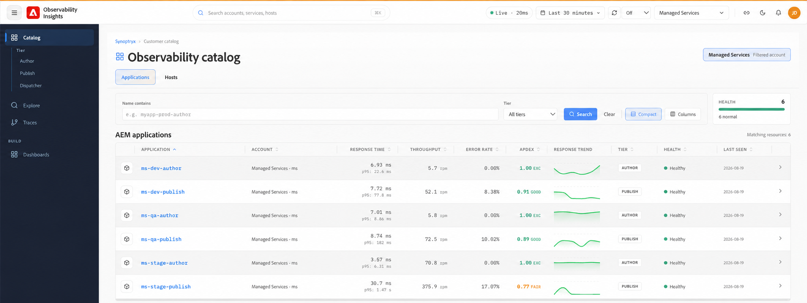

# Usar Observability Insights {#use-observability-insights}

Esta sección cubre los flujos de trabajo diarios de monitorización e investigación que más utiliza su equipo, organizados en torno a dos áreas de monitorización: monitorización del rendimiento de las aplicaciones y monitorización de la infraestructura.

## La interfaz de Observability Insights {#observability-insights-interface}

El panel de navegación izquierdo de Observability Insights le permite acceder a todas las áreas de monitorización para sus entornos de Managed Services de AEM.

La navegación incluye:

- **Catálogo**: inventario central de aplicaciones y hosts de AEM supervisados. Examine los recursos en **los niveles Author, Publish y Dispatcher**, con indicadores clave de rendimiento y estado de un vistazo, como el tiempo de respuesta, el rendimiento, la tasa de error y Apdex.

- **Explorar**: investigue la telemetría de observabilidad y explore en profundidad los datos de rendimiento en los recursos supervisados.

- **Seguimientos**: Analice las transacciones de aplicación de extremo a extremo y los seguimientos de solicitudes para identificar la latencia, los errores y los cuellos de botella de rendimiento.

- **Paneles**: Acceda a paneles seleccionados para obtener una visualización y una supervisión más profundas de las señales de la aplicación y la infraestructura.

Los recursos se pueden filtrar por cuenta y nivel, mientras que el catálogo ofrece una vista consolidada del estado de la aplicación y del host en toda la topología de AEM administrada.

## Aplicaciones{#applications}

Use [Aplicaciones](applications.md) cuando el problema afecte a la aplicación: páginas lentas, tasas de error en aumento, transacciones inestables o latencia inesperada en Autor o Publicación.

Las aplicaciones le ayudan a responder:

- ¿El problema está aislado de Autor, Publicación o afecta a ambos niveles?
- ¿Qué extremos o transacciones contribuyen más al tráfico y a las ralentizaciones?
- ¿Cambió la latencia o los errores antes o después de una implementación o un pico de tráfico?
- ¿Los seguimientos apuntan a operaciones del repositorio, dependencias externas o presión de JVM?

Las aplicaciones instrumentan las transacciones de AEM hasta llamadas de método, dependencias externas y operaciones de repositorio, de modo que puede pasar rápidamente de un síntoma general a una ruta de ejecución específica.

## Hosts {#hosts}

Use [Hosts](hosts.md) cuando necesite determinar si el comportamiento de la aplicación se debe o no a las condiciones del recurso host (saturación de CPU, presión de memoria, E/S de disco, rendimiento de red o capacidad de almacenamiento).

La monitorización del host le ayuda a responder:

- ¿La ralentización de la aplicación va acompañada de CPU, memoria o presión de E/S a nivel del host?
- ¿Un host se comporta de forma diferente a otros en el mismo entorno?
- ¿Las tendencias de utilización del disco o del almacenamiento apuntan a un problema de capacidad inminente?
- ¿Los patrones de infraestructura explican el comportamiento de la aplicación o son un efecto descendente?

Utilice los paneles de host junto con las aplicaciones para distinguir entre regresiones en el nivel de aplicación y restricciones de recursos en el nivel de entorno.

Ambos artículos incluyen flujos de trabajo de investigación, preguntas para guiar la clasificación y una lista de pruebas que capturar al escalar a Adobe Managed Services.
